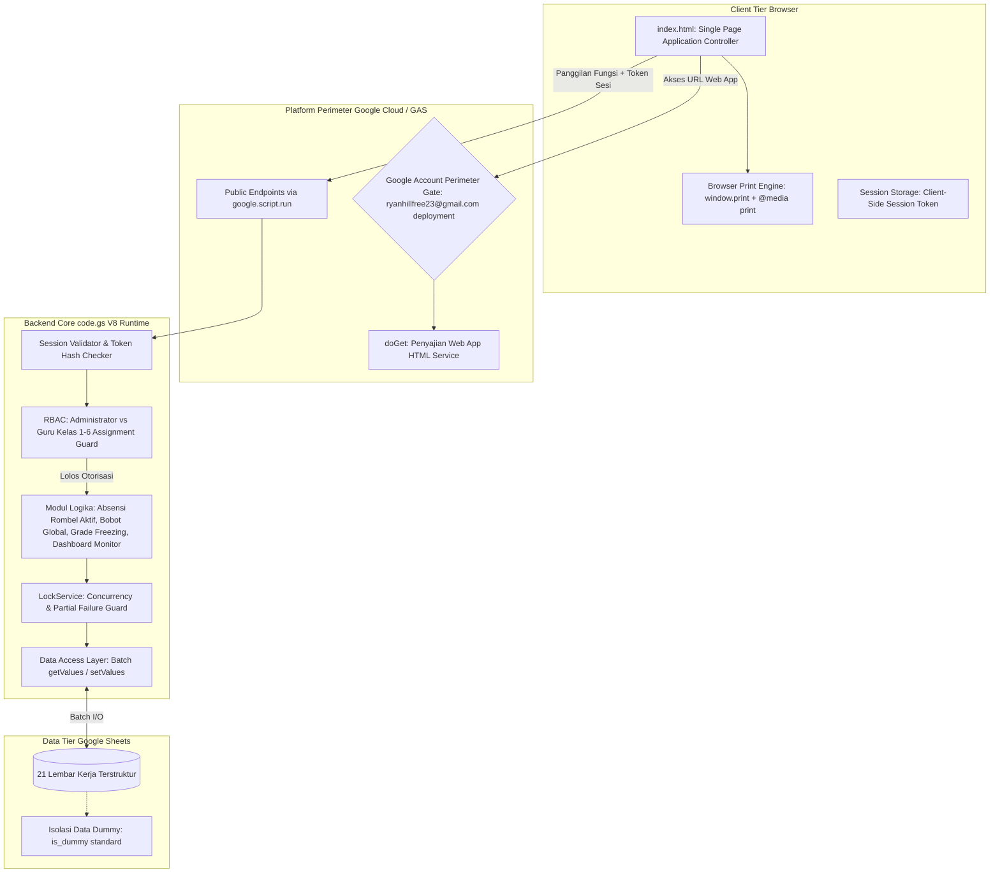
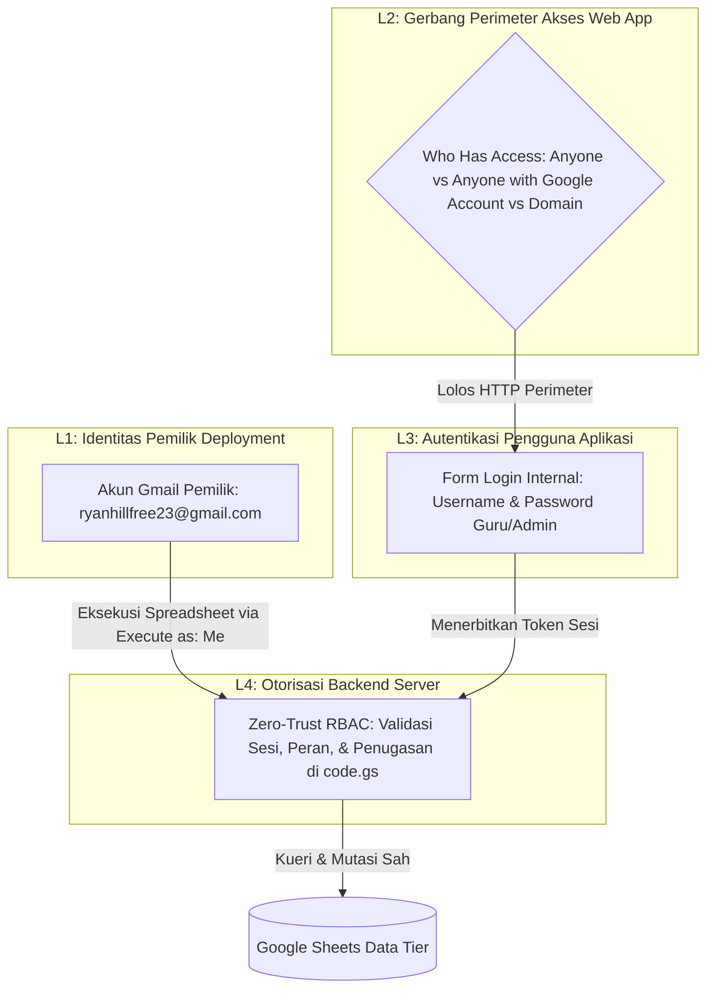
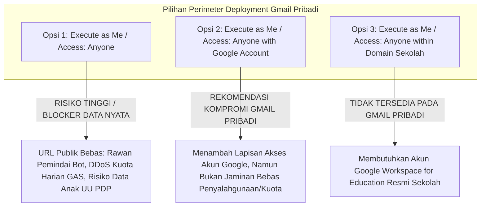
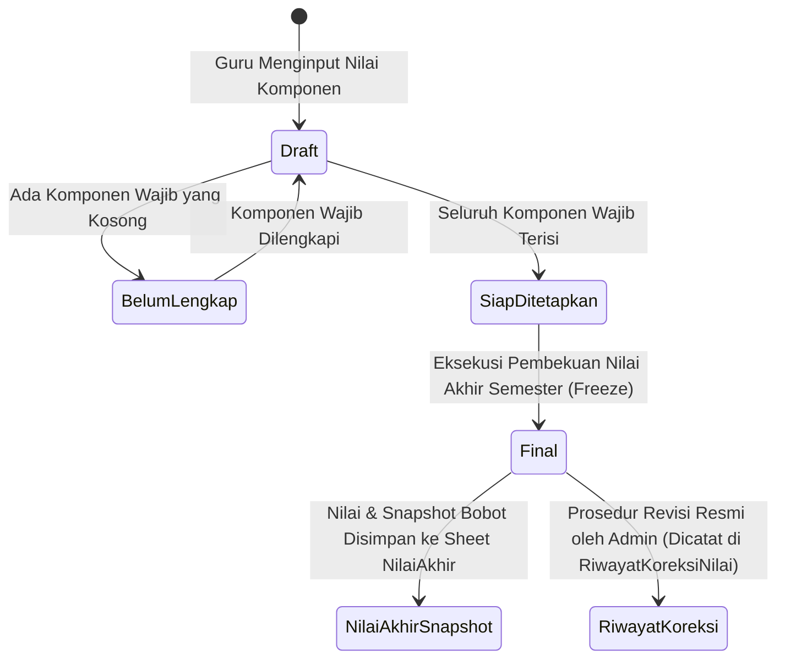
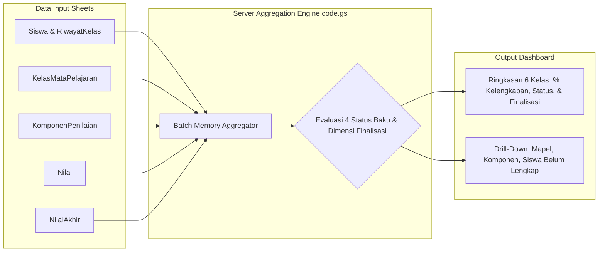

# SYSTEM ARCHITECTURE
# Sistem Absensi dan Penilaian Siswa SD

**Nama Proyek:** Sistem Absensi dan Penilaian Siswa SD
**Platform Target:** Google Apps Script Web App (V8 Runtime)
**Penyimpanan Data:** Google Sheets (21 Lembar Kerja Terstruktur)
**Frontend:** HTML5, Modern CSS, Vanilla JavaScript (Single Page Architecture)
**Versi Dokumen:** 1.0-baseline (Dokumentasi Spesifikasi Resmi Pra-Implementasi)
**Tanggal Penetapan Baseline:** 16 Oktober 2026
**Status Baseline:** Disahkan Pengguna sebagai Baseline Desain Pra-Implementasi Bersyarat (Implementasi Terkunci)
**Riwayat Versi Dokumen:**
- v1.0–v1.3: Draf arsitektur awal, analisis runtime GAS V8, dan model mitigasi timeout.
- v1.4-revised: Penyelarasan arsitektur dengan kebutuhan baru (monitoring 6 kelas, 21 sheet, kalender dinamis, partial failure mitigation, mitigasi risiko UU PDP).
- v1.5-final-correction: Penegasan pemisahan 4 lapisan deployment & keamanan, formula kelengkapan dinamis $E$ & $V$, status deterministik, audit 21 sheet dummy, dan kejujuran teknis autentikasi.
- v1.0-baseline: Penetapan baseline resmi pra-implementasi dengan verifikasi aktif keberhasilan penghapusan data anak sebelum data induk, pelaporan pemulihan kegagalan parsial, dan penguncian mutlak fase implementasi.
**Sumber Acuan:** `.prd.md` dan `.database.md`

---

## 1. Tujuan Arsitektur dan Batasan Desain

Dokumen ini mendefinisikan arsitektur sistem, model ancaman keamanan, evaluasi konfigurasi deployment pada akun Gmail pribadi, mekanisme kriptografi dan pengelolaan sesi, otorisasi server-side berbasis penugasan guru, integritas kalkulasi nilai dan absensi, dashboard monitoring kepala sekolah, mitigasi kegagalan sebagian pada operasi multi-sheet, serta arsitektur data dummy yang aman dan idempoten pada Google Apps Script (GAS) dan Google Sheets.

### 1.1. Prinsip Utama Desain
1. **Zero-Trust Frontend:** Antarmuka HTML Service diperlakukan sebagai lingkungan publik yang tidak tepercaya. Validasi hak akses, integritas parameter (`siswa_id`, `kelas_id`, `mapel_id`, skor nilai), dan status akun wajib diperiksa 100% di server pada setiap operasi kueri maupun mutasi.
2. **Penyalinan Manual Tiga Berkas:** Struktur aplikasi tetap dipertahankan dalam tiga berkas: `app/index.html` (frontend), `app/code.gs` (backend & otorisasi), dan `app/setup.gs` (setup skema idempoten & seeder pengujian terpisah).
3. **Pemisahan Data Transaksional, Snapshot Historis, dan Riwayat Koreksi:**
   - Hasil akhir semester yang sudah berstatus `difinalisasi` dibekukan ke tabel snapshot terkini (`NilaiAkhir`).
   - Seluruh riwayat multi-koreksi pasca-final disimpan pada lembar terpisah (`RiwayatKoreksiNilai`) agar laporan masa lampau dapat direkonstruksi 100% tanpa memperlambat kueri rapor harian.
4. **Efisiensi Batch Data Access:** Menghindari latensi tinggi pemanggilan berulang `SpreadsheetApp` dengan membaca tabel sekaligus ke dalam array memori JavaScript V8.
5. **Mitigasi Kegagalan Parsial Multi-Sheet:** Google Sheets tidak memiliki transaksi ACID native antar-sheet. Operasi lintas sheet (`NilaiAkhir`, `RiwayatKoreksiNilai`, `AuditLog`) wajib dilindungi `LockService` dan penanganan error rollback logis terstruktur.

---

## 2. Gambaran Tingkat Tinggi Arsitektur (High-Level Architecture)



---

## 3. Audit Keamanan Autentikasi dan Model Deployment

### 3.1. Model Ancaman Aplikasi (Threat Model) dan 4 Lapisan Keamanan
Aplikasi yang menyimpan data pribadi siswa sekolah dasar rentan terhadap beberapa vektor ancaman spesifik pada platform Google Apps Script. Untuk memitigasi risiko secara terstruktur, sistem membedakan secara tegas 4 (empat) lapisan keamanan:



1. **Pembedaan Tegas 4 Lapisan Keamanan:**
   - **Lapisan 1 (Identitas Pemilik Deployment):** Akun `ryanhillfree23@gmail.com` adalah pemilik script dan spreadsheet. Alamat ini bukan akun kepala sekolah otomatis. Password akun Google pemilik dilarang keras dicantumkan di mana pun.
   - **Lapisan 2 (Siapa yang Dapat Membuka Web App):** Pengaturan *Who has access* pada deployment Web App yang bertindak sebagai filter akses HTTP perimeter sebelum antarmuka disajikan ke browser.
   - **Lapisan 3 (Login Internal Aplikasi):** Guru dan admin login menggunakan kredensial mandiri aplikasi (username dan password ter-hash pada sheet `Pengguna`).
   - **Lapisan 4 (Otorisasi Backend Server):** Pemeriksaan hak akses di backend (`code.gs`) yang memverifikasi validitas sesi, peran, serta kecocokan penugasan kelas dan mata pelajaran pada tabel `PenugasanGuru`.
2. **Konsekuensi Model Eksekusi (*Execute As: Me*):**
   - Web App wajib berjalan dengan konfigurasi **`Execute as: Me` (pemilik script `ryanhillfree23@gmail.com`)**.
   - Seluruh interaksi dengan Google Sheets berjalan dengan wewenang pemilik deployment. Akibatnya, Google Sheets tidak dapat membedakan identitas guru yang sedang melakukan panggilan API.
   - **Kaidah Keamanan Mutlak:** Oleh karena Google Sheets menganggap seluruh operasi berasal dari pemilik, maka **setiap fungsi backend tanpa kecuali wajib memvalidasi sesi, peran, dan penugasan secara mandiri di sisi server**. Guru dan publik sama sekali tidak diberikan hak akses langsung ke spreadsheet.
3. **Vektor Manipulasi Sisi Klien:**
   - *Ancaman:* Guru kelas 1 membuka DevTools console dan memanggil fungsi server secara langsung, misalnya `google.script.run.apiSaveGrades(token, { kelas_id: "KLS-02", siswa_id: "SIS-02-01", nilai: 100 })` untuk siswa di kelas lain.
   - *Mitigasi:* Server mengekstrak identitas pengguna dari token sesi yang valid, memeriksa tabel `PenugasanGuru`, dan memverifikasi apakah pengguna memiliki hak akses sah pada kelas dan mapel tersebut. Jika tidak cocok, request ditolak seketika (`403 Forbidden`).
4. **Keterbatasan Konvensi Underscore (`_`):**
   - Akhiran `_` hanyalah konvensi visibilitas Apps Script untuk menyembunyikan fungsi dari pemanggilan antarmuka klien, **bukan mekanisme otorisasi**.
   - Setiap fungsi publik yang dapat dipanggil klien wajib memiliki pengawal otorisasi (*authorization guard*) di baris pertama eksekusinya.
5. **Vektor Pembajakan & Pemalsuan Sesi (Session Hijacking):**
   - *Ancaman:* Token sesi yang tersimpan dalam teks biasa di spreadsheet dapat dicuri jika spreadsheet dibagikan atau tautan bocor.
   - *Mitigasi:* Token yang dipegang klien adalah UUID v4 acak. Di sisi server (sheet `Sesi`), sistem **hanya menyimpan hash SHA-256 dari token** (`token_hash`). Server memvalidasi token dengan melakukan hash pada token yang dikirim klien, lalu mencocokkannya dengan `token_hash` di database.
6. **Vektor Kebocoran Kredensial di Log:**
   - *Ancaman:* Password, hash, salt, pepper, atau token sesi tercatat di lembar `AuditLog` atau Google Cloud Logging.
   - *Mitigasi:* Parameter fungsi autentikasi disanitasi secara ketat sebelum dicatat ke log. Sheet `AuditLog` hanya mencatat metadata non-sensitif (waktu, ID pengguna, nama aksi, status).

### 3.2. Evaluasi Autentikasi: Akun Google vs Akun Internal
- **Autentikasi Akun Google:** Memberikan keamanan enterprise terbaik (proteksi brute force canggih, 2FA, zero credential management di Sheets).
- **Keinginan Pengguna & Trade-off:** Pengguna menginginkan akses operasional melalui link Web App dan login internal (username & password) tanpa mewajibkan guru menggunakan akun Google institusi resmi.
- **Konsekuensi Teknis:** Tanggung jawab manajemen salt, pepper, hashing, sesi, dan mitigasi brute force beralih sepenuhnya ke kode backend aplikasi. Hal ini membutuhkan validasi teknis ketat sebelum implementasi dan dicatat sebagai **Blocker Teknis**.

### 3.3. Evaluasi Kritis Hashing Password dan Kejujuran Teknis
1. **Klarifikasi Ilmiah Algoritma:**
   - Loop HMAC-SHA256 berulang (*ad-hoc loop*) **tidak sama secara teknis** dengan standar PBKDF2 (RFC 2898 / RFC 8018) yang memiliki spesifikasi derivasi blok dan operasi XOR terstandarisasi.
   - **Kejujuran Teknis Terhadap Batas Performa:** Target latensi komputasi verifikasi hash < 1.000 ms pada runtime Apps Script V8 **BUKAN bukti keamanan algoritma kriptografi**, melainkan semata-mata batas teknis operasional agar tidak memicu gateway timeout pada HTTP Web App. Ketahanan terhadap serangan *offline hash cracking* tetap bergantung pada entropi salt, panjang password, dan kekuatan algoritma derivasi.
2. **Kriteria Penerimaan Keamanan dan Performa (Gerbang Teknis Phase 2):**
   Sebelum kode login diimplementasikan, wajib dilakukan pengujian tolok ukur (*benchmarking*) empiris di Google Apps Script V8 dengan kriteria:
   - *Kriteria Performa:* Latensi komputasi verifikasi hash satu akun pada Apps Script V8 wajib berada di bawah **1.000 milidetik** (target optimal < 500 ms) agar tidak memicu gateway timeout.
   - *Kriteria Keamanan:* Wajib menggunakan salt acak kriptografis 16-byte unik per pengguna, server pepper rahasia di `ScriptProperties`, serta faktor komputasi yang memaksimalkan beban kerja penyerang dalam batas waktu CPU yang diizinkan.
   - *Batasan Runtime GAS:* GAS V8 memiliki batas waktu eksekusi total 6 menit (atau ~30 detik per request web). Komputasi hashing berulang tidak boleh memonopoli CPU secara berlebihan.
   - *Aturan Penghentian (Fallback Circuit-Breaker):* Jika pendekatan internal gagal memenuhi kriteria performa dan keamanan di runtime Apps Script V8, **implementasi form login wajib dihentikan** dan dilaporkan kepada pengguna untuk meminta keputusan alternatif (misalnya integrasi Google Sign-In).
3. **Peringatan Verifikasi Keamanan:** Dilarang menandai keamanan autentikasi sebagai sudah terbukti hanya karena dokumentasi telah direvisi. Keamanan autentikasi berstatus *Menunggu Validasi Teknis* hingga benchmark empiris diselesaikan.

### 3.4. Entropi Token Sesi dan Pengelolaan Sesi
1. **Verifikasi Pembangkitan Token di Google Apps Script:**
   - Runtime Apps Script V8 **tidak menyediakan Web Crypto API (`crypto.getRandomValues()`)** pada lingkungan backend.
   - Pembangkitan token sesi di backend memanfaatkan API native resmi yang terverifikasi tersedia: **`Utilities.getUuid()`** (menghasilkan string UUID v4 dengan 122 bit pseudo-random entropy).
   - **Kejujuran Teknis Token:** Dilarang mengklaim token aman hanya karena memakai `Utilities.getUuid()` atau hashing SHA-256. Keacakan generator UUID v4 dan ketahanan penyimpanan token di database tetap berstatus **Menunggu Validasi Teknis** sampai implementasi otorisasi backend dan pengujian integritas sesi diuji secara empiris.
   - *Koreksi Entropi:* Ditegaskan secara ilmiah bahwa **penambahan timestamp tidak meningkatkan entropi kriptografis**. Keacakan token sepenuhnya bersumber dari generator UUID v4 bawaan platform.
2. **Penyimpanan Token Hash di Server:**
   - Klien menyimpan token sesi di `sessionStorage` per tab browser.
   - Lembar basis data (`Sesi`) **hanya menyimpan hash SHA-256 dari token** (`token_hash`).
3. **Kebijakan Invalidasi Sesi:**
   - Batas waktu kedaluwarsa sesi ditetapkan (misalnya 8 jam).
   - Sesi diinvalidasi secara instan saat logout, perubahan password pengguna, penonaktifan akun, atau perubahan penugasan guru.

### 3.5. Analisis Deployment Google Apps Script pada Akun Gmail Pribadi (`ryanhillfree23@gmail.com`)
Lingkungan percobaan dan pengembangan dijalankan menggunakan akun Gmail pribadi (`ryanhillfree23@gmail.com`). Berdasarkan dokumentasi resmi Google Apps Script, konfigurasi deployment Web App dievaluasi sebagai berikut:



- **Opsi 1 (Execute as Me / Access: Anyone):**
  **RISIKO KEAMANAN TINGGI (BLOCKER SEBELUM PENGGUNAAN DATA NYATA).** Akses publik anonim tidak otomatis melanggar hukum, tetapi menimbulkan risiko privasi dan keamanan serius terhadap data pribadi anak (prinsip kehati-hatian perlindungan data anak UU PDP No. 27/2022). URL terbuka bebas bagi siapa pun di internet. Form login internal menjadi satu-satunya pertahanan aplikasi. Pembukaan akses publik anonim mengekspos endpoint ke pemindai bot web, serangan brute force otomatis, dan penghabisan kuota eksekusi Google Apps Script harian (DDoS kuota). **Dilarang keras mengklaim form login internal saja cukup melindungi data sensitif siswa jika perimeter luar terbuka tanpa autentikasi HTTP.** Opsi ini hanya ditoleransi untuk demo data fiktif terisolasi, bukan data riil.
- **Opsi 2 (Execute as Me / Access: Anyone with Google Account):**
  **OPSI KOMPROMI TEKNIS TERBAIK UNTUK GMAIL PRIBADI (BUKAN JAMINAN MUTLAK).** Pembatasan akses akun Google menambah lapisan autentikasi HTTP tingkat Google, namun **BUKAN jaminan bebas penyalahgunaan atau kehabisan kuota**. Siapa pun di internet yang memiliki akun Google publik masih dapat mengakses URL dan memicu eksekusi Web App jika tautan bocor. Namun, opsi ini menyaring bot web anonim otomatis secara efektif tanpa mewajibkan domain institusi.
  *Alur Akses Pengguna:* Guru menghadapi langkah tambahan: login akun Google di browser terlebih dahulu sebelum halaman Web App disajikan, baru kemudian login menggunakan username/password internal sekolah.
- **Opsi 3 (Execute as Me / Access: Anyone within [Domain Sekolah]):**
  **TIDAK TERSEDIA PADA AKUN PRIBADI.** Akun `ryanhillfree23@gmail.com` adalah akun Gmail konsumen. Opsi ini hanya dapat digunakan jika sekolah nantinya memigrasikan deployment ke Google Workspace for Education institusi resmi.
- **Status Keputusan Deployment:**
  Konfigurasi final belum diputuskan. Dilarang memilih konfigurasi deployment sebelum ketersediaan dan perilakunya diverifikasi pada lingkungan aktual. Status tetap: **Blocker sebelum data operasional nyata digunakan**.

### 3.6. Aturan Otorisasi Server-Side Berbasis Peran dan Penugasan (Zero-Trust RBAC Guard)
Aplikasi membedakan hak akses secara mutlak di sisi server antara dua peran utama:
1. **Administrator / Kepala Sekolah:**
   - Akses penuh membaca data Kelas 1 s.d. Kelas 6 SD.
   - Memantau rekapitulasi kehadiran dan penilaian seluruh rombel.
   - Mengakses Dashboard Monitoring Penyelesaian Penilaian Semester.
   - Melakukan koreksi nilai final dengan alasan administratif wajib.
   - Mengelola akun, penugasan guru, kenaikan kelas, dan audit log.
   - **Batasan:** Administrator tidak memiliki akses ke kredensial akun Google pribadi guru.
2. **Guru Kelas (Kelas 1–6):**
   - Akses dibatasi secara ketat hanya pada rombel dan mata pelajaran yang ditugaskan pada tabel `PenugasanGuru`.
   - Guru Kelas 1 dilarang keras dapat membaca atau mengubah data siswa, absensi, atau nilai Kelas 2 s.d. 6.
   - Seluruh fungsi backend memverifikasi parameter `kelas_id` terhadap penugasan aktif guru:

```javascript
function apiSaveGrades(sessionToken, payload) {
  // 1. Verifikasi Sesi Kriptografis
  var user = validateSession_(sessionToken);
  if (!user) throw new Error("UNAUTHORIZED: Sesi tidak valid atau telah kedaluwarsa.");

  // 2. Verifikasi Status Akun
  if (user.status !== "aktif") throw new Error("FORBIDDEN: Akun dinonaktifkan.");

  // 3. Verifikasi Hak Akses Berbasis Peran & Penugasan (Zero-Trust RBAC)
  if (user.peran !== "admin") {
    var isAssigned = verifyTeacherAssignment_(user.pengguna_id, payload.kelas_id, payload.mapel_id);
    if (!isAssigned) {
      throw new Error("FORBIDDEN: Anda tidak memiliki wewenang pada kelas atau mata pelajaran ini.");
    }
  }

  // 4. Eksekusi Logika Bisnis dengan LockService
  return executeSaveGrades_(user, payload);
}
```

---

## 4. Integritas Penilaian dan Perlindungan Nilai Historis

### 4.1. Masalah Rekalkulasi Dinamis
Jika nilai akhir semester dihitung secara dinamis setiap kali lembar rapor dibuka, maka perubahan konfigurasi bobot penilaian di masa depan (misal pada semester berikutnya) akan mengubah secara diam-diam nilai akhir siswa pada semester-semester masa lampau yang telah dibagikan kepada orang tua.

### 4.2. Siklus Hidup Nilai dan Formula Matematis Normalisasi
Misalkan himpunan seluruh komponen aktif semester adalah $C$ dengan bobot $w_c$, di mana validasi konfigurasi mewajibkan $\sum_{c \in C} w_c = 100\%$. Untuk siswa $s$ pada mata pelajaran $m$:



1. **Pemeriksaan Komponen Wajib:**
   Jika terdapat komponen $c \in C$ di mana $is\_wajib(c) = \text{true}$ dan nilainya kosong ($V_s(c) = \text{null}$), maka sistem **dilarang menghasilkan angka nilai akhir prematur**. Status nilai ditetapkan sebagai **`Belum Lengkap`** (ditampilkan tanda strip `-` dengan lencana peringatan).
2. **Kalkulasi Komponen Lengkap & Normalisasi Komponen Opsional:**
   Jika seluruh komponen wajib memiliki nilai, definisikan himpunan komponen yang dinilai:
   $$C_{\text{dinilai}} = \{c \in C \mid V_s(c) \neq \text{null}\}$$
   - Komponen opsional yang kosong ($V_s(c) = \text{null}$ dengan $is\_wajib(c) = \text{false}$) **tidak dimasukkan ke dalam $C_{\text{dinilai}}$**.
   - Komponen dengan skor nol yang sah ($V_s(c) = 0$) **tetap dimasukkan ke dalam $C_{\text{dinilai}}$**, berkontribusi $0 \times w_c = 0$ pada pembilang, dan bobotnya $w_c$ tetap dihitung pada penyebut.
   - Formula nilai akhir:
     $$\text{Nilai Akhir} = \frac{\sum_{c \in C_{\text{dinilai}}} (V_s(c) \times w_c)}{\sum_{c \in C_{\text{dinilai}}} w_c}$$
   - *Rasionalisasi Matematis:* Membagi dengan $\sum_{c \in C_{\text{dinilai}}} w_c$ secara matematis menormalkan kembali nilai ke skala 0–100 secara adil tanpa merugikan siswa yang tidak mengikuti kegiatan pengayaan opsional.

### 4.3. Evaluasi Desain Penyimpanan Nilai Final: Perbandingan Pilihan
Tinjauan arsitektur terhadap struktur penyimpanan nilai akhir dan pencatatan riwayat koreksi:

1. **Kelemahan Fatal Kolom Tunggal `nilai_sebelumnya`:**
   Satu kolom `nilai_sebelumnya` pada tabel nilai akhir **tidak cukup secara matematis dan audit**. Jika sebuah nilai mengalami dua kali koreksi (misalnya: nilai awal 70 dikoreksi menjadi 75 karena salah input, lalu dikoreksi lagi menjadi 80 karena susulan tugas resmi), nilai 70 akan terhapus dan ditimpa oleh 75. Riwayat penetapan nilai awal hilang, sehingga proses audit forensik tidak dapat merekonstruksi kronologi perubahan.
2. **Perbandingan Dua Pilihan Arsitektur:**

| Kriteria Evaluasi | Pilihan 1: Append-Only Records (Semua Versi dalam 1 Tabel) | Pilihan 2: Current Snapshot `NilaiAkhir` + Sheet Terpisah `RiwayatKoreksiNilai` (REKOMENDASI) |
|---|---|---|
| **Penyajian Rapor Harian** | Lambat. Query rapor harus memfilter baris aktif (`is_current = true` atau `max(versi)`) dari ribuan baris campuran. | **Sangat Cepat & Efisien.** Sheet `NilaiAkhir` hanya memiliki 1 baris per siswa per mapel per semester. Pembacaan rapor berupa lookup langsung ($O(1)$ in memory). |
| **Pencatatan Multi-Revisi** | Nilai lama dan baru berada dalam satu tabel yang membengkak seiring waktu. | **Sangat Rapi & Terisolasi.** Seluruh jejak audit koreksi (nilai lama, nilai baru, alasan, pelaku, waktu) tersimpan permanen di `RiwayatKoreksiNilai`. |
| **Kesesuaian Google Sheets** | Rentan salah baca jika query filter versi di memori memiliki bug. | **Sangat Selaras.** Memisahkan data aktif dari data log historis menjaga kesederhanaan struktur data. |

3. **Rekomendasi Arsitektur & Mekanisme Koreksi:**
   - **Pilihan 2 ditetapkan sebagai acuan rancangan**: Sheet `NilaiAkhir` menyimpan snapshot aktif terkini, dan sheet `RiwayatKoreksiNilai` mencatat seluruh riwayat audit multi-revisi pasca-final secara tak terbatas.
   - **Alur Koreksi Menjaga Integritas Data:**
     - Nilai final terkunci mutlak dari antarmuka guru mapel.
     - Hanya **Administrator** yang berwenang melakukan koreksi dengan alasan administratif tertulis wajib.
     - Saat koreksi disetujui: nilai lama disimpan ke `RiwayatKoreksiNilai.nilai_sebelumnya`, nilai baru dicatat ke `RiwayatKoreksiNilai.nilai_baru`, alasan dicatat ke `alasan_revisi`, pelaku dicatat ke `revised_by`, dan cap waktu dicatat ke `revised_at`.
     - Baris aktif di `NilaiAkhir` diperbarui nilainya, `versi_koreksi` dinaikkan (increment +1), dan `last_revised_by` serta `last_revised_at` diisi.
     - Operasi dicatat ke lembar `AuditLog`.
4. **Dampak pada Seluruh Dokumen:**
   Penambahan sheet `RiwayatKoreksiNilai` memperluas skema basis data menjadi **21 lembar kerja**, yang telah disinkronkan pada PRD, Database, Tasks, dan Operational Rules.

### 4.4. Arsitektur Dashboard Monitoring Kepala Sekolah
Untuk memantau penyelesaian penilaian semester pada 6 kelas (Kelas 1 s.d. 6 SD), sistem menyediakan mesin agregasi di sisi server yang membaca data secara batch dan menghitung status kelengkapan kelas secara deterministik.



1. **Efisiensi Pengambilan Data Batch:**
   Backend membaca sheet `Kelas`, `Siswa`, `RiwayatKelas`, `KelasMataPelajaran`, `KomponenPenilaian`, `Nilai`, dan `NilaiAkhir` dalam 1 operasi batch ke array memori. Komputasi kelengkapan 6 rombel dihitung secara lokal di runtime V8 tanpa pemanggilan cell-by-cell ke Google Sheets.
2. **Formula Persentase Kelengkapan Dinamis & Deterministik:**
   - **Kaidah Denominator:** Sistem **dilarang** menggunakan asumsi statis $\text{jumlah siswa} \times \text{total seluruh komponen wajib}$ jika setiap mata pelajaran atau tingkat kelas memiliki konfigurasi jumlah komponen wajib yang berbeda.
   - **Total Penilaian Wajib yang Diharapkan ($E$):**
     Jumlah seluruh kombinasi siswa aktif, mata pelajaran kelas, dan komponen penilaian wajib yang berlaku pada semester terkait:
     $$E = \sum_{s \in \text{SiswaAktif}(k)} \sum_{m \in \text{MapelKelas}(k)} |\text{KomponenWajib}(m)|$$
   - **Total Penilaian Wajib yang Valid ($V$):**
     Jumlah kombinasi $(s, m, c)$ yang telah memiliki nilai numerik valid ($0.0 \le \text{skor} \le 100.0$) pada sheet `Nilai`:
     $$V = \sum_{s \in \text{SiswaAktif}(k)} \sum_{m \in \text{MapelKelas}(k)} \sum_{c \in \text{KomponenWajib}(m)} [\text{NilaiValid}(s, m, c)]$$
   - **Formula Persentase:**
     $$\text{Persentase Kelengkapan} = \begin{cases}
     \frac{V}{E} \times 100\%, & \text{jika } E > 0 \\
     \text{"N/A"}, & \text{jika } E = 0
     \end{cases}$$
   - **Validitas Nilai & Komponen:**
     - Skor nol (`0`) adalah nilai valid yang sah dan berkontribusi terhadap $V$.
     - Nilai `null`, string kosong `""`, *undefined*, belum tersimpan, atau di luar rentang valid tidak dihitung dalam $V$.
     - Komponen opsional (`is_wajib = false`) tidak dimasukkan ke dalam $E$ maupun $V$ untuk evaluasi kelengkapan wajib.
3. **Definisi Deterministik 4 Status Kelengkapan Penilaian:**
   Tumpang tindih antara `Sedang Berlangsung` dan `Belum Lengkap` dieliminasi dengan aturan status yang bergantung pada kuantitas data dan pemicu evaluasi:
   - **`Belum Dimulai`:** $V = 0$ (saat $E > 0$). Belum ada satu pun nilai wajib yang diinput.
   - **`Sedang Berlangsung`:** $0 < V < E$ selama jendela/periode pengisian nilai masih aktif dan belum ada pemicu evaluasi kelengkapan akhir/audit yang menetapkan status belum lengkap.
   - **`Belum Lengkap`:** $V < E$ saat evaluasi kelengkapan dipicu (misalnya tenggat waktu pengisian semester telah terlampaui, atau wali kelas/kepala sekolah menjalankan fungsi audit kelengkapan rapor).
   - **`Lengkap`:** $V = E$ (100% penilaian wajib yang diharapkan untuk seluruh siswa aktif telah terisi dan valid, tanpa pembulatan ke atas).
4. **Pemicu Evaluasi dan Mesin Transisi Status:**
   - **Tiga Pemicu Evaluasi:**
     1. *Pemicu Dinamis Server:* Dihitung real-time di memori saat dashboard monitoring dibuka oleh administrator.
     2. *Pemicu Batas Waktu (Deadline):* Saat tanggal kalender melewati batas akhir pengisian semester pada konfigurasi sekolah.
     3. *Pemicu Audit Manual:* Dijalankan secara resmi oleh Kepala Sekolah sebelum penetapan nilai semester.
   - **Kaidah Transisi Status Lengkap:**
     - `Belum Dimulai` $\to$ `Sedang Berlangsung`: Terjadi saat guru menginput minimal satu nilai valid ($V > 0$ dan $V < E$) selama periode buka.
     - `Sedang Berlangsung` $\to$ `Belum Lengkap`: Terjadi saat deadline tiba atau audit manual dijalankan sementara nilai belum lengkap ($V < E$).
     - `Sedang Berlangsung` $\to$ `Lengkap`: Terjadi saat seluruh nilai wajib terisi valid ($V = E$) selama periode aktif.
     - `Belum Lengkap` $\to$ `Sedang Berlangsung` (*Pembukaan Kembali Periode*): Terjadi jika admin memperpanjang batas waktu / membuka kembali (*reopen*) jendela pengisian semester untuk memberi kesempatan susulan ($0 < V < E$).
     - `Belum Lengkap` $\to$ `Lengkap` (*Pelengkapan Pasca-Audit*): Terjadi jika guru melengkapi seluruh sisa nilai wajib selama masa perpanjangan hingga $V = E$.
     - `Lengkap` $\to$ `Sedang Berlangsung` / `Belum Lengkap` (*Penghapusan Nilai Sebelum Finalisasi*): Terjadi jika ada nilai yang dihapus/dibatalkan sebelum finalisasi sehingga $V < E$.
5. **Dimensi Status Finalisasi Mandiri (Terpisah):**
   Status finalisasi adalah dimensi independen dari status kelengkapan, bukan pengganti status kelengkapan:
   - **`Belum Difinalisasi`:** Belum ada snapshot nilai yang dibekukan ke sheet `NilaiAkhir`.
   - **`Difinalisasi Sebagian`:** Sebagian mata pelajaran pada rombel telah dibekukan ke `NilaiAkhir`, namun mata pelajaran lain masih berstatus draft.
   - **`Difinalisasi`:** Seluruh mata pelajaran dan seluruh siswa aktif telah diverifikasi dan dibekukan ke sheet `NilaiAkhir` oleh kepala sekolah/administrator.
   - **Prasyarat Finalisasi & Pengecualian:** Kelas normal hanya dapat difinalisasi jika berstatus `Lengkap` ($V = E$). Jika terdapat siswa yang tidak dapat melengkapi nilai karena kondisi luar biasa (misal berhenti sekolah tanpa kabar), admin dapat mengeksekusi finalisasi dengan catatan khusus, di mana baris siswa tersebut dibekukan dengan skor `null` dan `status_kelengkapan: belum_lengkap` pada sheet `NilaiAkhir` (mencetak tanda strip `-` di rapor).
   - **Penguncian Pasca-Finalisasi:** Setelah status `Difinalisasi`, lembar input `Nilai` terkunci total; koreksi lanjutan wajib melalui modul revisi administratif administrator pada sheet `RiwayatKoreksiNilai`.
   - **Penyajian Dashboard:** Dashboard menampilkan status kelengkapan dan status finalisasi berdampingan sebagai dua indikator yang saling melengkapi (misalnya lencana `Lengkap` dengan indikator `Belum Difinalisasi` atau `Difinalisasi`).
6. **Pemisahan Pemantauan Nilai vs Absensi:**
   Status penilaian semester dievaluasi secara mandiri dari status kehadiran harian siswa.
7. **Struktur Data Respons Drill-Down:**
   Endpoint backend `apiGetMonitoringDashboard(token, { tahun_ajaran_id, semester_id })` mengembalikan kontrak JSON hierarkis yang memuat ringkasan 6 kelas ($E$, $V$, %, status kelengkapan, status finalisasi) dan rincian siswa/mapel/komponen yang belum lengkap untuk navigasi drill-down instan di UI.

---

## 5. Arsitektur dan Formula Absensi Berbasis Kalender Sekolah

### 5.1. Kaidah Historis Penempatan Siswa pada Tanggal Kejadian
- **Kaidah Mutlak:** Kelengkapan absensi kelas pada tanggal $t$ dihitung berdasarkan daftar siswa yang **benar-benar aktif dan terdaftar di rombel tersebut pada tanggal $t$** dengan memeriksa interval penempatan pada sheet `RiwayatKelas` ($\text{tanggal\_mulai} \le t \le \text{tanggal\_selesai}$).
- Sistem **dilarang keras mengevaluasi kelengkapan historis menggunakan data siswa saat ini (`Siswa.kelas_id_aktif`)**, karena mutasi siswa di masa depan akan merusak kelengkapan data absensi tanggal lampau secara retroaktif.

### 5.2. Dokumentasi Perilaku 4 Skenario Dinamika Siswa
1. **Skenario 1 (Siswa Masuk atau Keluar di Tengah Semester):**
   - Siswa yang masuk pada tanggal $t_{\text{masuk}}$ hanya wajib hadir pada hari efektif di mana $t \ge t_{\text{masuk}}$. Hari sebelum $t_{\text{masuk}}$ tidak dihitung dalam hari wajib hadir ($W_{\text{siswa}}$).
   - Siswa yang keluar/mutasi pada tanggal $t_{\text{keluar}}$ hanya dihitung hingga tanggal $t \le t_{\text{keluar}}$.
2. **Skenario 2 (Siswa Pindah Kelas Antar-Rombel):**
   - Pada tanggal sebelum kepindahan ($t < t_{\text{pindah}}$), kehadiran siswa dihitung pada rombel lama.
   - Sejak tanggal kepindahan ($t \ge t_{\text{pindah}}$), kehadiran siswa dihitung pada rombel baru. Catatan historis di rombel lama tidak berpindah dan tidak terhapus.
3. **Skenario 3 (Catatan Absensi yang Sudah Diverifikasi Lalu Diperbaiki):**
   - Jika catatan kehadiran tanggal lampau perlu diperbaiki (misal perbaikan status dari Alpa ke Sakit), guru/admin mengeksekusi koreksi.
   - Backend melakukan *upsert* pada tabel `Absensi`, mengevaluasi ulang status kelengkapan kelas pada tanggal $t$, memperbarui `updated_at`, dan mencatat riwayat koreksi ke sheet `AuditLog`.
4. **Skenario 4 (Daftar Siswa Aktif pada Tanggal Kejadian Berbeda dari Siswa Saat Ini):**
   - Seluruh kueri rekap kehadiran tanggal lampau mendasarkan daftar siswa pada irisan interval penempatan di `RiwayatKelas`.
   - Adanya mutasi, kelulusan, atau penambahan siswa baru pada hari ini tidak akan mengubah denominator maupun persentase kehadiran kelas pada tanggal lampau.

### 5.3. Tiga Konsep Dasar Kehadiran & Formula
1. **Hari Sekolah Terjadwal ($K$):** Jumlah hari yang ditandai sebagai `efektif` pada sheet `KalenderSekolah` dalam rentang waktu yang dievaluasi.
2. **Hari Absensi Lengkap ($L_{\text{kelas}}$):** Hari efektif di mana guru telah mencatat dan memverifikasi status kehadiran seluruh siswa yang aktif di rombel tersebut pada tanggal terkait ($L_{\text{kelas}} \le K$).
3. **Hari Wajib Hadir Siswa ($W_{\text{siswa, lengkap}}$):** Hari absensi lengkap yang berada di dalam rentang masa penempatan aktif siswa di rombel tersebut berdasarkan `RiwayatKelas`.

- **Formula Persentase Kehadiran:**
  $$\text{Persentase Kehadiran} = \begin{cases}
  \frac{H_i}{W_{\text{siswa, lengkap}}} \times 100\%, & \text{jika } W_{\text{siswa, lengkap}} > 0 \\
  \text{"N/A"}, & \text{jika } W_{\text{siswa, lengkap}} = 0
  \end{cases}$$
- **Penanganan Hari Belum Lengkap:** Tanggal terjadwal yang belum diinput absensinya ditandai sebagai `belum_diinput`. Hari ini **dilarang keras dianggap hadir atau alpa** dan **dilarang dimasukkan ke dalam pembagi hari wajib hadir ($W_{\text{siswa, lengkap}}$)**.
- **Indikator Transparansi Audit pada Laporan:** Laporan bulanan dan semester wajib menampilkan metrik audit:
  - Jumlah Hari Sekolah Terjadwal ($K$).
  - Jumlah Hari Absensi Lengkap ($L_{\text{kelas}}$).
  - Jumlah Hari Belum Lengkap ($K - L_{\text{kelas}}$).
  - Rincian akumulasi mutlak $H, S, I, A$.
  - Jika $L_{\text{kelas}} < K$, sistem menampilkan lencana peringatan bahwa data absensi semester belum tuntas diinput.
- **Contoh Numerik Nyata (Dinamika Rombel):**
  - *Skenario:* Bulan Oktober memiliki 22 hari sekolah terjadwal ($K = 22$).
  - Wali kelas menginput dan memverifikasi absensi selama 15 hari ($L_{\text{kelas}} = 15$, 7 hari belum diinput).
  - *Siswa A (terdaftar penuh sejak awal semester):* $W = 15$ hari. Catatan: $H = 13, S = 1, I = 1, A = 0$.
    $\text{Persentase Kehadiran} = \frac{13}{15} \times 100\% = 86.67\%$.
    Laporan mencantumkan: *86.67% (Terverifikasi 15 dari 22 hari terjadwal, 7 hari belum diinput)*.
  - *Siswa B (siswa pindahan masuk per 15 Oktober):* Hari efektif sejak tanggal penempatan aktif yang sudah diabsen lengkap adalah 8 hari ($W = 8$). Catatan: $H = 8$.
    $\text{Persentase Kehadiran} = \frac{8}{8} \times 100\% = 100.0\%$.
    Siswa B tidak dirugikan oleh hari-hari sebelum dirinya terdaftar di kelas.

---

## 6. Protokol Komunikasi Data, Penanganan Konkurensi, dan Kegagalan Parsial

### 6.1. Standar Format Tanggal dan Kontrak Respons
- Tanggal dikirim dan disimpan strictly sebagai **string ISO `YYYY-MM-DD`** untuk mencegah distorsi zona waktu.
- Zona waktu operasional aplikasi ditetapkan pada `Asia/Jakarta` (WIB / GMT+7).
- Format respons server terstandardisasi:
  ```json
  {
    "success": true,
    "data": {},
    "message": "Operasi berhasil diselesaikan.",
    "code": "OK"
  }
  ```

### 6.2. Strategi Penanganan Konkurensi (`LockService`)
Untuk mencegah tabrakan data saat beberapa guru menginput absensi atau nilai secara bersamaan:
```javascript
function executeWithLock_(lockTimeoutMs, actionCallback) {
  var lock = LockService.getScriptLock();
  try {
    lock.waitLock(lockTimeoutMs || 30000);
    return actionCallback();
  } catch (err) {
    throw new Error("Layanan sibuk: Proses lain sedang memodifikasi data. Silakan coba kembali dalam beberapa detik.");
  } finally {
    lock.releaseLock();
  }
}
```

### 6.3. Mitigasi Risiko Kegagalan Sebagian (*Partial Failure Mitigation*) pada Operasi Multi-Sheet
1. **Analisis Keterbatasan ACID Google Sheets:**
   Google Apps Script tidak mendukung transaksi atomik terdistribusi lintas lembar kerja. Pada operasi pembekuan dan koreksi nilai, sistem harus memodifikasi tiga sheet sekaligus: `NilaiAkhir`, `RiwayatKoreksiNilai`, dan `AuditLog`. Jika terjadi error jaringan atau timeout di tengah penulisan, terdapat risiko inkonsistensi data (*partial write*).
2. **Pola Rollback Logis Terstruktur (*Compensating Action Pattern*):**
   ```javascript
   function executeGradeCorrectionWithSafety_(adminUser, correctionPayload) {
     return executeWithLock_(30000, function() {
       var originalSnapshot = getNilaiAkhirRow_(correctionPayload.nilai_akhir_id);
       var writtenSteps = [];

       try {
         // Langkah 1: Update Nilai Terkini di NilaiAkhir
         updateNilaiAkhirRow_(correctionPayload.nilai_akhir_id, correctionPayload.nilai_baru, adminUser.pengguna_id);
         writtenSteps.push("NILAI_AKHIR");

         // Langkah 2: Catat Jejak Riwayat Multi-Revisi di RiwayatKoreksiNilai
         insertRiwayatKoreksiRow_(originalSnapshot, correctionPayload, adminUser.pengguna_id);
         writtenSteps.push("RIWAYAT_KOREKSI");

         // Langkah 3: Catat Jejak Audit Administratif di AuditLog
         insertAuditLogRow_(adminUser.pengguna_id, "KOREKSI_NILAI_FINAL", correctionPayload);
         writtenSteps.push("AUDIT_LOG");

         return { success: true, message: "Koreksi nilai berhasil dibekukan dan dicatat di riwayat audit." };
       } catch (err) {
         // Mitigasi Kegagalan Sebagian: Rollback Logis
         if (writtenSteps.includes("NILAI_AKHIR") && !writtenSteps.includes("RIWAYAT_KOREKSI")) {
           // Rollback NilaiAkhir kembali ke nilai semula
           restoreNilaiAkhirRow_(correctionPayload.nilai_akhir_id, originalSnapshot);
         }
         Logger.log("PARTIAL_FAILURE_ALERT: Koreksi nilai gagal di langkah " + writtenSteps.join("->") + ". Error: " + err.message);
         throw new Error("Gagal memproses koreksi nilai secara lengkap. Perubahan telah dibatalkan untuk menjaga integritas data.");
       }
     });
   }
   ```
3. **Jaminan Integritas Status:** Sistem dilarang diam-diam meninggalkan status yang menyesatkan. Jika penulisan audit gagal, mutasi snapshot dibatalkan kembali ke kondisi awal.

---

## 7. Strategi Cetak Laporan dan Ekspor PDF

- Memanfaatkan kemampuan native peramban web modern melalui `window.print()` dan aturan CSS `@media print`.
- Seluruh navigasi, header sistem, dan tombol aksi disembunyikan secara otomatis.
- Ukuran halaman dipaksa ke format standar cetak dokumen sekolah (A4/F4) dengan pemisahan halaman antarsiswa yang presisi (*page-break-after: always*).
- Menghilangkan beban integrasi dengan Google Drive API dan menghindarkan kuota konversi PDF Apps Script yang terbatas.

---

## 8. Arsitektur Seeder Data Dummy Terpisah, Idempoten, dan Prosedur Pembersihan Aman

Untuk memfasilitasi pengujian menyeluruh tanpa membahayakan integritas basis data maupun data operasional sekolah:
1. **Pemisahan Modul & Pencegahan Eksekusi Otomatis:**
   Logika seeder diletakkan pada fungsi terpisah `seedSampleData_()` dan fungsi pembersihan `purgeDummyData_()` dalam berkas `app/setup.gs`. Seeder **dilarang keras dipanggil secara otomatis** saat inisialisasi tabel master `setupMasterSheets_()`.
2. **Identifikasi Data Dummy pada Seluruh 21 Sheet:**
   - **Tabel Operasional / Transaksional:** Memuat kolom penanda eksplisit `is_dummy = true` (misal: `Nilai`, `Absensi`, `PenilaianNonAkademik`, `CatatanSemester`, `NilaiAkhir`, `RiwayatKoreksiNilai`, `Sesi`).
   - **Tabel Master / Konfigurasi:** Menggunakan format kunci primer deterministik berpola entitas dummy `<PREFIKS>-DUMMY-<ID>` yang selaras dengan prefiks resmi di kamus data (misal: `USR-DUMMY-ADM`, `USR-DUMMY-G01`, `SIS-DUMMY-101`, `KLS-DUMMY-1`, `MPL-DUMMY-01`, `KOM-DUMMY-01`, `ASP-DUMMY-01`, `KAL-DUMMY-01`, dll.).
   - **Prinsip Non-Asumsi Skema:** Sistem tidak boleh berasumsi seluruh sheet memiliki kolom `is_dummy` jika skema tabel master tidak memilikinya; penandaan berbasis relasi foreign-key ke entitas master dummy digunakan sebagai bukti keterikatan data.
3. **Mekanisme Idempotensi (*Upsert Guard*):**
   Sebelum menyisipkan rekaman dummy, sistem membaca seluruh kunci primer yang ada di memori. Jika rekaman dengan ID dummy terkait sudah ada, sistem memperbarui datanya (*upsert*) atau melewatinya (*skip*), bukan menambah baris baru.
4. **Kebijakan Non-Destruktif Mutlak:**
   - Seeder dilarang keras memanggil `.clear()` atau `.clearContents()` pada sheet yang berisi data non-dummy.
   - Operasi penulisan seeder hanya menambahkan baris baru dengan ID dummy atau memperbarui baris dummy yang telah ada.
5. **Prosedur Pembersihan Bertingkat (*Hierarchical Cascade Purge*):**
   Fungsi `purgeDummyData_()` mengeksekusi penghapusan data dummy secara terbalik (Child-to-Parent) melintasi 21 lembar kerja untuk menjaga integritas relasional logis:
   - **Urutan Eksekusi Penghapusan:**
     1. `RiwayatKoreksiNilai` (tabel anak terdalam dari nilai akhir)
     2. `NilaiAkhir`
     3. `Nilai`
     4. `PenilaianNonAkademik`
     5. `CatatanSemester`
     6. `Absensi`
     7. `RiwayatKelas`
     8. `PenugasanGuru`
     9. `KelasMataPelajaran`
     10. `Siswa`
     11. `KomponenPenilaian`
     12. `AspekNonAkademik`
     13. `MataPelajaran`
     14. `Kelas`
     15. `KalenderSekolah`
     16. `Semester`
     17. `TahunAjaran`
     18. `Sesi`
     19. `Pengguna`
     20. `AuditLog` (mencatat entri baru tentang operasi pembersihan; jejak audit operasional riil tetap dipertahankan).
     21. `Pengaturan` (mereset parameter konfigurasi lingkungan pengujian `is_dummy_env` jika ada; parameter konfigurasi identitas resmi sekolah non-dummy dilarang keras dihapus).
6. **Kaidah Keamanan Pembersihan (*Safety Guards*):**
   - **Batas Keamanan & Ketiadaan Garansi Otomatis:** Urutan eksekusi Child-to-Parent dan sifat idempotensi semata BUKAN jaminan keamanan mutlak pada Google Sheets yang tidak memiliki transaksi ACID native. Sistem tidak boleh berasumsi proses berjalan aman tanpa verifikasi aktif.
   - **Verifikasi Pra-Penghapusan Data Induk (*Pre-deletion Child Verification*):** Penghapusan entitas dummy pada tabel induk (`Siswa`, `MataPelajaran`, `Kelas`, `Pengguna`, `TahunAjaran`) HANYA diizinkan setelah sistem secara aktif memeriksa dan memverifikasi bahwa seluruh data anak yang mereferensikannya (`RiwayatKoreksiNilai`, `NilaiAkhir`, `Nilai`, `Absensi`, `RiwayatKelas`, `PenugasanGuru`, `KelasMataPelajaran`) telah terbukti 100% berhasil dihapus pada langkah sebelumnya.
   - **Penghentian Seketika pada Referensi Belum Terselesaikan (*Immediate Halt on Unresolved References*):** Jika masih ditemukan referensi data anak yang belum terselesaikan (baik akibat kegagalan parsial penghapusan anak, gangguan baca spreadsheet, maupun adanya referensi dari data operasional riil), proses pembersihan data induk WAJIB DIHENTIKAN SEKETIKA (*halt immediately*). Menghapus data induk dalam kondisi referensi anak belum tuntas dilarang keras.
   - **Verifikasi Asal Baris & Pembatalan Identitas Ambigu (*Abort on Ambiguous Identity*):** Sistem hanya menghapus baris yang dapat dibuktikan 100% sebagai dummy (melalui prefiks ID `DUMMY-` atau relasi foreign-key terverifikasi). Jika asal suatu baris ambigu atau tidak dapat dipastikan secara deterministik, operasi pembersihan pada tabel tersebut WAJIB DIBATALKAN SEKETIKA (*abort*) dan dilaporkan.
   - **Perlindungan Data Operasional Riil:** Jika terdapat data operasional riil yang memiliki referensi ke entitas dummy, penghapusan entitas dummy tersebut WAJIB DITOLAK seketika guna mencegah munculnya data yatim (*orphaned data*).
   - **Penanganan Kegagalan Parsial & Pelaporan Kondisi Pemulihan (*Recovery Condition Reporting*):** Jika proses pembersihan mengalami kegagalan di tengah jalan (misal timeout atau sheet API error pada sheet ke-10):
     1. Sistem wajib segera menghentikan eksekusi (*immediate halt*), bukan terus memaksa menghapus sheet induk berikutnya.
     2. Sistem mencatat daftar sheet yang berhasil dibersihkan dan sheet yang gagal ke `AuditLog`.
     3. Sistem menghasilkan laporan terstruktur mengenai kondisi pemulihan (*recovery condition report*) yang merinci sheet mana saja yang telah bersih, entitas apa yang masih tersisa, dan instruksi tindakan pemulihan manual/ulang bagi administrator sebelum pembersihan dapat dilanjutkan.
   - **Audit Trail:** Hasil akhir pembersihan (jumlah baris terhapus per sheet, pelaku eksekusi, cap waktu, status pemulihan jika terjadi kegagalan) dicatat secara permanen di `AuditLog`.
7. **Kredensial Dummy Non-Produksi Aman:**
   - Password dummy di-hash menggunakan algoritma yang sama dengan produksi namun dicatat secara eksplisit dalam panduan pengujian sebagai kredensial non-produksi.
   - Dilarang keras menanamkan password akun Google pemilik deployment `ryanhillfree23@gmail.com` ke dalam kode maupun seeder.
   - *Catatan Kritis:* Jangan membuat atau menjalankan seeder pada fase dokumentasi ini. Implementasi seeder dan pembersihan baru dapat dibangun saat fase implementasi dibuka dan disetujui.

---

## 9. Pemetaan Kriteria Penerimaan Pengujian Hak Akses (Acceptance Test Mapping)

| ID Kriteria | Skenario Pengujian Hak Akses | Komponen Arsitektur Penegak (Backend Guard) | Hasil yang Diharapkan |
|---|---|---|---|
| **AC-01** | Guru Kelas 1 memanggil `getClassData("KLS-02")` | `RBACGuard -> verifyTeacherAssignment_()` | Ditolak dengan `403 Forbidden` |
| **AC-02** | Guru Kelas 1 memanggil `apiSaveGrades` untuk siswa Kelas 2 | `RBACGuard -> verifyTeacherAssignment_()` | Ditolak dengan `403 Forbidden` |
| **AC-03** | Modifikasi payload/parameter di browser DevTools | Server-side validation pada setiap fungsi publik | Parameter tidak sah terdeteksi & ditolak |
| **AC-04** | Pemanggilan API dengan token sesi kedaluwarsa | `AuthGuard -> validateSession_()` | Ditolak dengan `401 Unauthorized` |
| **AC-05** | Pemanggilan API setelah logout / pencabutan sesi | `AuthGuard -> validateSession_()` | Ditolak dengan `401 Unauthorized` |
| **AC-06** | Pemanggilan API publik tanpa menyertakan token | `AuthGuard -> validateSession_()` | Ditolak dengan `401 Unauthorized` |
| **AC-07** | Administrator memantau rekap nilai Kelas 1–6 | `RBACGuard -> user.peran === "admin"` | Diberikan akses agregasi 6 kelas |
| **AC-08** | Eksekusi `seedSampleData_()` pada spreadsheet aktif | `BatchDAL -> check is_dummy, non-destructive` | Data operasional riil tidak terhapus |
| **AC-09** | Perhitungan kelengkapan kelas dengan 1 sel wajib kosong | `BizLogic -> evaluateClassCompleteness_()` | Status dilaporkan `Belum Lengkap` |
| **AC-10** | Evaluasi sel bernilai skor nol (`0`) | `BizLogic -> evaluateClassCompleteness_()` | Dihitung sebagai terisi (sah) |
| **AC-11** | Penilaian 100% lengkap namun belum dibekukan | `BizLogic -> evaluateClassCompleteness_()` | Berstatus `Lengkap`, bukan `Difinalisasi` |
| **AC-12** | Kegagalan penulisan sheet saat koreksi nilai | `LockMgr -> executeGradeCorrectionWithSafety_()` | Rollback logis & status tidak misleading |
