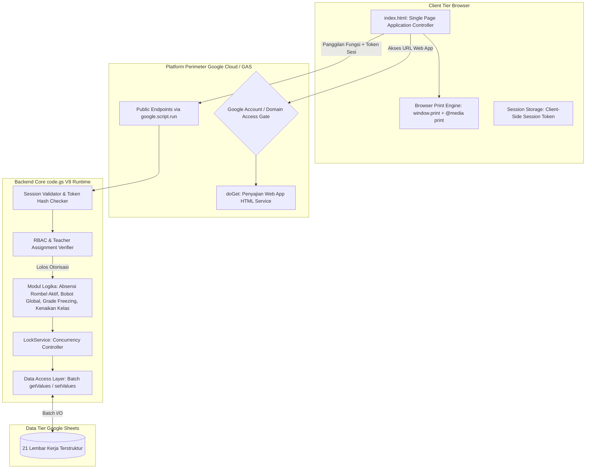
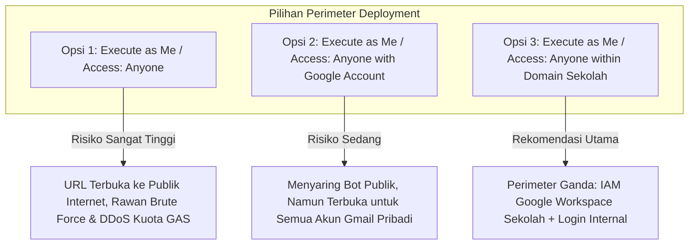
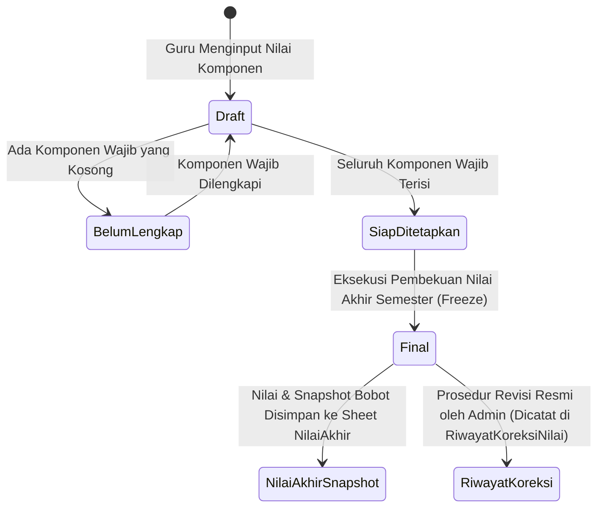

# SYSTEM ARCHITECTURE
# Sistem Absensi dan Penilaian Siswa SD

**Nama Proyek:** Sistem Absensi dan Penilaian Siswa SD  
**Platform Target:** Google Apps Script Web App (V8 Runtime)  
**Penyimpanan Data:** Google Sheets (21 Lembar Kerja Terstruktur)  
**Frontend:** HTML5, Modern CSS, Vanilla JavaScript (Single Page Architecture)  
**Versi Dokumen:** 1.3-revised (Dokumentasi Pra-Implementasi & Audit Koreksi Keamanan Final)  
**Status:** Menunggu Peninjauan dan Persetujuan Final Pengguna  
**Sumber Acuan:** `.prd.md` dan `.database.md`

---

## 1. Tujuan Arsitektur dan Batasan Desain

Dokumen ini mendefinisikan arsitektur sistem, model ancaman keamanan, evaluasi konfigurasi deployment, mekanisme kriptografi dan sesi, otorisasi server-side, integritas kalkulasi nilai dan absensi, serta strategi mitigasi konkurensi pada Google Apps Script (GAS) dan Google Sheets.

### 1.1. Prinsip Utama Desain
1. **Zero-Trust Frontend:** Antarmuka HTML Service diperlakukan sebagai lingkungan publik yang tidak tepercaya. Validasi hak akses, integritas parameter (`siswa_id`, `kelas_id`, skor nilai), dan status akun wajib diperiksa 100% di server pada setiap operasi.
2. **Penyalinan Manual Tiga Berkas:** Struktur aplikasi tetap dipertahankan dalam tiga berkas: `app/index.html` (frontend), `app/code.gs` (backend & otorisasi), dan `app/setup.gs` (setup skema idempoten & seeder pengujian).
3. **Pemisahan Data Transaksional, Snapshot Historis, dan Riwayat Koreksi:**
   - Hasil akhir semester yang sudah berstatus `final` dibekukan ke tabel snapshot terkini (`NilaiAkhir`).
   - Seluruh riwayat multi-koreksi pasca-final disimpan pada lembar terpisah (`RiwayatKoreksiNilai`) agar laporan masa lampau dapat direkonstruksi 100% tanpa memperlambat kueri rapor harian.
4. **Efisiensi Batch Data Access:** Menghindari latensi tinggi pemanggilan berulang `SpreadsheetApp` dengan membaca tabel sekaligus ke dalam array memori JavaScript V8.

---

## 2. Gambaran Tingkat Tinggi Arsitektur (High-Level Architecture)



---

## 3. Audit Keamanan Autentikasi dan Model Deployment

### 3.1. Model Ancaman Aplikasi (Threat Model)
Aplikasi yang menyimpan data pribadi siswa sekolah dasar rentan terhadap beberapa vektor ancaman spesifik pada platform Google Apps Script:

1. **Vektor Manipulasi Sisi Klien:**
   - *Ancaman:* Pengguna membuka DevTools console dan memanggil fungsi publik server secara langsung, misalnya `google.script.run.apiSaveGrades(token, { siswa_id: "SIS-X", nilai: 100 })` untuk siswa di luar kelas yang diajarnya.
   - *Mitigasi:* Server mengekstrak identitas pengguna dari token sesi yang valid, memeriksa tabel `PenugasanGuru`, dan memverifikasi apakah guru tersebut berhak menilai siswa dan mata pelajaran terkait sebelum menulis data.
2. **Keterbatasan Konvensi Underscore (`_`):**
   - Akhiran `_` hanyalah konvensi visibilitas Apps Script untuk menyembunyikan fungsi dari pemanggilan antarmuka klien, **bukan mekanisme otorisasi**.
   - Setiap fungsi publik yang dapat dipanggil klien wajib memiliki pengawal otorisasi (*authorization guard*) di baris pertama eksekusinya.
3. **Vektor Pembajakan & Pemalsuan Sesi (Session Hijacking):**
   - *Ancaman:* Token sesi yang tersimpan dalam teks biasa di spreadsheet dapat dicuri jika spreadsheet dibagikan atau tautan bocor.
   - *Mitigasi:* Token yang dipegang klien adalah UUID v4 acak. Di sisi server (sheet `Sesi`), sistem **hanya menyimpan hash SHA-256 dari token** (`token_hash`). Server memvalidasi token dengan melakukan hash pada token yang dikirim klien, lalu mencocokkannya dengan `token_hash` di database.
4. **Vektor Kebocoran Kredensial di Log:**
   - *Ancaman:* Password, hash, salt, pepper, atau token sesi tercatat di lembar `AuditLog` atau Google Cloud Logging.
   - *Mitigasi:* Parameter fungsi autentikasi disanitasi secara ketat sebelum dicatat ke log. Sheet `AuditLog` hanya mencatat metadata non-sensitif (waktu, ID pengguna, nama aksi, status).
5. **Vektor Akses Langsung ke Google Sheets:**
   - *Ancaman:* Jika pengguna memiliki akses view/edit langsung ke spreadsheet, seluruh pembatasan logika Web App dapat dilewati.
   - *Mitigasi:* File Google Sheets disimpan di Google Drive privat milik pemilik script / institusi sekolah dan **sama sekali tidak dibagikan** kepada akun guru maupun publik.

### 3.2. Evaluasi Autentikasi: Akun Google vs Akun Internal
- **Autentikasi Akun Google:** Memberikan keamanan enterprise terbaik (proteksi brute force canggih, 2FA, zero credential management di Sheets).
- **Keputusan Pengguna & Trade-off:** Pengguna menetapkan sistem menggunakan **akun internal (username & password)** agar setiap guru memiliki kredensial mandiri terlepas dari ketersediaan akun Google institusi.
- **Konsekuensi Teknis:** Tanggung jawab manajemen salt, pepper, hashing, sesi, dan mitigasi brute force beralih sepenuhnya ke kode backend aplikasi. Hal ini membutuhkan validasi teknis ketat sebelum implementasi dan dicatat sebagai **Blocker Teknis**.

### 3.3. Evaluasi Kritis Hashing Password di Google Apps Script
1. **Klarifikasi Ilmiah Algoritma:**
   - Loop HMAC-SHA256 berulang (*ad-hoc loop*) **tidak sama secara teknis** dengan standar PBKDF2 (RFC 2898 / RFC 8018) yang memiliki spesifikasi derivasi blok dan operasi XOR terstandarisasi.
   - Klaim bahwa putaran tertentu pasti aman atau pasti timeout dicabut karena **belum divalidasi secara empiris di lingkungan Apps Script V8**.
2. **Kriteria Penerimaan Keamanan dan Performa (Gerbang Teknis Phase 2):**
   Sebelum kode login diimplementasikan, wajib dilakukan pengujian tolok ukur (*benchmarking*) empiris di Google Apps Script V8 dengan kriteria:
   - *Kriteria Performa:* Latensi komputasi verifikasi hash satu akun pada Apps Script V8 wajib berada di bawah **1.000 milidetik** (target optimal < 500 ms) agar tidak memicu gateway timeout pada HTTP Web App.
   - *Kriteria Keamanan:* Wajib menggunakan salt acak kriptografis 16-byte unik per pengguna, server pepper rahasia di `ScriptProperties`, serta faktor komputasi yang memaksimalkan beban kerja penyerang dalam batas waktu CPU yang diizinkan.
   - *Aturan Penghentian (Fallback Circuit-Breaker):* Jika pendekatan internal gagal memenuhi kriteria performa dan keamanan di runtime Apps Script V8, **implementasi form login wajib dihentikan** dan dilaporkan kepada pengguna untuk meminta keputusan alternatif (misalnya integrasi Google Sign-In).
3. **Peringatan Verifikasi Keamanan:** Dilarang menandai keamanan autentikasi sebagai sudah terbukti hanya karena dokumentasi telah direvisi. Keamanan autentikasi berstatus *Menunggu Validasi Teknis* hingga benchmark empiris diselesaikan.

### 3.4. Entropi Token Sesi dan Pengelolaan Sesi
1. **Verifikasi Pembangkitan Token di Google Apps Script:**
   - Runtime Apps Script V8 **tidak menyediakan Web Crypto API (`crypto.getRandomValues()`)** pada lingkungan backend.
   - Pembangkitan token sesi di backend memanfaatkan API native resmi yang terverifikasi tersedia: **`Utilities.getUuid()`** (menghasilkan string UUID v4 dengan 122 bit pseudo-random entropy).
   - *Peringatan Klaim Keacakan:* Dilarang mengklaim `Utilities.getUuid()` ditambah metode byte acak tertentu aman sebelum API, sumber keacakan (CSPRNG), dan implementasinya diverifikasi secara empiris di runtime GAS.
   - *Koreksi Entropi:* Ditegaskan secara ilmiah bahwa **penambahan timestamp tidak meningkatkan entropi kriptografis**. Keacakan token sepenuhnya bersumber dari generator UUID v4 bawaan platform.
2. **Penyimpanan Token Hash di Server:**
   - Klien menyimpan token sesi di `sessionStorage` per tab browser.
   - Lembar basis data (`Sesi`) **hanya menyimpan hash SHA-256 dari token** (`token_hash`).
3. **Kebijakan Invalidasi Sesi:**
   - Batas waktu kedaluwarsa sesi ditetapkan (misalnya 8 jam).
   - Sesi diinvalidasi secara instan saat logout, perubahan password pengguna, penonaktifan akun, atau perubahan penugasan guru.

### 3.5. Evaluasi Konfigurasi Deployment Web App
Pilihan konfigurasi deployment Google Apps Script menentukan batas keamanan perimeter luar:



- **Opsi 1 (Execute as Me / Access: Anyone):** **RISIKO TINGGI (BLOCKER KEAMANAN).** URL terbuka bagi siapa saja di internet. Form login internal menjadi satu-satunya pertahanan. Sangat berisiko terhadap data anak (UU PDP No. 27/2022), bot internet, dan kehabisan kuota eksekusi script. Memerlukan persetujuan risiko formal jika dipilih.
- **Opsi 2 (Execute as Me / Access: Anyone with Google Account):** Opsi kompromi yang layak jika sekolah belum memiliki Google Workspace. Mengharuskan pengguna login akun Google untuk menyaring bot publik anonim, lalu diautentikasi lewat form login internal.
- **Opsi 3 (Execute as Me / Access: Anyone within [Domain Sekolah]):** Rekomendasi utama jika sekolah memiliki Google Workspace for Education. Memberikan keamanan perimeter ganda (*Defense in Depth*). Namun, sistem tidak boleh mengasumsikan sekolah otomatis memilikinya.

### 3.6. Aturan Otorisasi Server-Side (Authorization Guard)
Setiap fungsi publik server yang dipanggil via `google.script.run` wajib menerapkan verifikasi otorisasi pada baris pertama eksekusinya:
```javascript
function apiSaveGrades(sessionToken, payload) {
  // 1. Verifikasi Sesi Kriptografis
  var user = validateSession_(sessionToken);
  if (!user) throw new Error("UNAUTHORIZED: Sesi tidak valid atau telah kedaluwarsa.");

  // 2. Verifikasi Status Akun
  if (user.status !== "aktif") throw new Error("FORBIDDEN: Akun dinonaktifkan.");

  // 3. Verifikasi Hak Akses Berbasis Peran & Penugasan
  if (user.peran !== "admin") {
    var isAssigned = verifyTeacherAssignment_(user.pengguna_id, payload.kelas_id, payload.mapel_id);
    if (!isAssigned) {
      throw new Error("FORBIDDEN: Anda tidak memiliki wewenang pada kelas atau mata pelajaran ini.");
    }
  }

  // 4. Eksekusi Logika Bisnis dengan LockService
  return executeSaveGrades_(user, payload);
}
```

---

## 4. Integritas Penilaian dan Perlindungan Nilai Historis

### 4.1. Masalah Rekalkulasi Dinamis
Jika nilai akhir semester dihitung secara dinamis setiap kali lembar rapor dibuka, maka perubahan konfigurasi bobot penilaian di masa depan (misal pada semester berikutnya) akan mengubah secara diam-diam nilai akhir siswa pada semester-semester masa lampau yang telah dibagikan kepada orang tua.

### 4.2. Siklus Hidup Nilai dan Formula Matematis Normalisasi
Misalkan himpunan seluruh komponen aktif semester adalah $C$ dengan bobot $w_c$, di mana validasi konfigurasi mewajibkan $\sum_{c \in C} w_c = 100\%$. Untuk siswa $s$ pada mata pelajaran $m$:



1. **Pemeriksaan Komponen Wajib:**
   Jika terdapat komponen $c \in C$ di mana $is\_wajib(c) = \text{true}$ dan nilainya kosong ($V_s(c) = \text{null}$), maka sistem **dilarang menghasilkan angka nilai akhir prematur**. Status nilai ditetapkan sebagai **`Belum Lengkap`** (ditampilkan tanda strip `-` dengan lencana peringatan).
2. **Kalkulasi Komponen Lengkap & Normalisasi Komponen Opsional:**
   Jika seluruh komponen wajib memiliki nilai, definisikan himpunan komponen yang dinilai:
   $$C_{\text{dinilai}} = \{c \in C \mid V_s(c) \neq \text{null}\}$$
   - Komponen opsional yang kosong ($V_s(c) = \text{null}$ dengan $is\_wajib(c) = \text{false}$) **tidak dimasukkan ke dalam $C_{\text{dinilai}}$**.
   - Komponen dengan skor nol yang sah ($V_s(c) = 0$) **tetap dimasukkan ke dalam $C_{\text{dinilai}}$**, berkontribusi $0 \times w_c = 0$ pada pembilang, dan bobotnya $w_c$ tetap dihitung pada penyebut.
   - Formula nilai akhir:
     $$\text{Nilai Akhir} = \frac{\sum_{c \in C_{\text{dinilai}}} (V_s(c) \times w_c)}{\sum_{c \in C_{\text{dinilai}}} w_c}$$
   - *Rasionalisasi Matematis:* Membagi dengan $\sum_{c \in C_{\text{dinilai}}} w_c$ secara matematis menormalkan kembali nilai ke skala 0–100 secara adil tanpa merugikan siswa yang tidak mengikuti kegiatan pengayaan opsional.

### 4.3. Evaluasi Desain Penyimpanan Nilai Final: Perbandingan Pilihan
Tinjauan arsitektur terhadap struktur penyimpanan nilai akhir dan pencatatan riwayat koreksi:

1. **Kelemahan Fatal Kolom Tunggal `nilai_sebelumnya`:**
   Satu kolom `nilai_sebelumnya` pada tabel nilai akhir **tidak cukup secara matematis dan audit**. Jika sebuah nilai mengalami dua kali koreksi (misalnya: nilai awal 70 dikoreksi menjadi 75 karena salah input, lalu dikoreksi lagi menjadi 80 karena susulan tugas resmi), nilai 70 akan terhapus dan ditimpa oleh 75. Riwayat penetapan nilai awal hilang, sehingga proses audit forensik tidak dapat merekonstruksi kronologi perubahan.
2. **Perbandingan Dua Pilihan Arsitektur:**

| Kriteria Evaluasi | Pilihan 1: Append-Only Records (Semua Versi dalam 1 Tabel) | Pilihan 2: Current Snapshot `NilaiAkhir` + Sheet Terpisah `RiwayatKoreksiNilai` (REKOMENDASI) |
|---|---|---|
| **Penyajian Rapor Harian** | Lambat. Query rapor harus memfilter baris aktif (`is_current = true` atau `max(versi)`) dari ribuan baris campuran. | **Sangat Cepat & Efisien.** Sheet `NilaiAkhir` hanya memiliki 1 baris per siswa per mapel per semester. Pembacaan rapor berupa lookup langsung ($O(1)$ in memory). |
| **Pencatatan Multi-Revisi** | Nilai lama dan baru berada dalam satu tabel yang membengkak seiring waktu. | **Sangat Rapi & Terisolasi.** Seluruh jejak audit koreksi (nilai lama, nilai baru, alasan, pelaku, waktu) tersimpan permanen di `RiwayatKoreksiNilai`. |
| **Kesesuaian Google Sheets** | Rentan salah baca jika query filter versi di memori memiliki bug. | **Sangat Selaras.** Memisahkan data aktif dari data log historis menjaga kesederhanaan struktur data. |

3. **Rekomendasi Arsitektur & Mekanisme Koreksi:**
   - **Pilihan 2 ditetapkan sebagai acuan rancangan**: Sheet `NilaiAkhir` menyimpan snapshot aktif terkini, dan sheet `RiwayatKoreksiNilai` mencatat seluruh riwayat audit multi-revisi pasca-final secara tak terbatas.
   - **Alur Koreksi Menjaga Integritas Data:**
     - Nilai final terkunci mutlak dari antarmuka guru mapel.
     - Hanya **Administrator** yang berwenang melakukan koreksi dengan alasan administratif tertulis wajib.
     - Saat koreksi disetujui: nilai lama disimpan ke `RiwayatKoreksiNilai.nilai_sebelumnya`, nilai baru dicatat ke `RiwayatKoreksiNilai.nilai_baru`, alasan dicatat ke `alasan_revisi`, pelaku dicatat ke `revised_by`, dan cap waktu dicatat ke `revised_at`.
     - Baris aktif di `NilaiAkhir` diperbarui nilainya, `versi_koreksi` dinaikkan (increment +1), dan `last_revised_by` serta `last_revised_at` diisi.
     - Operasi dicatat ke lembar `AuditLog`.
4. **Dampak pada Seluruh Dokumen:**
   Penambahan sheet `RiwayatKoreksiNilai` memperluas skema basis data menjadi **21 lembar kerja**, yang telah disinkronkan pada PRD, Database, Tasks, dan Operational Rules.

---

## 5. Arsitektur dan Formula Absensi Berbasis Kalender Sekolah

### 5.1. Kaidah Historis Penempatan Siswa pada Tanggal Kejadian
- **Kaidah Mutlak:** Kelengkapan absensi kelas pada tanggal $t$ dihitung berdasarkan daftar siswa yang **benar-benar aktif dan terdaftar di rombel tersebut pada tanggal $t$** dengan memeriksa interval penempatan pada sheet `RiwayatKelas` ($\text{tanggal\_mulai} \le t \le \text{tanggal\_selesai}$).
- Sistem **dilarang keras mengevaluasi kelengkapan historis menggunakan data siswa saat ini (`Siswa.kelas_id_aktif`)**, karena mutasi siswa di masa depan akan merusak kelengkapan data absensi tanggal lampau secara retroaktif.

### 5.2. Dokumentasi Perilaku 4 Skenario Dinamika Siswa
1. **Skenario 1 (Siswa Masuk atau Keluar di Tengah Semester):**
   - Siswa yang masuk pada tanggal $t_{\text{masuk}}$ hanya wajib hadir pada hari efektif di mana $t \ge t_{\text{masuk}}$. Hari sebelum $t_{\text{masuk}}$ tidak dihitung dalam hari wajib hadir ($W_{\text{siswa}}$).
   - Siswa yang keluar/mutasi pada tanggal $t_{\text{keluar}}$ hanya dihitung hingga tanggal $t \le t_{\text{keluar}}$.
2. **Skenario 2 (Siswa Pindah Kelas Antar-Rombel):**
   - Pada tanggal sebelum kepindahan ($t < t_{\text{pindah}}$), kehadiran siswa dihitung pada rombel lama.
   - Sejak tanggal kepindahan ($t \ge t_{\text{pindah}}$), kehadiran siswa dihitung pada rombel baru. Catatan historis di rombel lama tidak berpindah dan tidak terhapus.
3. **Skenario 3 (Catatan Absensi yang Sudah Diverifikasi Lalu Diperbaiki):**
   - Jika catatan kehadiran tanggal lampau perlu diperbaiki (misal perbaikan status dari Alpa ke Sakit), guru/admin mengeksekusi koreksi.
   - Backend melakukan *upsert* pada tabel `Absensi`, mengevaluasi ulang status kelengkapan kelas pada tanggal $t$, memperbarui `updated_at`, dan mencatat riwayat koreksi ke sheet `AuditLog`.
4. **Skenario 4 (Daftar Siswa Aktif pada Tanggal Kejadian Berbeda dari Siswa Saat Ini):**
   - Seluruh kueri rekap kehadiran tanggal lampau mendasarkan daftar siswa pada irisan interval penempatan di `RiwayatKelas`.
   - Adanya mutasi, kelulusan, atau penambahan siswa baru pada hari ini tidak akan mengubah denominator maupun persentase kehadiran kelas pada tanggal lampau.

### 5.3. Tiga Konsep Dasar Kehadiran & Formula
1. **Hari Sekolah Terjadwal ($K$):** Jumlah hari yang ditandai sebagai `efektif` pada sheet `KalenderSekolah` dalam rentang waktu yang dievaluasi.
2. **Hari Absensi Lengkap ($L_{\text{kelas}}$):** Hari efektif di mana guru telah mencatat dan memverifikasi status kehadiran seluruh siswa yang aktif di rombel tersebut pada tanggal terkait ($L_{\text{kelas}} \le K$).
3. **Hari Wajib Hadir Siswa ($W_{\text{siswa, lengkap}}$):** Hari absensi lengkap yang berada di dalam rentang masa penempatan aktif siswa di rombel tersebut berdasarkan `RiwayatKelas`.

- **Formula Persentase Kehadiran:**
  $$\text{Persentase Kehadiran} = \begin{cases} 
  \frac{H_i}{W_{\text{siswa, lengkap}}} \times 100\%, & \text{jika } W_{\text{siswa, lengkap}} > 0 \\ 
  \text{"N/A"}, & \text{jika } W_{\text{siswa, lengkap}} = 0 
  \end{cases}$$
- **Penanganan Hari Belum Lengkap:** Tanggal terjadwal yang belum diinput absensinya ditandai sebagai `belum_diinput`. Hari ini **dilarang keras dianggap hadir atau alpa** dan **dilarang dimasukkan ke dalam pembagi hari wajib hadir ($W_{\text{siswa, lengkap}}$)**.
- **Indikator Transparansi Audit pada Laporan:** Laporan bulanan dan semester wajib menampilkan metrik audit:
  - Jumlah Hari Sekolah Terjadwal ($K$).
  - Jumlah Hari Absensi Lengkap ($L_{\text{kelas}}$).
  - Jumlah Hari Belum Lengkap ($K - L_{\text{kelas}}$).
  - Rincian akumulasi mutlak $H, S, I, A$.
  - Jika $L_{\text{kelas}} < K$, sistem menampilkan lencana peringatan bahwa data absensi semester belum tuntas diinput.
- **Contoh Numerik Nyata (Dinamika Rombel):**
  - *Skenario:* Bulan Oktober memiliki 22 hari sekolah terjadwal ($K = 22$).
  - Wali kelas menginput dan memverifikasi absensi selama 15 hari ($L_{\text{kelas}} = 15$, 7 hari belum diinput).
  - *Siswa A (terdaftar penuh sejak awal semester):* $W = 15$ hari. Catatan: $H = 13, S = 1, I = 1, A = 0$.  
    $\text{Persentase Kehadiran} = \frac{13}{15} \times 100\% = 86.67\%$.  
    Laporan mencantumkan: *86.67% (Terverifikasi 15 dari 22 hari terjadwal, 7 hari belum diinput)*.
  - *Siswa B (siswa pindahan masuk per 15 Oktober):* Hari efektif sejak tanggal penempatan aktif yang sudah diabsen lengkap adalah 8 hari ($W = 8$). Catatan: $H = 8$.  
    $\text{Persentase Kehadiran} = \frac{8}{8} \times 100\% = 100.0\%$.  
    Siswa B tidak dirugikan oleh hari-hari sebelum dirinya terdaftar di kelas.

---

## 6. Protokol Komunikasi Data dan Penanganan Konkurensi

### 6.1. Standar Format Tanggal dan Kontrak Respons
- Tanggal dikirim dan disimpan strictly sebagai **string ISO `YYYY-MM-DD`** untuk mencegah distorsi zona waktu.
- Zona waktu operasional aplikasi ditetapkan pada `Asia/Jakarta` (WIB / GMT+7).
- Format respons server terstandardisasi:
  ```json
  {
    "success": true,
    "data": {},
    "message": "Operasi berhasil diselesaikan.",
    "code": "OK"
  }
  ```

### 6.2. Strategi Penanganan Konkurensi (`LockService`)
Untuk mencegah tabrakan data saat beberapa guru menginput absensi atau nilai secara bersamaan:
```javascript
function executeWithLock_(lockTimeoutMs, actionCallback) {
  var lock = LockService.getScriptLock();
  try {
    lock.waitLock(lockTimeoutMs || 10000);
    return actionCallback();
  } catch (err) {
    throw new Error("Layanan sibuk: Proses lain sedang memodifikasi data. Silakan coba kembali dalam beberapa detik.");
  } finally {
    lock.releaseLock();
  }
}
```

---

## 7. Strategi Cetak Laporan dan Ekspor PDF

- Memanfaatkan kemampuan native peramban web modern melalui `window.print()` dan aturan CSS `@media print`.
- Seluruh navigasi, header sistem, dan tombol aksi disembunyikan secara otomatis.
- Ukuran halaman dipaksa ke format standar cetak dokumen sekolah (A4/F4) dengan pemisahan halaman antarsiswa yang presisi (*page-break-after: always*).
- Menghilangkan beban integrasi dengan Google Drive API dan menghindarkan kuota konversi PDF Apps Script yang terbatas.