# DATABASE DESIGN
# Sistem Absensi dan Penilaian Siswa SD

**Nama Proyek:** Sistem Absensi dan Penilaian Siswa SD  
**Penyimpanan Data:** Google Sheets  
**Platform Target:** Google Apps Script Web App (V8 Runtime)  
**Versi Dokumen:** 1.3-revised (Dokumentasi Pra-Implementasi & Audit Koreksi Keamanan Final)  
**Status:** Menunggu Peninjauan dan Persetujuan Final Pengguna  
**Sumber Acuan:** `.prd.md` dan `.architecture.md`

---

## 1. Tujuan dan Prinsip Desain Basis Data

Dokumen ini mendefinisikan arsitektur basis data, spesifikasi 21 lembar kerja (*sheet*), struktur kolom, tipe data, kunci primer/asing, aturan validasi, dan mekanisme integritas relasional pada Google Sheets.

### 1.1. Prinsip Utama Desain
1. **Peringatan Ketiadaan Mesin RDBMS:** Google Sheets **tidak memiliki mesin relasional (RDBMS), foreign key enforcement, indeks unik otomatis, cascade delete, atau database trigger**. Seluruh pemeriksaan integritas referensial, keunikan, dan validasi data wajib diimplementasikan 100% oleh logika backend `code.gs`.
2. **Kunci Primer Berbasis String Acak:** Setiap baris entitas diidentifikasi oleh ID unik yang dibuat oleh backend (prefiks entitas + timestamp/alfanumerik acak, misal `SIS-A8B9C1`). Nomor baris spreadsheet **dilarang keras dijadikan ID** karena nomor baris akan bergeser saat data disortir atau dihapus.
3. **Model Siswa Hybrid:**
   - Tabel `Siswa` menyimpan `kelas_id_aktif` sebagai penunjuk (*pointer*) rombel terkini untuk mempercepat kueri harian absensi dan nilai (menghindari operasi *join scan* seluruh tabel riwayat).
   - Tabel `RiwayatKelas` menyimpan seluruh rekam jejak historis penempatan kelas siswa secara permanen.
4. **Pemisahan Data Transaksional, Snapshot Historis, dan Riwayat Koreksi:**
   - Tabel `Nilai` menyimpan skor mentah per komponen penilaian selama semester aktif berjalan.
   - Tabel `NilaiAkhir` menyimpan snapshot nilai final yang telah dibekukan saat semester ditutup (1 baris per siswa per mapel per semester).
   - Tabel `RiwayatKoreksiNilai` mencatat seluruh jejak audit multi-revisi pasca-final secara permanen.
5. **Standar Kalender Sekolah:**
   - Tabel `KalenderSekolah` menyimpan jadwal hari sekolah efektif dan hari libur untuk menjadi dasar perhitungan persentase kehadiran yang objektif.
6. **Keamanan Kredensial & Sesi:**
   - Tabel `Pengguna` hanya menyimpan hash password dan salt acak unik per pengguna.
   - Tabel `Sesi` hanya menyimpan hash SHA-256 dari token sesi aktif (`token_hash`) untuk memitigasi risiko pembajakan sesi jika spreadsheet terbaca tanpa izin.
7. **Standar Format Data:**
   - Tanggal logis disimpan strictly sebagai teks ISO `YYYY-MM-DD`.
   - Cap waktu disimpan sebagai ISO Datetime `YYYY-MM-DDTHH:mm:ssZ` (standar zona waktu operasional: `Asia/Jakarta` / GMT+7).
   - Sel nilai kosong diinterpretasikan sebagai `null` (belum dinilai), bukan angka nol `0`.

---

## 2. Matriks 21 Lembar Kerja (Sheet Matrix)

| No | Nama Sheet | Kategori | Fungsi Utama | Kunci Primer (PK) |
|---|---|---|---|---|
| 1 | `Pengaturan` | Konfigurasi | Identitas sekolah dan parameter aktif aplikasi | `key` |
| 2 | `Pengguna` | Keamanan | Akun guru dan admin, password hash, salt | `pengguna_id` |
| 3 | `Sesi` | Keamanan | Token sesi aktif (token hash, expired_at) | `sesi_id` |
| 4 | `TahunAjaran` | Master Akademik | Master periode tahun ajaran sekolah | `tahun_ajaran_id` |
| 5 | `Semester` | Master Akademik | Master semester (Ganjil / Genap) | `semester_id` |
| 6 | `KalenderSekolah` | Master Akademik | Jadwal hari sekolah efektif dan libur | `kalender_id` |
| 7 | `Kelas` | Master Akademik | Master jenjang kelas 1–6 dan rombel | `kelas_id` |
| 8 | `Siswa` | Master Data | Data induk siswa dan pointer kelas aktif | `siswa_id` |
| 9 | `RiwayatKelas` | Historis | Rekam jejak mutasi dan penempatan kelas siswa | `riwayat_kelas_id` |
| 10 | `MataPelajaran` | Master Akademik | Daftar mata pelajaran sekolah | `mapel_id` |
| 11 | `PenugasanGuru` | Otorisasi | Hak akses wali kelas dan guru mata pelajaran | `penugasan_id` |
| 12 | `KelasMataPelajaran` | Kurikulum | Pemetaan mata pelajaran per kelas per tahun ajaran | `kelas_mapel_id` |
| 13 | `Absensi` | Transaksional | Catatan kehadiran harian siswa (H/S/I/A) | `absensi_id` |
| 14 | `KomponenPenilaian` | Konfigurasi Nilai | Definisi komponen bobot global per semester | `komponen_id` |
| 15 | `Nilai` | Transaksional | Rekaman skor mentah siswa per komponen & mapel | `nilai_id` |
| 16 | `NilaiAkhir` | Transaksional | Snapshot nilai akhir final yang dibekukan untuk rapor | `nilai_akhir_id` |
| 17 | `RiwayatKoreksiNilai`| Historis / Audit | Jejak audit multi-revisi nilai final pasca-pembekuan | `koreksi_id` |
| 18 | `AspekNonAkademik` | Konfigurasi Nilai | Master aspek evaluasi sikap dan keterampilan | `aspek_id` |
| 19 | `PenilaianNonAkademik`| Transaksional | Catatan predikat dan deskripsi sikap siswa | `nonakademik_id` |
| 20 | `CatatanSemester` | Pelaporan | Catatan wali kelas dan status kenaikan kelas | `catatan_id` |
| 21 | `AuditLog` | Keamanan | Rekam jejak audit operasional dan perubahan data | `audit_id` |

---

## 3. Spesifikasi Rinci Struktur Lembar Kerja

### 3.1. Sheet `Pengaturan`
Menyimpan parameter identitas resmi sekolah dan konteks operasional aktif.

| Kolom | Tipe Data | Kunci | Aturan Validasi & Deskripsi |
|---|---|---|---|
| `key` | String | PK | Wajib, unik, format alfanumerik huruf kecil dengan garis bawah (contoh: `nama_sekolah`). |
| `value` | String | - | Nilai parameter konfigurasi dalam bentuk teks. |
| `updated_at` | ISO Datetime | - | Waktu terakhir parameter diubah. |

*Daftar Kunci Baku:*
- `nama_sekolah`: Nama resmi sekolah dasar.
- `npsn`: Nomor Pokok Sekolah Nasional (8 digit numerik).
- `alamat_sekolah`: Alamat lengkap institusi sekolah.
- `nama_kepala_sekolah`: Nama lengkap beserta gelar Kepala Sekolah.
- `nip_kepala_sekolah`: NIP Kepala Sekolah (opsional jika non-PNS/honorer).
- `tahun_ajaran_aktif_id`: Referensi ke `TahunAjaran.tahun_ajaran_id`.
- `semester_aktif_id`: Referensi ke `Semester.semester_id`.
- `titimangsa_laporan`: Tempat penetapan laporan/rapor (contoh: *"Bandung"*).
- `tanggal_laporan`: Tanggal penandatanganan rapor format `YYYY-MM-DD`.

### 3.2. Sheet `Pengguna`
Menyimpan data akun pengguna dan kredensial ter-hash.

| Kolom | Tipe Data | Kunci | Aturan Validasi & Deskripsi |
|---|---|---|---|
| `pengguna_id` | String | PK | Format: `USR-[A-Z0-9]{6}`. Wajib, unik. |
| `username` | String | UK | Huruf kecil alfanumerik tanpa spasi, 4–20 karakter, unik. |
| `password_hash`| String | - | Hash derivasi (parameter dan algoritma divalidasi empiris di Phase 2). |
| `salt` | String | - | Salt acak heksadesimal 16-byte unik per pengguna. |
| `nama_lengkap` | String | - | Nama lengkap guru atau staf admin beserta gelar. |
| `nip` | String | - | NIP guru (opsional, jika ada). |
| `peran` | Enum | - | Nilai sah: `admin` atau `guru`. |
| `status` | Enum | - | Nilai sah: `aktif` atau `non-aktif`. Akun non-aktif ditolak saat login. |
| `created_at` | ISO Datetime | - | Waktu pembuatan akun. |
| `updated_at` | ISO Datetime | - | Waktu terakhir data akun diperbarui. |

### 3.3. Sheet `Sesi`
Menyimpan token sesi aktif untuk memverifikasi panggilan fungsi backend.

| Kolom | Tipe Data | Kunci | Aturan Validasi & Deskripsi |
|---|---|---|---|
| `sesi_id` | String | PK | Format: `SES-[A-Z0-9]{8}`. Wajib, unik. |
| `pengguna_id` | String | FK | Merujuk ke `Pengguna.pengguna_id`. |
| `token_hash` | String | UK | Hash SHA-256 dari token sesi UUID v4 klien. Dilarang menyimpan plaintext token! |
| `expired_at` | ISO Datetime | - | Batas kedaluwarsa sesi (default 8 jam sejak diterbitkan). |
| `created_at` | ISO Datetime | - | Waktu penerbitan sesi saat login berhasil. |

### 3.4. Sheet `TahunAjaran`
Menyimpan periode kalender tahun ajaran sekolah.

| Kolom | Tipe Data | Kunci | Aturan Validasi & Deskripsi |
|---|---|---|---|
| `tahun_ajaran_id` | String | PK | Format: `TA-[0-9]{4}` (contoh: `TA-2026`). Wajib, unik. |
| `nama_tahun_ajaran` | String | UK | Format tahun: `2026/2027`. Unik. |
| `tanggal_mulai` | ISO Date | - | Tanggal awal tahun ajaran format `YYYY-MM-DD`. |
| `tanggal_selesai` | ISO Date | - | Tanggal akhir tahun ajaran, harus lebih besar dari `tanggal_mulai`. |
| `status` | Enum | - | Nilai sah: `aktif` atau `arsip`. |
| `created_at` | ISO Datetime | - | Waktu pembuatan. |
| `updated_at` | ISO Datetime | - | Waktu pembaruan. |

### 3.5. Sheet `Semester`
Menyimpan periode semester dalam suatu tahun ajaran.

| Kolom | Tipe Data | Kunci | Aturan Validasi & Deskripsi |
|---|---|---|---|
| `semester_id` | String | PK | Format: `SEM-[0-9]{6}` (contoh: `SEM-20261`). Wajib, unik. |
| `tahun_ajaran_id` | String | FK | Merujuk ke `TahunAjaran.tahun_ajaran_id`. |
| `nama_semester` | Enum | - | Nilai sah: `ganjil` atau `genap`. |
| `tanggal_mulai` | ISO Date | - | Tanggal awal semester format `YYYY-MM-DD`. |
| `tanggal_selesai` | ISO Date | - | Tanggal akhir semester format `YYYY-MM-DD`. |
| `status` | Enum | - | Nilai sah: `aktif`, `selesai`, atau `arsip`. |
| `created_at` | ISO Datetime | - | Waktu pembuatan. |
| `updated_at` | ISO Datetime | - | Waktu pembaruan. |

*Aturan Unik Komposit:* Kombinasi `tahun_ajaran_id` + `nama_semester` wajib unik.

### 3.6. Sheet `KalenderSekolah`
Menyimpan jadwal hari sekolah efektif belajar dan hari libur untuk acuan perhitungan absensi objektif.

| Kolom | Tipe Data | Kunci | Aturan Validasi & Deskripsi |
|---|---|---|---|
| `kalender_id` | String | PK | Format: `KAL-[A-Z0-9]{8}`. Wajib, unik. |
| `tanggal` | ISO Date | UK | Tanggal kalender format `YYYY-MM-DD`. Unik per sekolah. |
| `tahun_ajaran_id` | String | FK | Merujuk ke `TahunAjaran.tahun_ajaran_id`. |
| `semester_id` | String | FK | Merujuk ke `Semester.semester_id`. |
| `jenis_hari` | Enum | - | Nilai sah: `efektif` (hari KBM terjadwal), `libur_resmi`, atau `libur_khusus`. |
| `keterangan` | String | - | Keterangan kegiatan/hari libur. |
| `created_at` | ISO Datetime | - | Waktu pembuatan. |

### 3.7. Sheet `Kelas`
Menyimpan daftar rombongan belajar (rombel) sekolah.

| Kolom | Tipe Data | Kunci | Aturan Validasi & Deskripsi |
|---|---|---|---|
| `kelas_id` | String | PK | Format: `KLS-[A-Z0-9]{4}`. Wajib, unik. |
| `tingkat` | Integer | - | Jenjang kelas SD: 1, 2, 3, 4, 5, atau 6. |
| `nama_rombel` | String | - | Nama rombongan belajar (contoh: `1A`, `2B`, `6C`). |
| `status` | Enum | - | Nilai sah: `aktif` atau `arsip`. |
| `created_at` | ISO Datetime | - | Waktu pembuatan. |
| `updated_at` | ISO Datetime | - | Waktu pembaruan. |

*Aturan Unik Komposit:* Kombinasi `tingkat` + `nama_rombel` wajib unik.

### 3.8. Sheet `Siswa` (Model Hybrid)
Menyimpan data induk siswa dan pointer rombel aktif terkini.

| Kolom | Tipe Data | Kunci | Aturan Validasi & Deskripsi |
|---|---|---|---|
| `siswa_id` | String | PK | Format: `SIS-[A-Z0-9]{6}`. Wajib, unik internal permanen. |
| `nis` | String | - | Nomor Induk Siswa lokal sekolah (opsional, unik jika diisi). |
| `nisn` | String | UK | Nomor Induk Siswa Nasional (10 digit teks, opsional, unik jika diisi). |
| `nama_lengkap` | String | - | Nama lengkap siswa sesuai akta lahir. |
| `jenis_kelamin` | Enum | - | Nilai sah: `L` (Laki-laki) atau `P` (Perempuan). |
| `tanggal_lahir` | ISO Date | - | Tanggal lahir format `YYYY-MM-DD` (opsional). |
| `kelas_id_aktif`| String | FK | Pointer kelas aktif saat ini. Merujuk ke `Kelas.kelas_id`. |
| `status` | Enum | - | Nilai sah: `aktif`, `lulus`, `mutasi_keluar`, atau `non-aktif`. |
| `created_at` | ISO Datetime | - | Waktu pendaftaran siswa. |
| `updated_at` | ISO Datetime | - | Waktu terakhir pembaruan data siswa. |

### 3.9. Sheet `RiwayatKelas`
Mencatat seluruh rekam jejak historis penempatan dan mutasi kelas siswa.

| Kolom | Tipe Data | Kunci | Aturan Validasi & Deskripsi |
|---|---|---|---|
| `riwayat_kelas_id`| String | PK | Format: `RWK-[A-Z0-9]{8}`. Wajib, unik. |
| `siswa_id` | String | FK | Merujuk ke `Siswa.siswa_id`. |
| `kelas_id` | String | FK | Merujuk ke `Kelas.kelas_id`. |
| `tahun_ajaran_id`| String | FK | Merujuk ke `TahunAjaran.tahun_ajaran_id`. |
| `tanggal_mulai` | ISO Date | - | Tanggal mulai aktif di kelas format `YYYY-MM-DD`. |
| `tanggal_selesai`| ISO Date | - | Tanggal berakhir di kelas (kosong jika masih aktif). |
| `status` | Enum | - | Nilai sah: `aktif` atau `selesai`. |
| `created_at` | ISO Datetime | - | Waktu pencatatan riwayat. |

### 3.10. Sheet `MataPelajaran`
Menyimpan daftar mata pelajaran sekolah.

| Kolom | Tipe Data | Kunci | Aturan Validasi & Deskripsi |
|---|---|---|---|
| `mapel_id` | String | PK | Format: `MPL-[A-Z0-9]{4}`. Wajib, unik. |
| `kode_mapel` | String | UK | Kode singkatan unik (contoh: `PAI`, `MAT`, `BIN`). |
| `nama_mapel` | String | - | Nama lengkap mata pelajaran. |
| `status` | Enum | - | Nilai sah: `aktif` atau `arsip`. |
| `created_at` | ISO Datetime | - | Waktu pembuatan. |
| `updated_at` | ISO Datetime | - | Waktu pembaruan. |

### 3.11. Sheet `PenugasanGuru`
Menyimpan hak akses administratif guru terhadap kelas dan mata pelajaran.

| Kolom | Tipe Data | Kunci | Aturan Validasi & Deskripsi |
|---|---|---|---|
| `penugasan_id` | String | PK | Format: `TGS-[A-Z0-9]{6}`. Wajib, unik. |
| `pengguna_id` | String | FK | Merujuk ke `Pengguna.pengguna_id`. |
| `kelas_id` | String | FK | Merujuk ke `Kelas.kelas_id`. |
| `mapel_id` | String | FK | Merujuk ke `MataPelajaran.mapel_id` (kosong jika peran adalah wali kelas). |
| `peran_penugasan`| Enum | - | Nilai sah: `wali_kelas` atau `guru_mapel`. |
| `tahun_ajaran_id`| String | FK | Merujuk ke `TahunAjaran.tahun_ajaran_id`. |
| `status` | Enum | - | Nilai sah: `aktif` atau `arsip`. |
| `created_at` | ISO Datetime | - | Waktu penugasan dibuat. |
| `updated_at` | ISO Datetime | - | Waktu pembaruan. |

### 3.12. Sheet `KelasMataPelajaran`
Menghubungkan mata pelajaran yang diajarkan pada kelas dan tahun ajaran tertentu.

| Kolom | Tipe Data | Kunci | Aturan Validasi & Deskripsi |
|---|---|---|---|
| `kelas_mapel_id` | String | PK | Format: `KMP-[A-Z0-9]{6}`. Wajib, unik. |
| `kelas_id` | String | FK | Merujuk ke `Kelas.kelas_id`. |
| `mapel_id` | String | FK | Merujuk ke `MataPelajaran.mapel_id`. |
| `tahun_ajaran_id`| String | FK | Merujuk ke `TahunAjaran.tahun_ajaran_id`. |
| `status` | Enum | - | Nilai sah: `aktif` atau `arsip`. |
| `created_at` | ISO Datetime | - | Waktu pembuatan. |

### 3.13. Sheet `Absensi`
Mencatat kehadiran harian siswa pada hari sekolah efektif.

| Kolom | Tipe Data | Kunci | Aturan Validasi & Deskripsi |
|---|---|---|---|
| `absensi_id` | String | PK | Format: `ABS-[A-Z0-9]{8}`. Wajib, unik. |
| `tanggal` | ISO Date | - | Tanggal absensi format teks `YYYY-MM-DD`. |
| `siswa_id` | String | FK | Merujuk ke `Siswa.siswa_id`. |
| `kelas_id` | String | FK | Merujuk ke `Kelas.kelas_id`. |
| `status_absensi` | Enum | - | Nilai sah: `hadir`, `sakit`, `izin`, atau `alpa`. |
| `catatan` | String | - | Keterangan tambahan opsional (alasan sakit/izin). |
| `created_at` | ISO Datetime | - | Waktu pencatatan. |
| `updated_at` | ISO Datetime | - | Waktu koreksi status. |

*Aturan Unik Komposit:* Kombinasi `tanggal` + `siswa_id` wajib unik di sisi backend (mencegah duplikasi absensi siswa pada tanggal yang sama; penginputan ulang diperlakukan sebagai koreksi/upsert).

*Kaidah Integritas Relasional & Dinamika Siswa:*
1. **Dasar Historis:** Kueri daftar siswa wajib diabsen pada tanggal $t$ strictly didasarkan pada interval penempatan di sheet `RiwayatKelas` ($\text{tanggal\_mulai} \le t \le \text{tanggal\_selesai}$), bukan pointer `Siswa.kelas_id_aktif` saat ini.
2. **Siswa Masuk/Keluar:** Siswa mutasi masuk hanya diwajibkan diabsen per tanggal masuknya; hari sebelum tanggal masuk tidak dihitung dalam hari wajib hadir ($W_{\text{siswa}}$). Siswa keluar tidak lagi dimunculkan setelah tanggal keluar.
3. **Pindah Kelas:** Catatan kehadiran pada rombel lama tetap tersimpan permanen dan tidak bergeser saat siswa berpindah rombel.
4. **Koreksi Pasca-Verifikasi:** Perbaikan status absensi pada tanggal lampau memperbarui baris `Absensi`, mengevaluasi ulang status kelengkapan kelas pada tanggal kejadian, dan mencatat histori ke `AuditLog`.
5. **Absensi Belum Lengkap:** Tanggal atau siswa yang belum diinput ditandai `belum_diinput`, dilarang keras dihitung sebagai hadir maupun alpa, dan tidak masuk dalam penyebut hari hadir.

### 3.14. Sheet `KomponenPenilaian`
Menyimpan definisi komponen bobot penilaian global per semester.

| Kolom | Tipe Data | Kunci | Aturan Validasi & Deskripsi |
|---|---|---|---|
| `komponen_id` | String | PK | Format: `KMP-[A-Z0-9]{4}`. Wajib, unik. |
| `semester_id` | String | FK | Merujuk ke `Semester.semester_id`. |
| `nama_komponen` | String | - | Contoh: *"Tugas/Formatif"*, *"Sumatif Materi"*, *"PAS"*. |
| `bobot` | Decimal | - | Bobot penilaian dalam persentase (misal: 25.0, 30.0). |
| `is_wajib` | Boolean | - | `true` jika wajib diikuti siswa; `false` jika opsional. |
| `urutan` | Integer | - | Urutan tampilan (1, 2, 3...). |
| `status` | Enum | - | Nilai sah: `aktif` atau `arsip`. |
| `created_at` | ISO Datetime | - | Waktu konfigurasi. |
| `updated_at` | ISO Datetime | - | Waktu pembaruan. |

*Aturan Integritas:* Total bobot seluruh komponen berstatus `aktif` dalam satu semester wajib tepat 100% ($\sum w_c = 100\%$).

### 3.15. Sheet `Nilai`
Mencatat skor mentah siswa per komponen dan mata pelajaran selama semester berjalan.

| Kolom | Tipe Data | Kunci | Aturan Validasi & Deskripsi |
|---|---|---|---|
| `nilai_id` | String | PK | Format: `NIL-[A-Z0-9]{8}`. Wajib, unik. |
| `komponen_id` | String | FK | Merujuk ke `KomponenPenilaian.komponen_id`. |
| `siswa_id` | String | FK | Merujuk ke `Siswa.siswa_id`. |
| `mapel_id` | String | FK | Merujuk ke `MataPelajaran.mapel_id`. |
| `nilai` | Decimal / Kosong| - | Angka skor (0.0–100.0) atau string kosong/null (belum dinilai). |
| `catatan` | String | - | Catatan guru terhadap capaian siswa (opsional). |
| `updated_at` | ISO Datetime | - | Waktu pencatatan atau koreksi nilai. |

*Aturan Unik Komposit:* Kombinasi `komponen_id` + `siswa_id` + `mapel_id` wajib unik.  
*Pembedaan Nilai:* Skor `0` sah dihitung dalam pembilang dan penyebut; nilai kosong (`null`) menandakan belum dinilai dan memicu status `Belum Lengkap` jika komponen bersifat wajib.

### 3.16. Sheet `NilaiAkhir` (Snapshot Terkini Nilai Final Semester)
Menyimpan snapshot nilai akhir semester aktif terkini (tepat 1 baris per siswa per mapel per semester) yang telah dibekukan (*frozen*) untuk penyajian rapor harian cepat ($O(1)$ in memory).

| Kolom | Tipe Data | Kunci | Aturan Validasi & Deskripsi |
|---|---|---|---|
| `nilai_akhir_id` | String | PK | Format: `NAK-[A-Z0-9]{8}`. Wajib, unik. |
| `semester_id` | String | FK | Merujuk ke `Semester.semester_id`. |
| `siswa_id` | String | FK | Merujuk ke `Siswa.siswa_id`. |
| `mapel_id` | String | FK | Merujuk ke `MataPelajaran.mapel_id`. |
| `nilai_akhir` | Decimal / Kosong| - | Skor akhir yang dibekukan (angka skor atau null jika belum lengkap). |
| `status_kelengkapan`| Enum | - | Nilai sah: `lengkap` atau `belum_lengkap`. |
| `snapshot_bobot_json`| String | - | Serialisasi JSON snapshot bobot komponen yang digunakan saat penetapan nilai. |
| `status_nilai` | Enum | - | Nilai sah: `final`. |
| `versi_koreksi` | Integer | - | Nomor versi revisi (default 0; naik 1 setiap kali terjadi koreksi pasca-final). |
| `finalized_by` | String | FK | ID pengguna yang membekukan nilai. Merujuk ke `Pengguna.pengguna_id`. |
| `finalized_at` | ISO Datetime | - | Waktu pembekuan nilai akhir. |
| `last_revised_by`| String | FK | ID admin yang terakhir merevisi nilai (kosong jika versi 0). |
| `last_revised_at`| ISO Datetime | - | Waktu terakhir revisi dilakukan (kosong jika versi 0). |

*Aturan Unik Komposit:* Kombinasi `semester_id` + `siswa_id` + `mapel_id` wajib unik.  
*Pencegahan Edit Guru:* Baris pada sheet ini terkunci total dari akun guru. Koreksi hanya dapat dilakukan oleh peran Administrator.

### 3.17. Sheet `RiwayatKoreksiNilai` (Jejak Audit Multi-Revisi Pasca-Final)
Mencatat seluruh rekam jejak audit setiap kali terjadi koreksi resmi terhadap nilai final pada sheet `NilaiAkhir`. Menggantikan pendekatan kolom tunggal `nilai_sebelumnya` agar histori berkali-kali koreksi dapat direkonstruksi 100% tanpa batas.

| Kolom | Tipe Data | Kunci | Aturan Validasi & Deskripsi |
|---|---|---|---|
| `koreksi_id` | String | PK | Format: `REV-[A-Z0-9]{8}`. Wajib, unik. |
| `nilai_akhir_id` | String | FK | Merujuk ke `NilaiAkhir.nilai_akhir_id`. |
| `semester_id` | String | FK | Merujuk ke `Semester.semester_id`. |
| `siswa_id` | String | FK | Merujuk ke `Siswa.siswa_id`. |
| `mapel_id` | String | FK | Merujuk ke `MataPelajaran.mapel_id`. |
| `versi_koreksi` | Integer | - | Nomor urut revisi (1, 2, 3...). |
| `nilai_sebelumnya`| Decimal / Kosong| - | Skor sebelum koreksi dilakukan. Menjaga nilai historis sebelumnya. |
| `nilai_baru` | Decimal / Kosong| - | Skor baru hasil koreksi resmi yang disetujui. |
| `alasan_revisi` | String | - | Alasan administratif resmi pelaksanaan koreksi nilai. Wajib diisi. |
| `revised_by` | String | FK | ID admin pelaksana koreksi. Merujuk ke `Pengguna.pengguna_id`. |
| `revised_at` | ISO Datetime | - | Waktu pencatatan koreksi. |

*Integritas Multi-Revisi:* Setiap koreksi nilai final menghasilkan baris baru pada tabel ini secara append-only. Dengan demikian, jika nilai direvisi berkali-kali (misal: 70 $\to$ 75 $\to$ 80), baris revisi ke-1 menyimpan 70 $\to$ 75, dan baris revisi ke-2 menyimpan 75 $\to$ 80, sehingga tidak ada data historis yang hilang atau tertimpa.

### 3.18. Sheet `AspekNonAkademik`
Definisi aspek evaluasi sikap dan keterampilan.

| Kolom | Tipe Data | Kunci | Aturan Validasi & Deskripsi |
|---|---|---|---|
| `aspek_id` | String | PK | Format: `ASP-[A-Z0-9]{4}`. Wajib, unik. |
| `nama_aspek` | String | - | Contoh: *"Dimensi Beriman & Bertakwa"*, *"Kemandirian"*, *"Gotong Royong"*. |
| `kategori` | Enum | - | Nilai sah: `sikap` atau `keterampilan`. |
| `deskripsi` | String | - | Panduan umum indikator capaian aspek. |
| `status` | Enum | - | Nilai sah: `aktif` atau `arsip`. |
| `created_at` | ISO Datetime | - | Waktu pembuatan. |

### 3.19. Sheet `PenilaianNonAkademik`
Mencatat predikat dan narasi sikap siswa per semester.

| Kolom | Tipe Data | Kunci | Aturan Validasi & Deskripsi |
|---|---|---|---|
| `nonakademik_id` | String | PK | Format: `PNA-[A-Z0-9]{8}`. Wajib, unik. |
| `semester_id` | String | FK | Merujuk ke `Semester.semester_id`. |
| `siswa_id` | String | FK | Merujuk ke `Siswa.siswa_id`. |
| `aspek_id` | String | FK | Merujuk ke `AspekNonAkademik.aspek_id`. |
| `predikat` | String | - | Contoh: `SB`, `BSH`, `MB`, `BB` atau `A`, `B`, `C`, `D`. |
| `deskripsi` | String | - | Narasi deskriptif capaian perkembangan sikap. |
| `updated_at` | ISO Datetime | - | Waktu pencatatan. |

### 3.20. Sheet `CatatanSemester`
Mencatat evaluasi wali kelas dan status kenaikan kelas untuk lembar rapor.

| Kolom | Tipe Data | Kunci | Aturan Validasi & Deskripsi |
|---|---|---|---|
| `catatan_id` | String | PK | Format: `CTS-[A-Z0-9]{8}`. Wajib, unik. |
| `semester_id` | String | FK | Merujuk ke `Semester.semester_id`. |
| `siswa_id` | String | FK | Merujuk ke `Siswa.siswa_id`. |
| `catatan_guru` | String | - | Pesan perkembangan motivasi belajar dari wali kelas. |
| `status_kenaikan`| String | - | Khusus semester genap (contoh: *"Naik ke Kelas 4"*, *"Lulus"*, *"Tinggal di Kelas 3"*). |
| `updated_at` | ISO Datetime | - | Waktu pencatatan. |

### 3.21. Sheet `AuditLog`
Mencatat seluruh aksi administratif dan modifikasi data penting.

| Kolom | Tipe Data | Kunci | Aturan Validasi & Deskripsi |
|---|---|---|---|
| `audit_id` | String | PK | Format: `LOG-[A-Z0-9]{8}`. Wajib, unik. |
| `timestamp` | ISO Datetime | - | Waktu pencatatan aktivitas. |
| `pengguna_id` | String | FK | ID pengguna pelaksana (`SYSTEM` jika setup otomatis). |
| `peran` | String | - | Peran pengguna saat aksi terjadi (`admin`, `guru`). |
| `aksi` | String | - | Nama aksi (contoh: `LOGIN_ATTEMPT`, `BULK_PROMOTION`, `FREEZE_GRADES`, `REVISE_FINAL_GRADE`). |
| `entitas` | String | - | Entitas terdampak (contoh: `Siswa`, `NilaiAkhir`, `RiwayatKoreksiNilai`, `Absensi`). |
| `entitas_id` | String | - | ID baris entitas terkait (atau `MASS_UPDATE`). |
| `status` | Enum | - | Nilai sah: `success` atau `failure`. |
| `rincian` | String | - | Ringkasan operasional non-sensitif (Dilarang memuat password/token!). |

---

## 4. Diagram Relasi Entitas Konseptual (Entity Relationships)

```mermaid
erDiagram
    Pengaturan {
        string key PK
        string value
        datetime updated_at
    }
    Pengguna ||--o{ Sesi : memiliki
    Pengguna ||--o{ PenugasanGuru : ditugaskan
    Pengguna ||--o{ AuditLog : mencatat_aksi
    Pengguna ||--o{ NilaiAkhir : membekukan_nilai
    Pengguna ||--o{ RiwayatKoreksiNilai : merevisi_nilai
    
    TahunAjaran ||--o{ Semester : memiliki
    TahunAjaran ||--o{ KalenderSekolah : kalender_efektif
    TahunAjaran ||--o{ RiwayatKelas : merekam
    TahunAjaran ||--o{ KelasMataPelajaran : memetakan
    TahunAjaran ||--o{ PenugasanGuru : menaungi
    
    Semester ||--o{ KalenderSekolah : periode_efektif
    Semester ||--o{ KomponenPenilaian : memuat
    Semester ||--o{ NilaiAkhir : membekukan_hasil
    Semester ||--o{ RiwayatKoreksiNilai : merekam_revisi
    Semester ||--o{ PenilaianNonAkademik : merekam
    Semester ||--o{ CatatanSemester : merekam
    
    Kelas ||--o{ Siswa : kelas_aktif
    Kelas ||--o{ RiwayatKelas : riwayat
    Kelas ||--o{ KelasMataPelajaran : memuat
    Kelas ||--o{ PenugasanGuru : ditugaskan_pada
    Kelas ||--o{ Absensi : konteks_kelas
    
    Siswa ||--o{ RiwayatKelas : memiliki_riwayat
    Siswa ||--o{ Absensi : dicatat_hadir
    Siswa ||--o{ Nilai : memperoleh_nilai
    Siswa ||--o{ NilaiAkhir : memiliki_nilai_akhir
    Siswa ||--o{ RiwayatKoreksiNilai : jejak_koreksi
    Siswa ||--o{ PenilaianNonAkademik : dievaluasi
    Siswa ||--o{ CatatanSemester : menerima_catatan
    
    MataPelajaran ||--o{ KelasMataPelajaran : diajarkan_di
    MataPelajaran ||--o{ PenugasanGuru : diajar_oleh
    MataPelajaran ||--o{ Nilai : dinilai_pada
    MataPelajaran ||--o{ NilaiAkhir : nilai_akhir_mapel
    MataPelajaran ||--o{ RiwayatKoreksiNilai : jejak_koreksi_mapel
    
    KomponenPenilaian ||--o{ Nilai : komponen_skor
    NilaiAkhir ||--o{ RiwayatKoreksiNilai : memiliki_jejak_revisi
    AspekNonAkademik ||--o{ PenilaianNonAkademik : dinilai_dalam
```

---

## 5. Strategi Setup Idempoten dan Seeder Pengujian

### 5.1. Logika Setup `setup.gs`
1. Membaca daftar seluruh sheet pada spreadsheet aktif.
2. Melakukan perulangan (*loop*) terhadap 21 sheet wajib di atas.
3. Jika sheet belum ada, panggil `SpreadsheetApp.getActiveSpreadsheet().insertSheet(namaSheet)`.
4. Periksa baris 1 (header). Jika kosong, isi baris header sesuai urutan kolom pada spesifikasi ini menggunakan operasi batch: `sheet.getRange(1, 1, 1, headers.length).setValues([headers])`.
5. Jika sheet sudah ada dan baris data telah terisi, **jangan sentuh atau bersihkan baris data**.
6. Jika pada sheet `Pengaturan` belum terdapat baris kunci default, tambahkan konfigurasi awal secara aman.

### 5.2. Seeder Data Pengujian (`seedSampleData_()`)
- Berada di file `setup.gs` dengan fungsi privat berakhiran `_`.
- Hanya dapat dijalankan secara manual oleh penguji/pengembang melalui Apps Script Editor.
- Dilengkapi pengaman: memeriksa apakah tabel `Siswa` sudah memiliki data riil. Jika ada data, eksekusi dihentikan seketika untuk mencegah penumpukan data sampah pada database sekolah operasional.