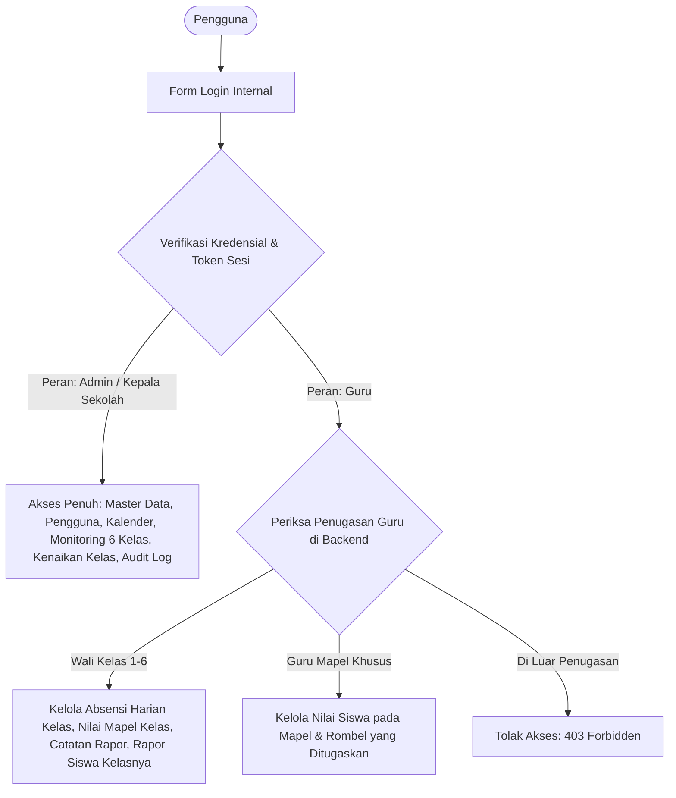
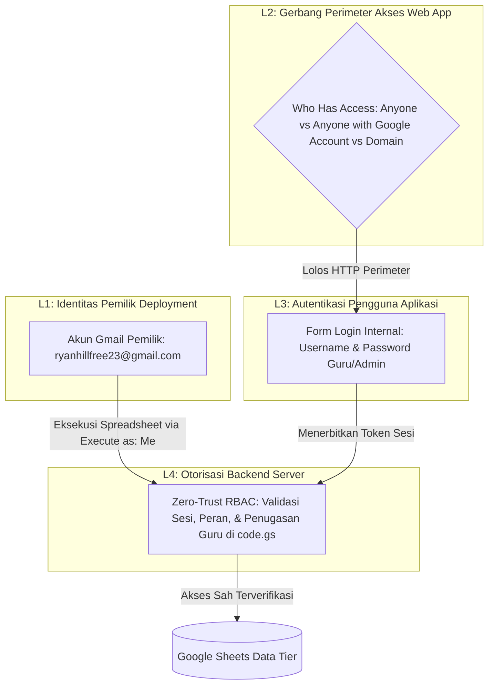
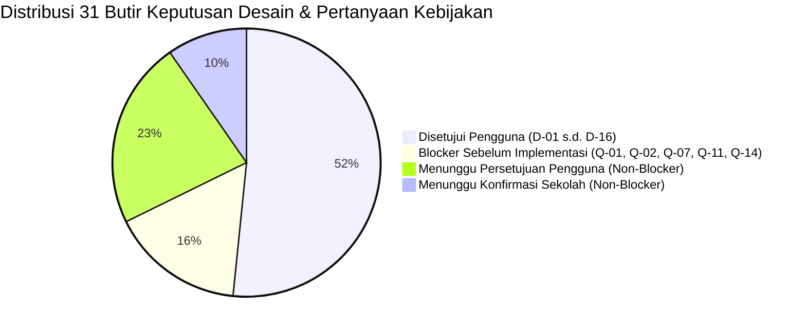

# PRODUCT REQUIREMENTS DOCUMENT (PRD)
# Sistem Absensi dan Penilaian Siswa SD

**Nama Proyek:** Sistem Absensi dan Penilaian Siswa SD
**Platform Target:** Google Apps Script Web App (V8 Runtime)
**Akun Pemilik Percobaan:** `ryanhillfree23@gmail.com` (Gmail Pribadi — Khusus Lingkungan Uji Coba)
**Penyimpanan Data:** Google Sheets (21 Lembar Kerja Terstruktur)
**Bahasa Antarmuka:** Bahasa Indonesia
**Versi Dokumen:** 1.0-baseline (Dokumentasi Spesifikasi Resmi Pra-Implementasi)
**Tanggal Penetapan Baseline:** 16 Oktober 2026
**Status Baseline:** Disahkan Pengguna sebagai Baseline Desain Pra-Implementasi Bersyarat (Implementasi Terkunci)
**Riwayat Versi Dokumen:**
- v1.0–v1.3: Draf inisial, audit konflik skema, dan perbaikan awal model relasi.
- v1.4-revised: Penyelarasan kebutuhan baru (monitoring 6 kelas, 21 sheet, kalender dinamis, partial failure mitigation, mitigasi risiko UU PDP).
- v1.5-final-correction: Koreksi deployment 4 lapisan, formula kelengkapan dinamis $E$ & $V$, 4 status deterministik, audit dummy 21 sheet, dan kejujuran teknis autentikasi.
- v1.0-baseline: Penetapan baseline resmi pra-implementasi dengan verifikasi aktif keberhasilan penghapusan data anak sebelum data induk, pelaporan pemulihan kegagalan parsial, dan penguncian mutlak fase implementasi.
**Target Pengguna:** Administrator / Kepala Sekolah dan Guru Sekolah Dasar (Kelas 1–6 SD)

---

## 1. Latar Belakang dan Tujuan

### 1.1. Latar Belakang
Pengelolaan data administrasi akademik di Sekolah Dasar (SD) mencakup pencatatan kehadiran harian, pengelolaan nilai tugas dan ujian, penilaian perkembangan karakter/sikap, pemantauan penyelesaian penilaian oleh kepala sekolah, hingga penyusunan buku rapor semester. Di lingkungan sekolah dasar, beban administratif sering kali membebani guru kelas dan guru mata pelajaran jika instrumen pencatatan tidak terintegrasi atau spreadsheet dikelola secara terpisah tanpa validasi terpusat.

Sistem Absensi dan Penilaian Siswa SD dirancang sebagai aplikasi web berbasis Google Apps Script (GAS) dengan Google Sheets sebagai basis data. Aplikasi ini menyediakan antarmuka web modern (*Single Page Architecture*) yang ringan, responsif, dan mudah dioperasikan oleh guru, sembari memastikan data tersimpan secara terpusat tanpa memerlukan infrastruktur server eksternal berbayar.

### 1.2. Tujuan Sistem
1. **Pemusatan Data Master:** Mengelola data identitas sekolah, tahun ajaran, semester, kalender efektif sekolah, jenjang kelas (1–6 SD), siswa, mata pelajaran, dan penugasan guru secara terpadu.
2. **Keamanan & Otorisasi Berbasis Peran:** Menerapkan autentikasi internal username/password serta pembatasan hak akses berbasis penugasan kelas dan mata pelajaran (*Role-Based Access Control / RBAC*).
3. **Akuntabilitas Kehadiran:** Menghitung persentase kehadiran siswa secara objektif dan dapat diaudit dengan membedakan *hari sekolah terjadwal*, *hari absensi lengkap*, dan *hari wajib hadir siswa* berdasarkan daftar siswa yang benar-benar aktif pada tanggal terkait.
4. **Integritas Penilaian & Perlindungan Nilai Historis:** Menerapkan pembobotan global per semester, penegakan status **`Belum Lengkap`** jika komponen wajib kosong, dan mekanisme pembekuan nilai final (*grade snapshot*) dengan lembar audit riwayat koreksi terpisah (`RiwayatKoreksiNilai`) agar laporan semester lampau tidak berubah akibat penyesuaian bobot di masa depan.
5. **Dashboard Monitoring Kepala Sekolah:** Menyediakan visualisasi ringkasan penyelesaian penilaian 6 kelas (Kelas 1–6) dengan metrik kelengkapan input dan navigasi drill-down.
6. **Evaluasi Non-Akademik:** Menyediakan pencatatan deskriptif sikap dan keterampilan (dimensi Profil Pelajar Pancasila).
7. **Pelaporan & Rapor Kurikulum Merdeka:** Menyediakan lembar pratinjau dan cetak rapor semester yang siap disimpan sebagai PDF melalui dialog cetak browser (`window.print()`).
8. **Kenaikan Kelas Massal:** Memfasilitasi alur mutasi dan kenaikan kelas massal akhir tahun ajaran yang transparan, terverifikasi, dan mempertahankan rekam jejak historis siswa.
9. **Audit Trail Komprehensif:** Mencatat operasi kritis ke lembar audit log tanpa membocorkan kredensial atau informasi sensitif.

---

## 2. Ruang Lingkup Sistem

### 2.1. Cakupan Versi Awal (MVP)
1. **Autentikasi & Manajemen Sesi:** Login username/password internal, penerbitan token sesi server, batas waktu sesi (*session timeout*), invalidasi sesi saat logout, dan mitigasi brute force.
2. **Manajemen Akun & Penugasan:** Pembuatan akun guru oleh admin, penetapan peran wali kelas (Kelas 1–6) dan guru mata pelajaran per rombel dan tahun ajaran dengan dukungan penugasan fleksibel.
3. **Data Master & Kalender Sekolah:** Identitas resmi sekolah (termasuk NPSN, Kepala Sekolah, NIP), tahun ajaran, semester, dan kalender hari efektif belajar/libur.
4. **Model Siswa Hybrid:** Penempatan kelas aktif pada tabel `Siswa` (`kelas_id_aktif`) dan pemeliharaan seluruh rekam jejak pada tabel `RiwayatKelas`.
5. **Absensi Harian Terverifikasi:** Pencatatan kehadiran harian (H/S/I/A), pencegahan catatan duplikat, dan pelacakan status kelengkapan absensi kelas berdasarkan daftar siswa yang aktif pada tanggal kejadian.
6. **Rekap Kehadiran Bulanan & Semester:** Rekapitulasi kehadiran berbasis hari belajar riil dengan formula yang memperhitungkan tanggal mutasi dan hari efektif penempatan siswa.
7. **Penilaian Akademik & Pembobotan Global:** Pengelolaan komponen penilaian per semester dengan bobot global, validasi kelengkapan komponen wajib, kalkulasi matematis normalisasi komponen opsional, dan pembekuan nilai final ke tabel `NilaiAkhir`.
8. **Dashboard Monitoring Kepala Sekolah:** Ringkasan monitoring 6 kelas (Kelas 1–6) memuat metrik komponen terisi vs kosong, persentase kelengkapan, 4 status kelengkapan deterministik, dimensi finalisasi terpisah, dan navigasi drill-down.
9. **Penilaian Non-Akademik:** Pengelolaan aspek sikap dan keterampilan beserta narasi capaian.
10. **Rapor Semester Kurikulum Merdeka:** Pratinjau dan cetak rapor dengan kop resmi, nilai akhir, capaian kompetensi, kehadiran, catatan wali kelas, dan status kenaikan kelas.
11. **Kenaikan Kelas Massal:** Modul terpandu dengan pratinjau kelayakan, konfirmasi admin, dan pembaharuan riwayat penempatan siswa.
12. **Pencetakan Dokumen:** Cetak berbasis browser `window.print()` dan stylesheet CSS `@media print` (*Save as PDF*).
13. **Audit Log & Proteksi Data:** Mencatat aktivitas administratif sensitif ke lembar `AuditLog` dan perlindungan data pribadi siswa.
14. **Setup Idempoten & Seeder Data Dummy Terpisah:** Inisialisasi struktur 21 lembar kerja tanpa menghapus data yang ada, disertai modul seeder data dummy terpisah dan non-destruktif khusus pengujian.

### 2.2. Di Luar Cakupan MVP (Non-MVP)
- Portal mandiri untuk siswa atau orang tua.
- Presensi otomatis berbasis GPS radius, biometrik, atau kartu RFID.
- Sinkronisasi otomatis dua arah dengan server Dapodik Kemdikbudristek.
- Notifikasi otomatis WhatsApp Gateway / SMS.
- Modul transaksi keuangan dan SPP.
- Aplikasi native Android / iOS.

---

## 3. Pengguna, Peran, dan Matriks Hak Akses (RBAC)

Sistem menerapkan prinsip **Least Privilege** dan **Zero-Trust Frontend**. Setiap fungsi backend yang membaca, membuat, memperbarui, menghapus, atau memfinalisasi data wajib memvalidasi token sesi, status akun, peran, dan cakupan penugasan pada baris pertama eksekusinya. Filter tampilan frontend bukan benteng otorisasi:

### 3.1. Administrator / Kepala Sekolah (`admin`)
Kepala sekolah dan staf administrator mengoperasikan akun internal dengan peran administrator untuk tata kelola sekolah secara menyeluruh:
- **Akses Lintas 6 Kelas:** Melihat data seluruh jenjang Kelas 1, 2, 3, 4, 5, dan 6 SD beserta daftar siswa aktif.
- **Monitoring Penilaian Semester:** Mengakses Dashboard Monitoring Kepala Sekolah untuk memantau kelengkapan penginputan nilai tiap guru per rombel dan per mata pelajaran secara berkala.
- **Pemantauan Absensi:** Memantau rekap absensi harian, bulanan, dan semester seluruh kelas secara terpisah dari data nilai.
- **Pengawasan Komponen Wajib:** Meninjau daftar komponen penilaian wajib yang belum diisi oleh guru kelas atau guru mata pelajaran.
- **Status Finalisasi & Riwayat Koreksi:** Memantau status pembekuan nilai akhir semester, serta melihat riwayat koreksi nilai resmi pada sheet `RiwayatKoreksiNilai`.
- **Manajemen Akun & Penugasan Guru:** Mengelola akun guru (buat akun dummy/riil, reset password, non-aktifkan akun) serta mengatur penugasan wali kelas (Kelas 1–6) dan guru mapel.
- **Eksekusi Koreksi Resmi:** Mengeksekusi koreksi administratif terhadap nilai berstatus `final` dengan alasan tertulis wajib.
- **Kenaikan Kelas Massal:** Mengeksekusi modul kenaikan kelas akhir tahun ajaran.
- **Audit Trail:** Meninjau seluruh aktivitas sensitif pada lembar `AuditLog`.

### 3.2. Guru Kelas dan Guru Mata Pelajaran (`guru`)
Sistem mendukung penugasan guru untuk Kelas 1, 2, 3, 4, 5, dan 6 SD:
- **Autentikasi Mandiri:** Melakukan login dan logout menggunakan kredensial akun internal mandiri.
- **Dashboard Terfilter Sesuai Penugasan:** Guru hanya melihat data kelas, siswa, mata pelajaran, komponen penilaian, dan nilai yang secara eksplisit terdaftar di sheet `PenugasanGuru`.
- **Fleksibilitas Penugasan:** Struktur database mendukung penugasan fleksibel:
  - Satu guru kelas bertanggung jawab pada satu rombel utama (Kelas 1 s/d 6).
  - Guru dapat ditugaskan mengajar mata pelajaran khusus lintas rombel (misalnya Guru Pendidikan Agama Islam atau PJOK untuk Kelas 1–6).
- **Wewenang Wali Kelas:**
  - Mengisi dan mengoreksi absensi harian kelas binaannya.
  - Memantau rekap absensi bulanan kelas binaannya.
  - Mengisi evaluasi sikap/non-akademik dan catatan wali kelas pada rapor.
  - Menghasilkan pratinjau dan mencetak rapor semester siswa di kelasnya.
- **Wewenang Guru Mata Pelajaran:**
  - Menginput dan memperbarui nilai komponen akademik hanya pada mata pelajaran dan kelas yang ditugaskan selama nilai berstatus `draft`.
- **Batasan Ketat Hak Akses Guru (Strict Backend RBAC):**
  - Guru Kelas 1 **dilarang keras membaca atau memodifikasi** data siswa, absensi, atau nilai Kelas 2 (dan sebaliknya) melalui URL, parameter request, atau pemanggilan fungsi backend langsung.
  - Dilarang merevisi nilai yang telah berstatus `final` secara mandiri.
  - Dilarang mengubah data akun guru lain, bobot global, atau kalender sekolah.
  - Dilarang mengeksekusi kenaikan kelas massal.

*Catatan Lingkungan Pengujian:* Akun untuk 6 guru kelas pada tahap awal akan dibuat sebagai akun dummy untuk keperluan verifikasi pengujian, bukan kredensial produksi permanen.

---

## 4. Keamanan Autentikasi dan Batasan Deployment

### 4.1. Model Ancaman (Threat Modeling) di HTML Service
1. **Pemanggilan Endpoint Server Langsung:** Antarmuka HTML Service bukan benteng keamanan. Penyerang dapat membuka DevTools browser dan memanggil fungsi `google.script.run.namaFungsi(payload)` dengan memanipulasi parameter `siswa_id`, `kelas_id`, atau skor nilai. Validasi hak akses dan status sesi wajib dilakukan 100% di server pada setiap operasi.
2. **Keterbatasan Konvensi Underscore (`_`):** Akhiran `_` hanyalah konvensi visibilitas Apps Script untuk menyembunyikan fungsi dari pemanggilan antarmuka klien, **bukan mekanisme otorisasi**. Fungsi publik yang dapat dipanggil klien wajib memiliki pengawal otorisasi (*authorization guard*) di baris pertama eksekusinya.
3. **Pembajakan & Pemalsuan Sesi (Session Hijacking):** Token sesi yang dikirim atau disimpan secara ceroboh dapat disalahgunakan. Token sesi wajib memiliki entropi kriptografis tinggi, disimpan dalam bentuk hash di database, memiliki batas kedaluwarsa, dan diinvalidasi saat logout, perubahan password, atau penonaktifan akun.
4. **Kebocoran Kredensial di Log:** Password, hash, salt, pepper, atau token sesi dilarang keras dicatat ke `AuditLog`, `console.log`, atau `Logger.log`.
5. **Bypass Spreadsheet Langsung:** Jika Google Sheets dibagikan langsung kepada akun guru, guru dapat membuka spreadsheet secara langsung dan memotong seluruh logika validasi Web App. Spreadsheet **tidak boleh dibagikan** kepada siapa pun selain akun pemilik script / admin utama. Seluruh pembacaan dan penulisan data dilakukan melalui identitas pemilik deployment backend.

### 4.2. Evaluasi Autentikasi: Akun Google vs Akun Internal
- **Autentikasi Akun Google:** Menyediakan perlindungan enterprise bawaan (proteksi brute force canggih, 2FA, zero credential management di Sheets).
- **Keputusan Pengguna & Trade-off:** Pengguna telah menetapkan bahwa sistem menggunakan **akun internal (username & password)** agar setiap guru memiliki akun mandiri tanpa bergantung pada akun Google institusi.
- **Konsekuensi Teknis:** Penggunaan autentikasi internal di atas Apps Script membebankan seluruh tanggung jawab keamanan kepada aplikasi (manajemen salt, pepper, hashing, sesi, mitigasi brute force, dan penguncian konkurensi). Oleh karena itu, arsitektur ini memerlukan validasi teknis ketat sebelum implementasi dan dicatat sebagai **Blocker Teknis**.

### 4.3. Audit Kriptografi Hashing Password & Gerbang Teknis
1. **Pencabutan Klaim Tanpa Uji:** Seluruh klaim sepihak mengenai batasan putaran iterasi atau jaminan keamanan angka tertentu dicabut. Ditegaskan bahwa loop HMAC berulang bukanlah standar PBKDF2 (RFC 2898/8018).
2. **Kriteria Penerimaan Keamanan dan Performa (Gerbang Teknis Phase 2):**
   Sebelum kode login diimplementasikan, wajib dilakukan pengujian tolok ukur (*benchmarking*) empiris di Google Apps Script V8 dengan kriteria penerimaan terukur:
   - *Kriteria Performa:* Latensi komputasi verifikasi hash satu akun pada Apps Script V8 wajib berada di bawah **1.000 milidetik** (target optimal < 500 ms) agar tidak memicu gateway timeout pada HTTP Web App.
   - *Kriteria Keamanan:* Wajib menggunakan salt acak kriptografis 16-byte unik per pengguna, server pepper rahasia di `ScriptProperties`, serta faktor komputasi yang memaksimalkan beban kerja penyerang dalam batas waktu CPU yang diizinkan.
   - *Aturan Penghentian (Fallback Circuit-Breaker):* Jika pendekatan internal gagal memenuhi kriteria performa dan keamanan di runtime Apps Script V8, **implementasi form login wajib dihentikan** dan dilaporkan kepada pengguna untuk meminta keputusan alternatif (misalnya integrasi Google Sign-In).
3. **Peringatan Verifikasi Keamanan:** Dilarang menandai keamanan autentikasi sebagai sudah terbukti hanya karena dokumentasi telah direvisi. Status keamanan autentikasi tetap berstatus *Menunggu Validasi Teknis* sampai benchmarking empiris pada Phase 2 berhasil diselesaikan dan disetujui. Target performa hash bukan bukti keamanan kriptografi.

### 4.4. Entropi Token Sesi dan Pengelolaan Sesi
1. **Verifikasi Pembangkitan Token di Google Apps Script:**
   - Runtime Apps Script V8 **tidak menyediakan Web Crypto API (`crypto.getRandomValues()`)** pada lingkungan backend.
   - Pembangkitan token sesi di backend memanfaatkan API native resmi yang terverifikasi tersedia: **`Utilities.getUuid()`** (menghasilkan UUID v4 berbasis pseudo-random 122-bit entropy).
   - *Peringatan Klaim Keacakan:* Dilarang mengklaim `Utilities.getUuid()` ditambah metode byte acak tertentu aman sebelum API, sumber keacakan (CSPRNG), dan implementasinya diverifikasi secara empiris di runtime GAS.
   - *Koreksi Entropi:* Ditegaskan secara ilmiah bahwa **penambahan timestamp tidak meningkatkan entropi kriptografis**. Keacakan token sepenuhnya bersumber dari generator UUID v4 bawaan platform.
2. **Penyimpanan Token Hash di Server:**
   - Klien memegang token sesi dalam memori peramban (`sessionStorage`).
   - Di lembar basis data (`Sesi`), server **hanya menyimpan hash SHA-256 dari token** (`token_hash`). Jika isi spreadsheet terbaca tanpa izin, penyerang tidak dapat langsung menggunakan nilai tersebut untuk membajak sesi aktif (*Session Hijacking Protection*).
3. **Kebijakan Invalidasi Sesi:**
   - Batas waktu kedaluwarsa sesi ditetapkan (misalnya 8 jam).
   - Sesi diinvalidasi secara instan saat logout, perubahan password pengguna, penonaktifan akun, atau perubahan penugasan guru.

### 4.5. Analisis Deployment Google Apps Script pada Akun Gmail Pribadi (`ryanhillfree23@gmail.com`)
Lingkungan percobaan dan pengembangan dijalankan menggunakan akun Gmail pribadi (`ryanhillfree23@gmail.com`). Dalam merancang arsitektur akses dan keamanan, sistem membedakan secara tegas 4 (empat) lapisan entitas yang berbeda:

1. **Pembedaan 4 Lapisan Akses & Keamanan:**
   - **Lapisan 1 (Identitas Pemilik Deployment):** Akun `ryanhillfree23@gmail.com` murni bertindak sebagai pemilik file script dan spreadsheet pada Google Drive. Alamat ini **bukan akun kepala sekolah otomatis**, dan password akun Google pemilik **dilarang keras dicantumkan atau disimpan** di dalam kode, seeder, spreadsheet, maupun dokumen.
   - **Lapisan 2 (Siapa yang Dapat Membuka Web App):** Pengaturan *Who has access* pada konfigurasi deployment Google Apps Script. Lapisan ini bertindak sebagai filter akses HTTP sebelum konten Web App disajikan ke peramban.
   - **Lapisan 3 (Login Internal Aplikasi):** Guru dan administrator memasukkan kredensial internal (username dan password mandiri sekolah) pada antarmuka Web App. Kredensial ini dikelola di sheet `Pengguna`.
   - **Lapisan 4 (Otorisasi Backend untuk Membaca dan Mengubah Data):** Pemeriksaan hak akses di sisi server (`code.gs`) yang memverifikasi token sesi, status aktif, peran pengguna, serta kecocokan penugasan kelas dan mata pelajaran pada tabel `PenugasanGuru`.
2. **Konsekuensi Model Eksekusi (*Execute As: Me*):**
   - Web App wajib dikonfigurasi sebagai **`Execute as: Me` (pemilik script `ryanhillfree23@gmail.com`)**.
   - Seluruh operasi baca dan tulis ke Google Sheets berjalan menggunakan wewenang pemilik deployment. Akibatnya, Google Sheets tidak dapat membedakan siapa pengguna akhir yang sebenarnya melakukan request.
   - **Kaidah Keamanan Mutlak:** Oleh karena seluruh operasi spreadsheet berjalan dengan wewenang pemilik, maka **setiap fungsi backend tanpa kecuali wajib memvalidasi sesi, peran, dan penugasan pengguna secara mandiri**. Guru dan publik sama sekali tidak diberikan hak akses langsung ke file spreadsheet.
3. **Analisis Realistis Opsi Akses Web App (*Who has access*) pada Akun Gmail Pribadi:**
   Akun `@gmail.com` tidak memiliki fasilitas Google Workspace for Education. Dua opsi yang tersedia dianalisis secara objektif:

| Opsi Akses Web App | Mekanisme Akses & Alur Pengguna | Analisis Risiko Keamanan & Privasi Siswa | Status Evaluasi |
|---|---|---|---|
| **Opsi 1: Anyone (Publik Anonim)** | Pengguna langsung membuka URL Web App tanpa login akun Google apa pun. Form login internal menjadi pintu gerbang pertama yang dihadapi pengguna. | **RISIKO TINGGI & BLOCKER SEBELUM DATA NYATA:** Akses publik anonim tidak otomatis melanggar hukum, tetapi menimbulkan risiko privasi dan keamanan serius terhadap data pribadi anak (berdasarkan prinsip kehati-hatian perlindungan data pribadi anak UU PDP No. 27/2022). Membuka URL ke publik mengekspos endpoint ke pemindai bot internet, serangan brute-force otomatis, dan risiko penghabisan kuota eksekusi Google Apps Script harian (DDoS kuota). Form login internal saja tidak cukup melindungi data sensitif siswa jika perimeter luar terbuka bebas tanpa autentikasi HTTP. | Dapat ditoleransi khusus untuk demonstrasi data dummy fiktif terisolasi; **Blocker sebelum data operasional riil digunakan**. |
| **Opsi 2: Anyone with Google Account** | **Langkah Tambahan:** Guru wajib login ke akun Google apa pun (misal Gmail pribadi masing-masing) di browser untuk membuka halaman Web App. Setelah gerbang Google terbuka, aplikasi menyajikan form login internal sekolah di mana guru memasukkan username dan password aplikasi. | **OPSI KOMPROMI TEKNIS (BUKAN JAMINAN MUTLAK):** Pembatasan akses akun Google menambah lapisan autentikasi HTTP tingkat Google, namun **BUKAN jaminan bebas penyalahgunaan atau kehabisan kuota**. Siapa pun di internet yang memiliki akun Google publik masih dapat mengakses URL dan memicu eksekusi Web App jika tautan bocor. Namun, opsi ini secara signifikan mengurangi serangan bot otomatis anonim tanpa mewajibkan domain institusi. | Opsi rekomendasi teknis untuk pengujian lingkungan Gmail pribadi. |
| **Opsi 3: Anyone within Domain** | Hanya akun dalam domain Google Workspace institusi sekolah yang dapat membuka Web App. | **TIDAK TERSEDIA PADA GMAIL PRIBADI:** Akun `ryanhillfree23@gmail.com` adalah akun konsumen. Opsi ini hanya dapat diaktifkan jika sekolah menyediakan Google Workspace for Education resmi. | Menunggu konfirmasi ketersediaan Google Workspace sekolah. |

4. **Kebutuhan Pengguna & Langkah Akses Aktual:**
   Pengguna menginginkan guru dapat membuka link Web App dan login menggunakan akun internal (username & password), tanpa mewajibkan akun Google pribadi guru sebagai identitas aplikasi. Jika Opsi 2 dipilih demi keamanan perimeter luar, maka guru menghadapi **langkah tambahan**: browser akan meminta autentikasi akun Google terlebih dahulu sebelum halaman Web App termuat, baru kemudian guru masuk menggunakan username dan password aplikasi sekolah.
5. **Status Keputusan Deployment:**
   Konfigurasi deployment final **belum diputuskan** dan tetap berstatus **Menunggu Validasi Lingkungan Aktual & Blocker sebelum penggunaan data operasional nyata**. Dilarang memilih konfigurasi final sebelum ketersediaan dan perilaku opsi deployment diverifikasi pada lingkungan yang benar-benar akan digunakan.

---

---

## 5. Kebutuhan Fungsional Rinci

### FR-01 — Manajemen Kalender Sekolah dan Hari Efektif
1. Admin mengelola kalender akademik sekolah pada sheet `KalenderSekolah` untuk setiap semester.
2. Setiap tanggal dalam rentang semester memiliki status:
   - `efektif`: Hari belajar reguler terjadwal di mana KBM berlangsung.
   - `libur_resmi`: Hari libur nasional atau cuti bersama.
   - `libur_khusus`: Hari libur khusus sekolah (kegiatan jeda tengah semester, rapat dinas).
3. Kalender sekolah menjadi rujukan dasar untuk menentukan **Hari Sekolah Terjadwal** dalam perhitungan kehadiran.

### FR-02 — Presensi Harian Siswa dan Status Kelengkapan Rombel
1. Wali kelas mencatat kehadiran siswa pada hari sekolah efektif.
2. Empat status kehadiran yang sah: **Hadir (H)**, **Sakit (S)**, **Izin (I)**, dan **Alpa (A)**.
3. **Pencegahan Catatan Duplikat:** Satu siswa hanya dapat memiliki satu rekaman kehadiran per tanggal kalender. Penginputan ulang pada tanggal yang sama diperlakukan sebagai koreksi pembaruan (*upsert*).
4. **Kaidah Historis Penempatan Siswa pada Tanggal Kejadian:**
   - **Kaidah Mutlak:** Kelengkapan absensi pada tanggal $t$ dihitung berdasarkan daftar siswa yang **benar-benar aktif dan terdaftar di rombel tersebut pada tanggal $t$** dengan memeriksa interval penempatan pada sheet `RiwayatKelas` ($\text{tanggal\_mulai} \le t \le \text{tanggal\_selesai}$).
   - Sistem **dilarang keras menggunakan data siswa saat ini (`Siswa.kelas_id_aktif`)** untuk mengevaluasi kelengkapan tanggal lampau, agar mutasi siswa di kemudian hari tidak merusak kelengkapan absensi historis.
5. **Dokumentasi Perilaku 4 Skenario Dinamika Siswa:**
   - **Skenario 1 (Siswa Masuk / Keluar di Tengah Semester):**
     Siswa yang baru masuk pada tanggal $t_{\text{masuk}}$ hanya memiliki kewajiban hadir pada tanggal $t \ge t_{\text{masuk}}$. Hari-hari sebelum tanggal masuk tidak dihitung dalam hari wajib hadir ($W_{\text{siswa}}$). Sebaliknya, siswa yang keluar/mutasi pada tanggal $t_{\text{keluar}}$ hanya dihitung hingga tanggal $t \le t_{\text{keluar}}$.
   - **Skenario 2 (Siswa Pindah Kelas Antar-Rombel):**
     Jika siswa pindah dari Kelas 1A ke 1B pada tanggal $t_{\text{pindah}}$, rekam jejak di 1A ditutup per $t_{\text{pindah}} - 1$ dan rekam jejak di 1B dibuka per $t_{\text{pindah}}$. Seluruh catatan kehadiran sebelum $t_{\text{pindah}}$ tetap utuh milik rombel 1A dan tidak berpindah ke 1B.
   - **Skenario 3 (Koreksi Absensi yang Sudah Diverifikasi):**
     Jika catatan absensi tanggal lampau yang sudah berstatus lengkap memerlukan perbaikan (misal siswa awalnya tercatat Alpa ternyata membawa surat dokter menjadi Sakit), wali kelas/admin dapat memperbarui status. Backend mengeksekusi *upsert* pada tabel `Absensi`, mengevaluasi ulang status kelengkapan kelas pada tanggal kejadian, memperbarui timestamp `updated_at`, dan mencatat koreksi ke lembar `AuditLog`.
   - **Skenario 4 (Daftar Siswa Tanggal Lampau Berbeda dari Siswa Saat Ini):**
     Daftar siswa saat mengevaluasi atau mencetak rekap tanggal lampau diambil strictly dari kueri interval penempatan `RiwayatKelas` pada tanggal tersebut. Penambahan siswa baru di masa sekarang tidak akan mengubah penyebut hari sekolah maupun persentase kehadiran rombel pada bulan-bulan lampau.
6. **Penanganan Absensi Belum Lengkap:**
   - Suatu tanggal dinyatakan sebagai **Hari Absensi Lengkap** jika seluruh siswa yang aktif pada tanggal tersebut telah terisi status kehadirannya (H/S/I/A).
   - Tanggal terjadwal yang belum diisi absensinya ditandai sebagai `belum_diinput`.
   - **Larangan Keras:** Tanggal atau catatan yang `belum_diinput` **dilarang keras dimasukkan sebagai hadir maupun alpa**, dan **dilarang dimasukkan ke dalam pembagi hari wajib hadir ($W_{\text{siswa, lengkap}}$)**.

### FR-03 — Perhitungan Rekap Kehadiran Objektif
Sistem menerapkan tiga konsep dasar kehadiran:
1. **Hari Sekolah Terjadwal ($K$):** Total hari berstatus `efektif` menurut kalender sekolah pada periode yang dipilih.
2. **Hari Absensi Lengkap ($L_{\text{kelas}}$):** Jumlah hari terjadwal di mana wali kelas telah menginput dan memverifikasi absensi seluruh siswa aktif rombel pada tanggal tersebut ($L_{\text{kelas}} \le K$).
3. **Hari Wajib Hadir Siswa ($W_{\text{siswa, lengkap}}$):** Jumlah hari absensi lengkap yang berada di dalam rentang masa penempatan aktif siswa di rombel tersebut berdasarkan `RiwayatKelas`.

#### Formula Persentase Kehadiran:
$$\text{Persentase Kehadiran} = \begin{cases}
\frac{H_i}{W_{\text{siswa, lengkap}}} \times 100\%, & \text{jika } W_{\text{siswa, lengkap}} > 0 \\
\text{"N/A"}, & \text{jika } W_{\text{siswa, lengkap}} = 0
\end{cases}$$

Di mana:
- $H_i$: Jumlah hari siswa $i$ tercatat Hadir pada hari-hari absensi lengkap.
- $S_i, I_i, A_i$: Akumulasi hari Sakit, Izin, dan Alpa ($H_i + S_i + I_i + A_i = W_{\text{siswa, lengkap}}$).
- **Penanganan Penyebut Nol:** Jika $W_{\text{siswa, lengkap}} = 0$, persentase menampilkan tanda strip atau **`N/A`** untuk mencegah error pembagian dengan nol (*division by zero*).
- **Penyajian Laporan Audit:** Laporan rekap kehadiran wajib menampilkan metrik audit transparan:
  - Jumlah Hari Sekolah Terjadwal ($K$).
  - Jumlah Hari Absensi Lengkap ($L_{\text{kelas}}$).
  - Jumlah Hari Belum Lengkap ($K - L_{\text{kelas}}$).
  - Rincian akumulasi mutlak $H, S, I, A$.
  - Jika $L_{\text{kelas}} < K$, laporan memberikan penanda peringatan bahwa data kehadiran semester belum lengkap diinput oleh guru.

### FR-04 — Penilaian Akademik, Formula Bobot Global, dan Normalisasi Komponen
1. Admin menetapkan struktur komponen penilaian yang berlaku global untuk seluruh mata pelajaran pada semester aktif (sheet `KomponenPenilaian`).
2. Setiap komponen memiliki atribut: `nama_komponen`, `bobot` (persentase), dan `is_wajib` (boolean).
3. **Validasi Bobot Konfigurasi 100%:** Total bobot seluruh komponen aktif dalam konfigurasi semester wajib sama dengan 100% ($\sum_{c \in C} w_c = 100\%$). Jika tidak 100%, sistem menolak konfigurasi admin.
4. **Pembedaan Nilai Kosong vs Nol:**
   - Nilai `0` adalah capaian skor nol yang sah (siswa mengikuti ujian/tugas tetapi memperoleh skor nol). Nilai nol tetap masuk dalam pembilang ($0 \times w_c = 0$) dan bobotnya tetap masuk dalam penyebut ($w_c$).
   - Nilai kosong (`null` atau string kosong) adalah kondisi di mana siswa belum dinilai / tidak mengikuti evaluasi.
5. **Kalkulasi Matematis dan Normalisasi Komponen Opsional:**
   Misalkan himpunan seluruh komponen aktif semester adalah $C$ dengan bobot $w_c$. Untuk siswa $s$ pada mata pelajaran $m$:
   - **Pemeriksaan Komponen Wajib:**
     Jika terdapat komponen $c \in C$ di mana $is\_wajib(c) = \text{true}$ dan nilainya kosong ($V_s(c) = \text{null}$), maka sistem **dilarang menghasilkan angka nilai akhir prematur**. Status nilai ditetapkan sebagai **`Belum Lengkap`** (ditampilkan tanda strip `-` dengan lencana peringatan).
   - **Kalkulasi Komponen Lengkap:**
     Jika seluruh komponen wajib memiliki nilai, definisikan himpunan komponen yang dinilai:
     $$C_{\text{dinilai}} = \{c \in C \mid V_s(c) \neq \text{null}\}$$
     Komponen opsional yang kosong ($V_s(c) = \text{null}$ dengan $is\_wajib(c) = \text{false}$) **tidak dimasukkan ke dalam $C_{\text{dinilai}}$**.
     Formula nilai akhir:
     $$\text{Nilai Akhir} = \frac{\sum_{c \in C_{\text{dinilai}}} (V_s(c) \times w_c)}{\sum_{c \in C_{\text{dinilai}}} w_c}$$
     *Rasionalisasi Matematis:* Membagi dengan $\sum_{c \in C_{\text{dinilai}}} w_c$ secara matematis menormalkan kembali nilai ke skala 0–100 secara adil tanpa merugikan siswa yang tidak mengikuti kegiatan pengayaan opsional.

### FR-05 — Perlindungan Nilai Historis, Rekam Jejak Koreksi Nilai Final, dan Penanganan Partial Failure
1. **Siklus Hidup Nilai (*Grade Lifecycle*):**
   - `draft`: Nilai sedang diinput guru mapel, kalkulasi bersifat dinamis.
   - `belum_lengkap`: Ada komponen wajib yang belum terisi nilai untuk satu atau lebih siswa.
   - `lengkap`: Seluruh komponen wajib telah terisi untuk seluruh siswa aktif.
   - `siap_ditetapkan`: Nilai lengkap telah ditinjau dan siap dibekukan.
   - `difinalisasi`: Nilai telah diverifikasi dan dibekukan pada akhir semester (*frozen snapshot*).
2. **Evaluasi Desain Rekam Jejak Nilai Final: Perbandingan Pilihan:**
   - **Kelemahan Kolom Tunggal `nilai_sebelumnya`:** Satu kolom `nilai_sebelumnya` pada tabel nilai final **tidak cukup secara teknis**. Jika nilai dikoreksi lebih dari satu kali (misal: 70 $\to$ 75 $\to$ 80), kolom tunggal akan menimpa nilai 70 dengan 75, sehingga rekam jejak nilai awal hilang dan rantai audit terputus.
   - **Pilihan 1 (Append-Only Versioned Records dalam 1 Sheet):**
     Setiap versi nilai final disimpan sebagai baris baru dalam tabel yang sama dengan nomor versi (`versi: 1, 2, 3...`).
     *Kelemahan:* Kueri rapor harian harus memfilter baris aktif (`is_current = true` atau `max(versi)`) dari ribuan baris campuran. Pada Google Apps Script, pembacaan seluruh tabel dan pemfilteran versi di memori memperlambat waktu respon secara signifikan.
   - **Pilihan 2 (Snapshot `NilaiAkhir` + Sheet Terpisah `RiwayatKoreksiNilai`) — REKOMENDASI UTAMA (MENUNGGU PERSETUJUAN PENGGUNA):**
     - Sheet `NilaiAkhir` hanya menyimpan snapshot nilai aktif terkini (tepat 1 baris per siswa per mapel per semester). Kueri pencetakan rapor harian berupa pencarian langsung (*direct lookup* $O(1)$ di memori) tanpa perlu memfilter riwayat versi.
     - Sheet `RiwayatKoreksiNilai` mencatat seluruh riwayat audit setiap kali terjadi koreksi pasca-final secara permanen (`koreksi_id`, `nilai_akhir_id`, `semester_id`, `siswa_id`, `mapel_id`, `versi_koreksi`, `nilai_sebelumnya`, `nilai_baru`, `alasan_revisi`, `revised_by`, `revised_at`).
     - Desain ini menjamin rekonstruksi 100% seluruh riwayat koreksi berkali-kali tanpa batas, sekaligus menjaga performa baca rapor tetap maksimal.
3. **Pencegahan Pengeditan Final Tanpa Otorisasi (*Role Guard*):**
   - Nilai berstatus `difinalisasi` terkunci mutlak dari antarmuka dan backend guru mata pelajaran.
   - Guru dilarang mengubah nilai yang sudah difinalisasi kecuali melalui alur revisi administratif yang secara eksplisit disetujui kepala sekolah.
   - Administrator hanya boleh melakukan koreksi nilai dengan mencantumkan alasan administratif wajib (`alasan_revisi`).
4. **Strategi Penanganan Risiko Kegagalan Sebagian (*Partial Failure Mitigation*) & Konkurensi:**
   - **Keterbatasan Teknis GAS:** Google Sheets API tidak menyediakan transaksi ACID terdistribusi antarbeberapa lembar kerja (*multi-sheet atomic transaction*).
   - **Pengendalian Konkurensi:** Operasi finalisasi dan koreksi nilai wajib menggunakan `LockService.getScriptLock()` dengan timeout maksimal (misal 30 detik) guna mencegah *race condition* penulisan ganda.
   - **Mitigasi Kegagalan Sebagian:** Penulisan ke `NilaiAkhir`, `RiwayatKoreksiNilai`, dan `AuditLog` diorkestrasi dalam blok `try...catch` terstruktur. Jika penulisan pada salah satu sheet gagal di tengah jalan, sistem tidak boleh diam-diam meninggalkan status yang menyesatkan:
     - Melakukan pencatatan error ke log eksekusi.
     - Membatalkan mutasi dalam memori dan mengembalikan respon error eksplisit ke pengguna (*rollback logis*).
     - Menandai catatan yang gagal diverifikasi agar tidak tampil sebagai nilai final yang sah.
5. **Penyajian Laporan Historis:**
   Seluruh pencetakan rapor dan buku nilai historis **hanya membaca data dari sheet `NilaiAkhir`**, bukan menghitung ulang dari tabel nilai mentah dengan bobot terkini.
6. **Dampak Penambahan Sheet pada Seluruh Dokumen:**
   Penambahan sheet `RiwayatKoreksiNilai` (bersama `KalenderSekolah` dan `NilaiAkhir`) memperluas skema basis data dari 19 menjadi **21 lembar kerja**.

### FR-06A — Dashboard Monitoring Kepala Sekolah untuk Penyelesaian Penilaian Semester
1. **Tujuan dan Ruang Lingkup:**
   Menyediakan antarmuka pemantauan khusus bagi Administrator / Kepala Sekolah untuk melacak kelengkapan input nilai dan status finalisasi akhir semester pada seluruh 6 kelas (Kelas 1, 2, 3, 4, 5, dan 6 SD).
2. **Ringkasan Metrik 6 Kelas:**
   Dashboard menampilkan tabel ikhtisar seluruh rombel dengan atribut minimal:
   - Nama Kelas (Kelas 1 s.d. Kelas 6).
   - Tahun Ajaran dan Semester yang sedang dipantau.
   - Guru Penanggung Jawab (Wali Kelas / Guru Kelas).
   - Jumlah Siswa Aktif pada semester tersebut (berdasarkan `RiwayatKelas`).
   - Jumlah Mata Pelajaran yang wajib dinilai pada kelas tersebut (berdasarkan `KelasMataPelajaran`).
   - Total Penilaian Wajib yang Diharapkan ($E$).
   - Total Penilaian Wajib yang Valid Terisi ($V$).
   - Jumlah Penilaian Wajib yang Masih Kosong ($E - V$).
   - Jumlah Siswa dengan nilai wajib belum lengkap.
   - Persentase Kelengkapan Input:
     $$\text{Kelengkapan (\%)} = \begin{cases}
     \frac{V}{E} \times 100\%, & \text{jika } E > 0 \\
     \text{"N/A"}, & \text{jika } E = 0
     \end{cases}$$
   - Status Kelengkapan Kelas (mengacu pada 4 status deterministik di bawah).
   - Dimensi Status Finalisasi Semester (`Belum Difinalisasi`, `Difinalisasi Sebagian`, `Difinalisasi`).
   - Waktu Pembaruan Terakhir (*Last Updated Timestamp*).
3. **Formula Kelengkapan Dinamis yang Presisi:**
   - **Larangan Penyebut Statis Otomatis:** Sistem dilarang mengalikan `jumlah siswa aktif × total seluruh komponen wajib` secara otomatis jika mata pelajaran atau komponen wajib berbeda antarkelas atau antarmata pelajaran.
   - **Definisi Penilaian Wajib yang Diharapkan ($E$):**
     Total seluruh kombinasi siswa aktif, mata pelajaran yang berlaku pada kelas tersebut, dan komponen penilaian yang berstatus `is_wajib = true` pada semester aktif:
     $$E = \sum_{s \in \text{SiswaAktif}(k)} \sum_{m \in \text{MapelKelas}(k)} |\text{KomponenWajib}(m)|$$
   - **Definisi Penilaian Wajib yang Valid ($V$):**
     Jumlah kombinasi $(s, m, c)$ yang diharapkan tersebut yang telah memiliki skor valid numerik ($0.0 \le \text{skor} \le 100.0$).
   - **Penanganan Pembagian Nol:** Jika $E = 0$ (misal belum ada siswa terdaftar atau konfigurasi kurikulum kelas belum diisi), sistem **menampilkan tanda strip atau `"N/A"`** dan dilarang membagi dengan nol.
   - **Aturan Skor Nol vs Kosong:** Nilai `0` adalah capaian skor yang sah dan dihitung sebagai terisi/lengkap ($V$). Sel bernilai `null`, string kosong (`""`), spasi, belum tersimpan, atau skor di luar rentang valid tidak dianggap lengkap.
   - **Komponen Opsional:** Komponen dengan `is_wajib = false` (misal pengayaan portofolio) dikeluarkan dari penyebut $E$ sehingga tidak menghalangi tercapainya status lengkap.
4. **Definisi 4 Status Kelengkapan Deterministik (Tanpa Tumpang Tindih):**
   - **`Belum Dimulai`:** Total penilaian wajib valid $V = 0$ (dari $E > 0$). Belum ada satu pun nilai wajib yang diinput guru kelas.
   - **`Sedang Berlangsung`:** Proses pengisian masih berjalan ($V > 0$ dan $V < E$) dan jendela pengisian nilai semester masih aktif terbuka (belum melewati batas waktu evaluasi akhir).
   - **`Belum Lengkap`:** Evaluasi kelengkapan menunjukkan masih ada nilai wajib yang kosong atau tidak valid ($V < E$) saat evaluasi kelengkapan dipicu (misal batas waktu pengisian nilai semester telah tiba atau kepala sekolah memicu audit kelengkapan rapor).
   - **`Lengkap`:** Semua penilaian wajib yang diharapkan untuk seluruh siswa relevan sudah terisi dan valid ($V = E$, 100% presisi tanpa pembulatan angka ke atas).
5. **Pemicu Evaluasi Kelengkapan dan Mesin Transisi Status:**
   - **Tiga Pemicu Evaluasi:**
     1. *Pemicu Dinamis Antarmuka:* Dihitung secara otomatis di memori server saat dashboard monitoring dibuka oleh pengguna.
     2. *Pemicu Batas Waktu (Deadline Trigger):* Evaluasi berkala yang memeriksa apakah tanggal kalender berjalan telah melewati tenggat waktu pengisian semester pada konfigurasi sekolah.
     3. *Pemicu Audit Manual:* Dijalankan secara eksplisit oleh Kepala Sekolah atau Wali Kelas saat hendak menutup penilaian semester.
   - **Kaidah Transisi Status Lengkap:**
     - `Belum Dimulai` $\to$ `Sedang Berlangsung`: Terjadi begitu guru menginput dan menyimpan minimal satu nilai valid ($V > 0$ dan $V < E$) selama jendela pengisian dibuka.
     - `Sedang Berlangsung` $\to$ `Belum Lengkap`: Terjadi saat evaluasi kelengkapan dipicu (tenggat waktu terlampaui atau audit manual dijalankan) dan nilai valid masih belum lengkap ($V < E$).
     - `Sedang Berlangsung` $\to$ `Lengkap`: Terjadi saat seluruh nilai wajib berhasil diinput valid ($V = E$) selama jendela pengisian aktif.
     - `Belum Lengkap` $\to$ `Sedang Berlangsung` (*Pembukaan Kembali Periode / Reopen Window*): Jika administrator memperpanjang tenggat waktu atau membuka kembali (*reopen*) jendela pengisian nilai semester untuk memberi masa susulan, status kelas bertransisi kembali menjadi `Sedang Berlangsung` selama $0 < V < E$.
     - `Belum Lengkap` $\to$ `Lengkap` (*Pelengkapan Nilai Pasca-Audit*): Jika guru melengkapi seluruh sisa nilai wajib yang kosong selama masa perpanjangan/susulan hingga $V = E$, status kelas otomatis bertransisi menjadi `Lengkap`.
     - `Lengkap` $\to$ `Sedang Berlangsung` / `Belum Lengkap` (*Pembatalan / Penghapusan Nilai Sebelum Finalisasi*): Jika suatu nilai yang sudah ada dihapus atau dibatalkan sebelum finalisasi sehingga $V < E$, status kelas otomatis kembali ke `Sedang Berlangsung` (jika jendela masih dibuka) atau `Belum Lengkap` (jika jendela telah ditutup).
6. **Pemisahan Dimensi Status Finalisasi dan Hubungannya dengan Kelengkapan:**
   - Status kelengkapan ($V$ vs $E$) dan status finalisasi administratif adalah dua dimensi mandiri yang berdiri sendiri secara tegas.
   - Nilai kelas yang sudah berstatus `Lengkap` **belum tentu difinalisasi**.
   - **Tiga Nilai Dimensi Finalisasi:**
     - **`Belum Difinalisasi`:** Belum ada satu pun snapshot nilai mata pelajaran yang dibekukan ke sheet `NilaiAkhir`.
     - **`Difinalisasi Sebagian`:** Sebagian mata pelajaran pada rombel tersebut telah dibekukan ke `NilaiAkhir` oleh guru mata pelajaran / administrator yang berwenang, namun mata pelajaran lain masih berstatus draft belum dibekukan.
     - **`Difinalisasi`:** Seluruh mata pelajaran dan seluruh siswa aktif pada kelas tersebut telah dibekukan ke `NilaiAkhir`.
   - **Prasyarat Mutlak Finalisasi:** Kelas secara normal HANYA dapat difinalisasi jika status kelengkapannya telah mencapai **`Lengkap`** ($V = E$) dan telah diverifikasi oleh kepala sekolah.
   - **Penanganan Kondisi Khusus (Pengecualian Administratif):** Jika terdapat siswa yang tidak memungkinkan melengkapi nilai wajib (misalnya berhenti sekolah tanpa pemberitahuan resmi atau sakit berkepanjangan) dan sekolah wajib menutup semester untuk mencetak rapor siswa lainnya, administrator dapat memfinalisasi kelas dengan catatan administratif khusus. Pada sheet `NilaiAkhir`, siswa yang bersangkutan dibekukan dengan skor `null` dan `status_kelengkapan: belum_lengkap`, sehingga rapor menampilkan tanda strip `-` secara sah.
   - **Penguncian Pasca-Finalisasi:** Setelah status `Difinalisasi`, input nilai pada sheet `Nilai` untuk rombel dan semester terkait terkunci mutlak. Perubahan nilai selanjutnya WAJIB menempuh prosedur koreksi resmi administrator yang dicatat di sheet `RiwayatKoreksiNilai`.
   - Pada antarmuka dashboard, indikator `Difinalisasi` disajikan sebagai badge/label status tambahan berdampingan dengan status kelengkapan, bukan menggantikan fakta kelengkapan nilai.
7. **Navigasi Drill-Down:**
   Administrator dapat mengklik baris kelas untuk membuka rincian hierarkis:
   - Level 1: Daftar mata pelajaran pada kelas tersebut beserta persentase kelengkapannya ($V_m / E_m$).
   - Level 2: Daftar komponen penilaian per mata pelajaran (menandai komponen mana yang belum lengkap).
   - Level 3: Daftar nama siswa spesifik yang nilai wajibnya belum diinput guru.
8. **Pemisahan Pemantauan Nilai vs Absensi:**
   Status kelengkapan nilai akademik dipantau **secara terpisah mutlak** dari status kelengkapan absensi harian. Kelengkapan nilai tidak boleh disamakan atau digabungkan dengan kelengkapan kehadiran siswa.

### FR-06 — Penilaian Non-Akademik (Sikap dan Karakter)
1. Guru (Wali Kelas) mengevaluasi aspek sikap/karakter dan keterampilan siswa (Dimensi Profil Pelajar Pancasila).
2. Capaian dinyatakan dalam predikat kualitatif (*Sangat Berkembang (SB)*, *Berkembang Sesuai Harapan (BSH)*, *Mulai Berkembang (MB)*, *Belum Berkembang (BB)*) disertai deskripsi naratif perkembangan pribadi siswa.
3. Aspek yang belum dinilai tidak boleh diberi predikat otomatis.

### FR-07 — Rapor Semester Kurikulum Merdeka
1. Menyajikan pratinjau buku laporan hasil belajar per siswa untuk semester aktif.
2. Struktur baku rapor:
   - Identitas Sekolah Lengkap (Nama Sekolah, NPSN, Alamat).
   - Identitas Siswa (Nama, NIS, NISN, Kelas/Fase, Semester, Tahun Ajaran).
   - Tabel Capaian Hasil Belajar: No, Mata Pelajaran, Nilai Akhir (Angka), Deskripsi Capaian Kompetensi Pembelajaran.
   - Tabel Perkembangan Karakter dan Sikap (Non-Akademik).
   - Rekapitulasi Kehadiran (Sakit: ... hari, Izin: ... hari, Alpa: ... hari).
   - Catatan Perkembangan Wali Kelas.
   - Keputusan Kenaikan Kelas (khusus semester genap: *"Naik ke kelas ..."* / *"Tinggal di kelas ..."*).
   - Titimangsa dan Kolom Tanda Tangan: Orang Tua/Wali, Wali Kelas (beserta NIP), dan Kepala Sekolah (beserta NIP).
3. **Pernyataan Yuridis:** Rapor yang dihasilkan adalah format internal sekolah berorientasi Kurikulum Merdeka. Format ini wajib diverifikasi kesesuaiannya dengan petunjuk teknis dinas pendidikan setempat sebelum dijadikan dokumen resmi kedinasan.

### FR-08 — Kenaikan Kelas Massal Terpandu
1. Dikelola khusus oleh Administrator pada akhir tahun ajaran (semester genap).
2. **Alur 3 Langkah:**
   - *Langkah 1 (Seleksi):* Memilih rombel asal dan rombel tujuan (atau status Lulus untuk kelas 6).
   - *Langkah 2 (Pratinjau & Pengecualian):* Menampilkan seluruh siswa di rombel asal. Admin dapat menandai siswa tertentu yang tinggal kelas atau mutasi keluar.
   - *Langkah 3 (Konfirmasi):* Menampilkan ringkasan mutasi dan meminta konfirmasi final.
3. **Eksekusi Backend Batch:** Menutup baris `RiwayatKelas` lama (`tanggal_selesai` diisi, status `selesai`), menerbitkan baris baru pada `RiwayatKelas` untuk tahun ajaran baru, dan memperbarui pointer `Siswa.kelas_id_aktif`. Seluruh mutasi dicatat pada `AuditLog`.

### FR-09 — Cetak Browser dan Simpan PDF
1. Modul Rapor, Rekap Absensi, dan Daftar Nilai menyediakan tombol cetak yang memanggil `window.print()`.
2. Antarmuka cetak diatur sepenuhnya oleh CSS `@media print`:
   - Menyembunyikan seluruh sidebar navigasi, header sistem, tombol aksi, dan pagination.
   - Mengatur margin kertas proporsional (format A4/F4) dan memisahkan halaman rapor antarsiswa secara otomatis (*page-break-after: always*).
   - Pengguna dapat memilih *"Save as PDF"* pada dialog cetak sistem operasi tanpa membebani kuota backend Google Apps Script.

### FR-10 — Audit Log Operasional Penting
1. Backend mencatat secara otomatis seluruh aksi penting ke sheet `AuditLog`.
2. Operasi yang dicatat mencakup: percobaan login, manipulasi akun pengguna, penetapan bobot global, pembekuan nilai final, koreksi nilai final, kenaikan kelas massal, koreksi absensi massal, dan eksekusi pembersihan data dummy.
3. Informasi log: timestamp ISO, ID pengguna, peran, nama aksi, entitas terdampak, ID entitas, status (`success`/`failure`), dan deskripsi ringkas.
4. Log dilarang memuat password, hash, salt, pepper, token, atau informasi pribadi sensitif secara berlebihan.

### FR-11 — Spesifikasi Seeder Data Dummy Terpisah dan Idempoten
1. **Rencana Data Dummy Pengujian Minimal:**
   - 1 akun Administrator dummy (Kepala Sekolah).
   - 6 akun Guru dummy untuk penanggung jawab Kelas 1, 2, 3, 4, 5, dan 6 SD.
   - Data siswa fiktif terdistribusi di setiap kelas (Kelas 1–6).
   - Master data tahun ajaran dan semester aktif fiktif.
   - Master mata pelajaran SD lengkap dengan pemetaan `KelasMataPelajaran` dan `PenugasanGuru`.
   - Komponen penilaian wajib (Formatif, Sumatif Materi, SAS) dan opsional (Pengayaan Portofolio).
   - Contoh data nilai: nilai lengkap 100%, nilai nol (`0`) yang valid, nilai kosong/belum diisi, dan nilai yang belum difinalisasi.
   - Contoh variasi status kelas: `Belum Dimulai`, `Sedang Berlangsung`, `Belum Lengkap`, dan `Lengkap`, serta status finalisasi `Belum Difinalisasi` vs `Difinalisasi`.
   - Data absensi realistis mencakup Hadir (H), Sakit (S), Izin (I), Alpa (A), serta contoh tanggal yang belum diinput.
   - Contoh mutasi siswa (masuk tengah semester atau pindah rombel) untuk pengujian akurasi historis `RiwayatKelas`.
   - Contoh riwayat koreksi nilai berulang pasca-finalisasi pada `RiwayatKoreksiNilai`.
   - Contoh skenario percobaan akses terlarang untuk pengujian penolakan otorisasi.
2. **10 Ketentuan Mutlak Seeder dan Pembersihan Data Dummy:**
   - **Aturan 1 (Penanda Dummy Eksplisit di Seluruh Sheet Terkait):** Seluruh baris yang dibuat oleh seeder wajib dapat diidentifikasi secara pasti sebagai data dummy, baik melalui kolom `is_dummy = true` pada tabel operasional/transaksional maupun konvensi prefiks ID `DUMMY-` pada entitas master. Dilarang berasumsi seluruh sheet otomatis memiliki kolom `is_dummy` jika skema tabel belum menyediakannya.
   - **Aturan 2 (Privasi Siswa Mutlak):** Dilarang keras menggunakan data riil, nama siswa nyata, NISN asli, atau data pribadi yang dilindungi UU PDP No. 27/2022. Seluruh identitas wajib fiktif.
   - **Aturan 3 (Terpisah dari Setup):** Modul seeder wajib berada dalam fungsi terpisah (`seedSampleData_()`) dan tidak boleh dieksekusi otomatis oleh fungsi inisialisasi tabel `setupMasterSheets_()`.
   - **Aturan 4 (Idempoten):** Eksekusi seeder berulang kali dilarang menghasilkan duplikasi baris data dummy (*check existence before insert*).
   - **Aturan 5 (Non-Destruktif):** Seeder dilarang keras menghapus, menimpa, atau memodifikasi data non-dummy (data operasional riil) yang sudah tersimpan di spreadsheet.
   - **Aturan 6 (Pembeda Sumber Data):** Menggunakan kunci unik atau penanda sumber data yang konsisten di seluruh tabel untuk isolasi total dari data produksi.
   - **Aturan 7 (Kredensial Non-Produksi Aman):** Password awal dummy dihasilkan melalui prosedur pengujian non-produksi yang terdokumentasi, dan wajib diganti sebelum sistem digunakan untuk data nyata.
   - **Aturan 8 (Larangan Password Google Pemilik):** Dilarang keras menaruh atau mencantumkan password akun Google pemilik deployment (`ryanhillfree23@gmail.com`) ke dalam seeder, kode, atau dokumentasi.
   - **Aturan 9 (Tanpa Kredensial Admin Permanen Tetap):** Setup dan seeder dilarang menanamkan akun administrator permanen dengan password default yang tidak dapat diubah (*hardcoded backdoors*).
   - **Aturan 10 (Prosedur Pembersihan Aman, Verifikasi Pra-Penghapusan, dan Pelaporan Pemulihan):** Wajib menyediakan fungsi pembersihan/reset data dummy terpisah (`purgeDummyData_()`) yang memenuhi kaidah:
     - **Bukan Jaminan Mutlak:** Urutan Child-to-Parent dan sifat idempotensi semata BUKAN jaminan keamanan mutlak pada Google Sheets yang tidak memiliki transaksi ACID native.
     - **Verifikasi Pra-Penghapusan Data Induk (*Pre-deletion Child Verification*):** Penghapusan data pada tabel induk (`Siswa`, `MataPelajaran`, `Kelas`, `Pengguna`, `TahunAjaran`) HANYA boleh dilakukan setelah sistem melakukan kueri dan memverifikasi secara aktif bahwa seluruh baris data anak yang mereferensikannya (`RiwayatKoreksiNilai`, `NilaiAkhir`, `Nilai`, `Absensi`, `RiwayatKelas`, `PenugasanGuru`, `KelasMataPelajaran`) telah terbukti bersih/berhasil terhapus pada langkah sebelumnya.
     - **Penghentian Seketika pada Referensi Belum Terselesaikan (*Immediate Halt on Unresolved References*):** Jika masih ditemukan referensi anak yang belum terselesaikan (akibat kegagalan penghapusan parsial, kesalahan baca database, atau adanya referensi dari data operasional riil), proses pembersihan data induk WAJIB DIHENTIKAN SEKETIKA (*halt immediately*). Dilarang keras melanjutkan penghapusan data induk.
     - **Tolak dan Batalkan pada Identitas Ambigu (*Abort on Ambiguous Identity*):** Jika identitas atau asal-usul suatu baris data ambigu (tidak dapat dipastikan 100% dibuat oleh seeder melalui awalan `DUMMY-` atau silsilah relasional dummy terverifikasi), proses pembersihan pada sheet tersebut WAJIB DIBATALKAN SEKETIKA (*abort*).
     - **Pelaporan Kondisi Pemulihan atas Kegagalan Parsial (*Recovery Condition Reporting*):** Jika terjadi kegagalan parsial di tengah proses pembersihan, sistem wajib: (1) menghentikan eksekusi segera, (2) mencatat status sheet yang berhasil dan yang gagal ke sheet `AuditLog`, serta (3) menghasilkan laporan kondisi pemulihan (*structured recovery condition report*) yang merinci daftar sheet terpengaruh, referensi yang tersisa, dan tindakan pemulihan yang harus dilakukan administrator sebelum proses dapat diulang kembali.
     - **Isolasi Data Riil Mutlak:** Dilarang keras menghapus atau memodifikasi data operasional riil dalam kondisi apa pun.
   - **Larangan Eksekusi Saat Ini:** Dilarang membuat atau menjalankan seeder pada tahap dokumentasi ini.

### FR-12 — Kriteria Penerimaan Pengujian Hak Akses dan RBAC
Pengujian hak akses wajib memenuhi kriteria penerimaan yang dapat diverifikasi secara objektif (*Verifiable Acceptance Criteria*):
1. **Isolasi Data Antarkelas Guru:** Guru Kelas 1 yang memanggil fungsi backend pembacaan data kelas (`getClassData`, `getAttendance`, `getGrades`) dengan parameter `kelas_id` milik Kelas 2 wajib ditolak dengan respon error `403 Forbidden: Akses di luar penugasan`.
2. **Pencegahan Mutasi Silang:** Guru Kelas 1 dilarang keras dapat mengubah nilai, menyimpan absensi, atau mengoreksi data siswa Kelas 2, baik melalui UI maupun pemanggilan langsung parameter fungsi backend.
3. **Zero-Trust Frontend:** Modifikasi parameter form, URL query, payload JSON, atau manipulasi script console browser dilarang dapat melewati otorisasi backend. Backend wajib memvalidasi sesi dan hak penugasan pada setiap request mutasi dan kueri.
4. **Validasi Sesi Kedaluwarsa:** Permintaan dengan token sesi yang telah melewati masa berlaku (`expired_at < now()`) wajib ditolak dengan status `401 Unauthorized`.
5. **Pencabutan Sesi Seketika (*Revocation*):** Sesi yang telah dicabut saat logout atau akibat perubahan kredensial akun dilarang dapat digunakan kembali untuk mengakses endpoint apa pun.
6. **Penolakan Pengguna Tanpa Sesi:** Seluruh pemanggilan fungsi backend terlindungi tanpa menyertakan token sesi valid wajib ditolak seketika sebelum membaca atau menulis Google Sheets.
7. **Akses Agregasi Administrator:** Pengguna dengan peran Administrator / Kepala Sekolah dapat melihat data dan rekapitulasi seluruh Kelas 1 sampai 6, namun **tidak otomatis memiliki akses ke kredensial akun Google pribadi guru**.
8. **Integritas Non-Destruktif Seeder:** Menjalankan seeder tidak boleh mengubah atau menghapus data operasional sekolah yang ada.
9. **Akurasi Status Kelengkapan Kelas:** Kelas yang memiliki satu saja sel komponen wajib kosong dilarang dilaporkan berstatus `Lengkap`.
10. **Pengakuan Skor Nol Valid:** Skor nol (`0`) wajib dihitung sebagai nilai terisi dan tidak boleh dianggap sebagai sel kosong atau `Belum Lengkap`.
11. **Pemisahan Status Finalisasi:** Nilai yang telah lengkap 100% namun belum dibekukan oleh kepala sekolah dilarang ditampilkan sebagai `Difinalisasi`.
12. **Resiliensi Kegagalan Parsial:** Kegagalan penulisan salah satu sheet saat proses koreksi atau finalisasi nilai dilarang meninggalkan status inkonsisten yang menyesatkan (*clean abort/rollback logis*).

---

## 6. Struktur Google Sheets (21 Lembar Kerja)

Skema basis data menggunakan 21 lembar kerja terstruktur:

| No | Nama Sheet | Kategori | Fungsi Utama | Kunci Utama (PK) |
|---|---|---|---|---|
| 1 | `Pengaturan` | Konfigurasi | Identitas sekolah dan parameter aktif global | `key` |
| 2 | `Pengguna` | Keamanan | Akun guru dan administrator, password hash, salt | `pengguna_id` |
| 3 | `Sesi` | Keamanan | Token sesi aktif (token hash, waktu kedaluwarsa) | `sesi_id` |
| 4 | `TahunAjaran` | Master Akademik | Master periode tahun ajaran | `tahun_ajaran_id` |
| 5 | `Semester` | Master Akademik | Master semester (ganjil/genap) | `semester_id` |
| 6 | `KalenderSekolah` | Master Akademik | Jadwal hari sekolah efektif dan hari libur | `kalender_id` |
| 7 | `Kelas` | Master Akademik | Master tingkat 1–6 dan rombel | `kelas_id` |
| 8 | `Siswa` | Master Data | Data induk siswa dan pointer kelas aktif | `siswa_id` |
| 9 | `RiwayatKelas` | Historis | Rekam jejak mutasi dan penempatan kelas siswa | `riwayat_kelas_id` |
| 10 | `MataPelajaran` | Master Akademik | Daftar mata pelajaran | `mapel_id` |
| 11 | `PenugasanGuru` | Otorisasi | Hak akses wali kelas dan guru mata pelajaran | `penugasan_id` |
| 12 | `KelasMataPelajaran` | Kurikulum | Pemetaan mata pelajaran per kelas per tahun ajaran | `kelas_mapel_id` |
| 13 | `Absensi` | Transaksional | Catatan kehadiran harian siswa (H/S/I/A) | `absensi_id` |
| 14 | `KomponenPenilaian` | Konfigurasi Nilai | Definisi komponen bobot global per semester | `komponen_id` |
| 15 | `Nilai` | Transaksional | Skor mentah siswa per komponen dan mata pelajaran | `nilai_id` |
| 16 | `NilaiAkhir` | Transaksional | Snapshot nilai akhir yang dibekukan untuk rapor | `nilai_akhir_id` |
| 17 | `RiwayatKoreksiNilai`| Historis / Audit | Jejak audit multi-revisi nilai final pasca-pembekuan | `koreksi_id` |
| 18 | `AspekNonAkademik` | Konfigurasi Nilai | Master aspek penilaian sikap/karakter | `aspek_id` |
| 19 | `PenilaianNonAkademik`| Transaksional | Catatan predikat dan deskripsi sikap siswa | `nonakademik_id` |
| 20 | `CatatanSemester` | Pelaporan | Catatan wali kelas dan status kenaikan kelas | `catatan_id` |
| 21 | `AuditLog` | Keamanan | Rekam jejak audit operasional dan modifikasi data | `audit_id` |

*Detail spesifikasi field dan relasi didefinisikan secara lengkap pada `.database.md`.*

---

## 7. Matriks Status Keputusan dan Pertanyaan Terbuka

Matriks berikut mengklasifikasikan 31 butir keputusan desain dan pertanyaan kebijakan ke dalam kategori yang saling eksklusif:

| ID | Topik Keputusan / Kebutuhan | Usulan Rekomendasi Teknis | Alasan / Rasional | Dampak Jika Belum Diputuskan | Status Klasifikasi | Pihak Pengonfirmasi |
|---|---|---|---|---|---|---|
| **D-01** | **Model Autentikasi Pengguna** | Username dan password internal per guru/admin. | Memungkinkan guru mengakses sistem via kredensial internal tanpa Google Workspace. | Menentukan arsitektur tabel `Pengguna` dan form login. | **DISETUJUI PENGGUNA** | Pengguna |
| **D-02** | **Pembatasan Hak Akses Guru (RBAC)** | Guru kelas 1–6 dibatasi ketat pada kelas/mapel binaannya; Admin akses penuh 6 kelas. | Menerapkan prinsip Least Privilege dan perlindungan data pribadi siswa. | Menentukan aturan otorisasi Zero-Trust di backend server. | **DISETUJUI PENGGUNA** | Pengguna |
| **D-03** | **Kenaikan Kelas Massal** | Alur 3 langkah terpandu (seleksi, pratinjau/pengecualian, konfirmasi admin). | Mempermudah mutasi akhir tahun ajaran dengan transparansi penuh dewan guru. | Menentukan modul kenaikan kelas di `code.gs`. | **DISETUJUI PENGGUNA** | Pengguna |
| **D-04** | **Ruang Lingkup Bobot Global** | Bobot penilaian berlaku global untuk semua mapel dalam satu semester aktif. | Menstandarkan proporsi penilaian formatif dan sumatif tingkat sekolah. | Menentukan tabel `KomponenPenilaian`. | **DISETUJUI PENGGUNA** | Pengguna |
| **D-05** | **Komponen Wajib Kosong** | Menghasilkan status `Belum Lengkap` (nilai akhir `null` / `-`). | Mencegah terbitnya angka nilai prematur sebelum evaluasi wajib tuntas. | Menentukan formula kalkulator nilai. | **DISETUJUI PENGGUNA** | Pengguna |
| **D-06** | **Format Rapor Semester** | Format Kurikulum Merdeka sederhana (nilai akhir, capaian, absensi, catatan). | Sesuai pedoman pembelajaran dan asesmen Kemdikbudristek. | Menentukan template tampilan dan cetak rapor. | **DISETUJUI PENGGUNA** | Pengguna |
| **D-07** | **Metode Cetak Dokumen** | Browser print `window.print()` dan CSS `@media print` (*Save as PDF*). | Menghindari beban kuota Google Drive API dan dependensi library eksternal. | Menentukan arsitektur cetak di `index.html`. | **DISETUJUI PENGGUNA** | Pengguna |
| **D-08** | **Format Identitas Siswa** | NISN berupa string teks opsional unik; NIS lokal terpisah. | Standar administrasi sekolah di Indonesia. | Menentukan skema tabel `Siswa`. | **DISETUJUI PENGGUNA** | Pengguna |
| **D-09** | **Seeder Data Pengujian** | Data fiktif terisolasi (`is_dummy`), terpisah dari setup, idempoten, non-destruktif. | Menjamin pengujian menyeluruh tanpa membahayakan data operasional sekolah. | Menentukan fungsi `seedSampleData_()`. | **DISETUJUI PENGGUNA** | Pengguna |
| **D-10** | **Audit Log Sistem** | Mencatat operasi penting tanpa password, token, atau secret. | Kepatuhan audit keamanan dan akuntabilitas data. | Menentukan tabel `AuditLog`. | **DISETUJUI PENGGUNA** | Pengguna |
| **D-11** | **Model Siswa Hybrid** | `Siswa.kelas_id_aktif` menyimpan pointer rombel; `RiwayatKelas` menyimpan rekam jejak. | Efisiensi query harian tanpa kehilangan riwayat mutasi. | Menentukan skema relasi data siswa. | **DISETUJUI PENGGUNA** | Pengguna |
| **D-12** | **Struktur Berkas Aplikasi** | Tiga berkas utama: `index.html`, `code.gs`, dan `setup.gs`. | Kemudahan proses penyalinan manual ke Apps Script Editor. | Menentukan struktur proyek lokal. | **DISETUJUI PENGGUNA** | Pengguna |
| **D-13** | **Lingkungan Uji Gmail Pribadi** | Menggunakan akun `ryanhillfree23@gmail.com` khusus untuk tahap uji/dev data dummy. | Memfasilitasi pengembangan awal tanpa mewajibkan Google Workspace sekolah. | Menentukan konfigurasi deployment pengujian. | **DISETUJUI PENGGUNA** | Pengguna |
| **D-14** | **Akses Web App via Link + Login Internal** | Guru/admin mengakses URL Web App dan login menggunakan akun internal aplikasi. | Kemudahan operasional guru tanpa ketergantungan akun Google institusi. | Menentukan arsitektur form login dan sesi. | **DISETUJUI PENGGUNA** | Pengguna |
| **D-15** | **Dashboard Monitoring Kepala Sekolah** | Dashboard ringkasan 6 kelas dengan metrik kelengkapan presisi ($E$ dan $V$), 4 status kelengkapan deterministik, dimensi finalisasi terpisah, dan drill-down. | Memudahkan kepala sekolah memantau penyelesaian penilaian semester dewan guru secara transparan. | Menentukan modul monitoring dan endpoint backend. | **DISETUJUI PENGGUNA** | Pengguna |
| **D-16** | **Akun Guru Uji Non-Produksi** | 6 akun guru dummy kelas 1–6 untuk pengujian, bukan kredensial produksi tetap. | Mencegah hardcoded credentials dan menjamin keamanan saat transisi ke produksi. | Menentukan struktur seeder dummy. | **DISETUJUI PENGGUNA** | Pengguna |
|---|---|---|---|---|---|---|
| **Q-01** | Algoritma & Parameter Hashing Password | Benchmarking empiris PBKDF2 vs repeated HMAC-SHA256 di Apps Script V8 (kriteria: < 1000 ms, 16-byte salt, server pepper). Target latensi < 1000 ms bukan bukti keamanan kriptografi, melainkan batas teknis agar tidak timeout. | Standar keamanan kredensial; komputasi Apps Script V8 terbatas. Hashing password tetap menunggu validasi teknis; belum ada algoritma final yang disetujui. | **BLOCKER SEBELUM IMPLEMENTASI & MENUNGGU VALIDASI TEKNIS** | Menunggu Validasi Teknis / Blocker | Tim Teknis & Pengguna |
| **Q-02** | Konfigurasi Akses Deployment Web App Riil | Opsi 1 (Anyone) adalah Blocker Keamanan data nyata. Opsi 2 (Anyone with Google Account) menambah lapisan akses perimeter namun bukan jaminan bebas bot/kuota. Deployment riil tetap kondisional. | UU PDP No. 27/2022. Membuka URL ke publik mengekspos data ke bot dan DDoS kuota. Validasi ketersediaan opsi deployment wajib dilakukan pada lingkungan aktual. | **BLOCKER SEBELUM PENGGUNAAN DATA NYATA & MENUNGGU INFO LINGKUNGAN** | Menunggu Info Lingkungan / Blocker | Pengguna & Pihak Sekolah |
| **Q-03** | Jumlah admin & akun admin awal | Mendukung banyak admin pada tabel `Pengguna`, diawali 1 admin default saat setup yang wajib ganti password. | Memastikan sekolah memiliki cadangan pengelola jika admin utama berhalangan. | Menentukan alur inisialisasi pada `setup.gs`. | Menunggu Persetujuan Pengguna | Pengguna |
| **Q-04** | Peran ganda admin sebagai guru | Diizinkan; admin dapat memiliki baris di `PenugasanGuru` sebagai wali kelas atau guru mapel. | Banyak staf sekolah dasar merangkap sebagai tenaga pengajar. | Menentukan fleksibilitas pengecekan hak akses di backend. | Menunggu Persetujuan Pengguna | Pengguna |
| **Q-05** | Penugasan guru fleksibel ke banyak rombel | Diizinkan; tabel `PenugasanGuru` mendukung banyak baris penugasan per guru (fleksibel). | Guru mata pelajaran tertentu (Agama, PJOK) mengajar di banyak kelas. | Mempengaruhi kueri filter data guru. | Menunggu Persetujuan Pengguna | Pengguna |
| **Q-06** | Batas akses data siswa oleh guru | Guru kelas/mapel hanya melihat data siswa dan nilai pada rombel binaannya. | Memenuhi prinsip privasi data siswa (Least Privilege & UU PDP). | Mempengaruhi logika filter data pada Data Access Layer. | Menunggu Persetujuan Pengguna | Pengguna |
| **Q-07** | Perlindungan nilai historis & multi-revisi | Menambahkan sheet snapshot `NilaiAkhir` dan sheet audit `RiwayatKoreksiNilai`. `NilaiAkhir` disetujui sebagai arah desain rekomendasi; menunggu persetujuan eksplisit. | Satu kolom `nilai_sebelumnya` tidak cukup untuk riwayat berkali-kali koreksi; Pilihan 2 menjamin rekonstruksi 100% dan lookup rapor $O(1)$. | **BLOCKER SEBELUM IMPLEMENTASI & MENUNGGU PERSETUJUAN PENGGUNA** | Menunggu Persetujuan Pengguna / Blocker | Pengguna & Pihak Sekolah |
| **Q-08** | Penanganan komponen opsional kosong | Dikeluarkan dari penyebut formula ($\sum w_c$) untuk menormalkan skor ke skala 0–100 secara adil. | Menjamin siswa tidak dirugikan atas kegiatan opsional yang tidak diikutinya. | Menentukan formula kalkulasi nilai di `code.gs`. | Menunggu Persetujuan Pengguna | Pengguna / Kebijakan Sekolah |
| **Q-09** | Skala nilai, pembulatan, narasi capaian | Skala 0–100, pembulatan bilangan bulat/1 desimal, narasi capaian pembelajaran fleksibel. | Fleksibel terhadap asesmen Kurikulum Merdeka yang menekankan narasi kompetensi. | Menentukan format output laporan dan tipe data nilai. | Menunggu Konfirmasi Kebijakan Sekolah | Kebijakan Sekolah |
| **Q-10** | Penempatan penilaian non-akademik di rapor | Disatukan pada lembar rapor utama di bawah tabel nilai akademik (tabel dimensi P5). | Menghemat lembar cetak dan memberikan gambaran holistik hasil belajar siswa. | Menentukan rancangan layout HTML/CSS cetak rapor. | Menunggu Konfirmasi Kebijakan Sekolah | Kebijakan Sekolah |
| **Q-11** | Kalender sekolah & formula absensi dinamis | Menambahkan sheet `KalenderSekolah` dan menghitung kehadiran $H / W_{\text{siswa, lengkap}}$ berbasis daftar siswa aktif per tanggal. `KalenderSekolah` disetujui sebagai arah desain rekomendasi; menunggu persetujuan eksplisit. | Menjamin akuntabilitas kehadiran siswa mutasi dan melacak hari yang belum diabsen tanpa merusak data historis. | **BLOCKER SEBELUM IMPLEMENTASI & MENUNGGU PERSETUJUAN PENGGUNA** | Menunggu Persetujuan Pengguna / Blocker | Pengguna / Kebijakan Sekolah |
| **Q-12** | Aturan kenaikan dan tinggal kelas | Ditentukan manual oleh dewan guru pada pratinjau kenaikan kelas tanpa otomatisasi sistem. | Kenaikan kelas mempertimbangkan aspek perkembangan anak secara holistik. | Menentukan logika pada modul kenaikan kelas massal. | Menunggu Konfirmasi Kebijakan Sekolah | Kebijakan Sekolah |
| **Q-13** | Kebijakan retensi data dan log | Riwayat siswa disimpan permanen; `AuditLog` diarsipkan jika melampaui 10.000 baris. | Menjaga performa spreadsheet agar tidak melampaui batas memori. | Menentukan prosedur pemeliharaan sistem berkala. | Menunggu Persetujuan Pengguna | Pengguna & Tim Teknis |
| **Q-14** | Kesesuaian format rapor dengan regulasi dinas | Format rapor tetap berstatus draft internal sekolah sampai diverifikasi kesesuaiannya dengan juknis dinas pendidikan oleh sekolah. | Mencegah penolakan administratif dinas saat akreditasi atau mutasi siswa. | **BLOCKER SEBELUM IMPLEMENTASI & MENUNGGU KONFIRMASI KEBIJAKAN SEKOLAH** | Menunggu Konfirmasi Kebijakan Sekolah / Blocker | Kebijakan Sekolah |
| **Q-15** | Kewajiban data NPSN dan NIP guru | NPSN dianjurkan diisi; NIP opsional (jika kosong dicetak tanda strip `-`). | Mengakomodasi guru dan tenaga kependidikan non-PNS. | Menentukan aturan validasi form master data dan cetak rapor. | Menunggu Persetujuan Pengguna | Pengguna |

---

## 8. Definisi Selesai (Definition of Done) & Gerbang Persetujuan

Pengembangan tahap dokumentasi dinyatakan selesai apabila:
1. Kelima dokumen di folder `.docs/` (`.prd.md`, `.architecture.md`, `.database.md`, `.gemini.md`, `.tasks.md`) telah disinkronkan secara menyeluruh tanpa kontradiksi.
2. Seluruh isu ancaman keamanan, evaluasi deployment, formula nilai berbobot, perlindungan nilai historis, dan formula absensi berbasis kalender telah terdokumentasi secara lugas.
3. Tidak ada berkas di luar folder `.docs/` yang dibuat atau diubah.
4. **GERBANG MUTLAK:** Tidak ada pengerjaan implementasi kode aplikasi sebelum pengguna menyetujui dokumen ini dan memberikan konfirmasi tertulis atas poin-poin pertanyaan terbuka berstatus *Blocker*.
