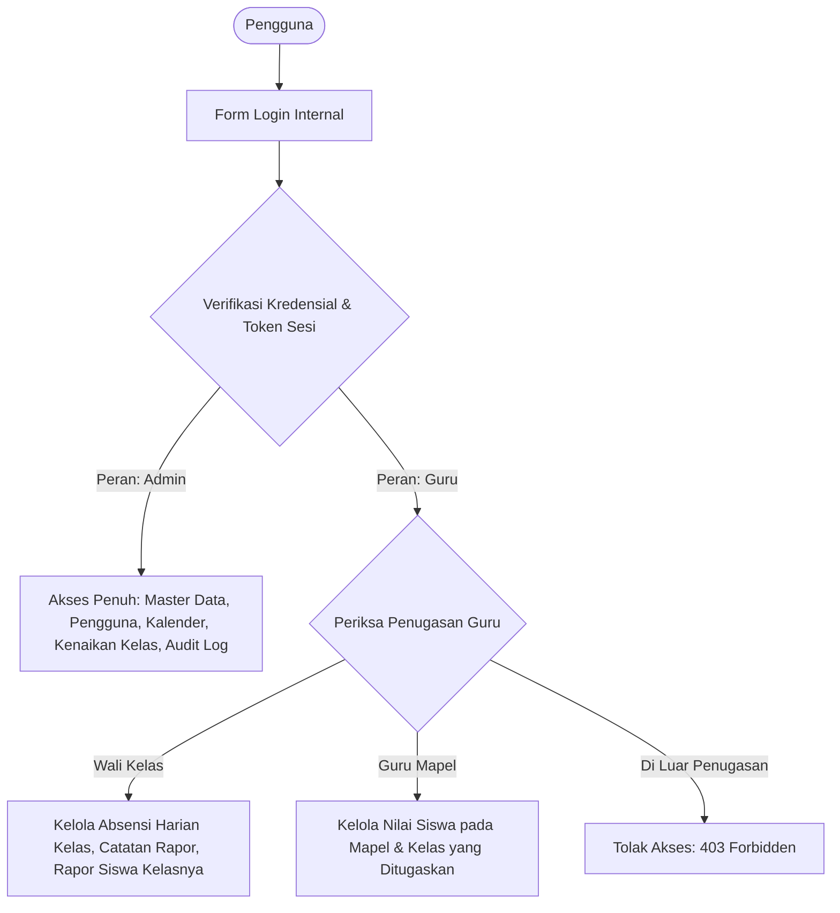
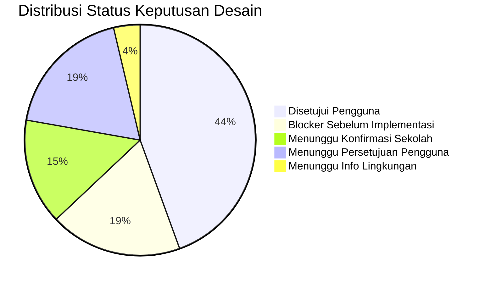

# PRODUCT REQUIREMENTS DOCUMENT (PRD)
# Sistem Absensi dan Penilaian Siswa SD

**Nama Proyek:** Sistem Absensi dan Penilaian Siswa SD  
**Platform Target:** Google Apps Script Web App (V8 Runtime)  
**Penyimpanan Data:** Google Sheets (21 Lembar Kerja Terstruktur)  
**Bahasa Antarmuka:** Bahasa Indonesia  
**Versi Dokumen:** 1.3-revised (Dokumentasi Pra-Implementasi & Audit Koreksi Keamanan Final)  
**Status:** Menunggu Peninjauan dan Persetujuan Final Pengguna  
**Target Pengguna:** Administrator Sekolah dan Guru Sekolah Dasar (SD)

---

## 1. Latar Belakang dan Tujuan

### 1.1. Latar Belakang
Pengelolaan data administrasi akademik di Sekolah Dasar (SD) mencakup pencatatan kehadiran harian, pengelolaan nilai tugas dan ujian, penilaian perkembangan karakter/sikap, hingga penyusunan buku rapor semester. Di lingkungan sekolah dasar, beban administratif sering kali membebani guru kelas dan guru mata pelajaran jika instrumen pencatatan tidak terintegrasi atau spreadsheet dikelola secara terpisah tanpa validasi terpusat.

Sistem Absensi dan Penilaian Siswa SD dirancang sebagai aplikasi web berbasis Google Apps Script (GAS) dengan Google Sheets sebagai basis data. Aplikasi ini menyediakan antarmuka web modern (*Single Page Architecture*) yang ringan, responsif, dan mudah dioperasikan oleh guru, sembari memastikan data tersimpan secara terpusat tanpa memerlukan infrastruktur server eksternal berbayar.

### 1.2. Tujuan Sistem
1. **Pemusatan Data Master:** Mengelola data identitas sekolah, tahun ajaran, semester, kalender efektif sekolah, jenjang kelas (1–6 SD), siswa, mata pelajaran, dan penugasan guru secara terpadu.
2. **Keamanan & Otorisasi Berbasis Peran:** Menerapkan autentikasi internal username/password serta pembatasan hak akses berbasis penugasan kelas dan mata pelajaran (*Role-Based Access Control / RBAC*).
3. **Akuntabilitas Kehadiran:** Menghitung persentase kehadiran siswa secara objektif dan dapat diaudit dengan membedakan *hari sekolah terjadwal*, *hari absensi lengkap*, dan *hari wajib hadir siswa* berdasarkan daftar siswa yang benar-benar aktif pada tanggal terkait.
4. **Integritas Penilaian & Perlindungan Nilai Historis:** Menerapkan pembobotan global per semester, penegakan status **`Belum Lengkap`** jika komponen wajib kosong, dan mekanisme pembekuan nilai final (*grade snapshot*) dengan lembar audit riwayat koreksi terpisah agar laporan semester lampau tidak berubah akibat penyesuaian bobot di masa depan.
5. **Evaluasi Non-Akademik:** Menyediakan pencatatan deskriptif sikap dan keterampilan (dimensi Profil Pelajar Pancasila).
6. **Pelaporan & Rapor Kurikulum Merdeka:** Menyediakan lembar pratinjau dan cetak rapor semester yang siap disimpan sebagai PDF melalui dialog cetak browser (`window.print()`).
7. **Kenaikan Kelas Massal:** Memfasilitasi alur mutasi dan kenaikan kelas massal akhir tahun ajaran yang transparan, terverifikasi, dan mempertahankan rekam jejak historis siswa.
8. **Audit Trail Komprehensif:** Mencatat operasi kritis ke lembar audit log tanpa membocorkan kredensial atau informasi sensitif.

---

## 2. Ruang Lingkup Sistem

### 2.1. Cakupan Versi Awal (MVP)
1. **Autentikasi & Manajemen Sesi:** Login username/password internal, penerbitan token sesi server, batas waktu sesi (*session timeout*), invalidasi sesi saat logout, dan mitigasi brute force.
2. **Manajemen Akun & Penugasan:** Pembuatan akun guru oleh admin, penetapan peran wali kelas dan guru mata pelajaran per rombel dan tahun ajaran.
3. **Data Master & Kalender Sekolah:** Identitas resmi sekolah (termasuk NPSN, Kepala Sekolah, NIP), tahun ajaran, semester, dan kalender hari efektif belajar/libur.
4. **Model Siswa Hybrid:** Penempatan kelas aktif pada tabel `Siswa` (`kelas_id_aktif`) dan pemeliharaan seluruh rekam jejak pada tabel `RiwayatKelas`.
5. **Absensi Harian Terverifikasi:** Pencatatan kehadiran harian (H/S/I/A), pencegahan catatan duplikat, dan pelacakan status kelengkapan absensi kelas berdasarkan daftar siswa yang aktif pada tanggal terkait.
6. **Rekap Kehadiran Bulanan & Semester:** Rekapitulasi kehadiran berbasis hari belajar riil dengan formula yang memperhitungkan tanggal mutasi dan hari efektif penempatan siswa.
7. **Penilaian Akademik & Pembobotan Global:** Pengelolaan komponen penilaian per semester dengan bobot global, validasi kelengkapan komponen wajib, kalkulasi matematis normalisasi komponen opsional, dan pembekuan nilai final ke tabel `NilaiAkhir`.
8. **Penilaian Non-Akademik:** Pengelolaan aspek sikap dan keterampilan beserta narasi capaian.
9. **Rapor Semester Kurikulum Merdeka:** Pratinjau dan cetak rapor dengan kop resmi, nilai akhir, capaian kompetensi, kehadiran, catatan wali kelas, dan status kenaikan kelas.
10. **Kenaikan Kelas Massal:** Modul terpandu dengan pratinjau kelayakan, konfirmasi admin, dan pembaharuan riwayat penempatan siswa.
11. **Pencetakan Dokumen:** Cetak berbasis browser `window.print()` dan stylesheet CSS `@media print` (*Save as PDF*).
12. **Audit Log & Proteksi Data:** Pencatatan aktivitas sensitif ke lembar `AuditLog` dan perlindungan data pribadi siswa.
13. **Setup Idempoten & Seeder Terpisah:** Inisialisasi struktur 21 lembar kerja tanpa menghapus data yang ada, disertai fungsi seeder data fiktif khusus pengujian.

### 2.2. Di Luar Cakupan MVP (Non-MVP)
- Portal mandiri untuk siswa atau orang tua.
- Presensi otomatis berbasis GPS radius, biometrik, atau kartu RFID.
- Sinkronisasi otomatis dua arah dengan server Dapodik Kemdikbudristek.
- Notifikasi otomatis WhatsApp Gateway / SMS.
- Modul transaksi keuangan dan SPP.
- Aplikasi native Android / iOS.

---

## 3. Pengguna, Peran, dan Matriks Hak Akses (RBAC)

Sistem menerapkan prinsip **Least Privilege** dan **Zero-Trust Frontend**. Setiap permintaan ke server wajib membawa token sesi yang diverifikasi hak aksesnya di backend:

### 3.1. Administrator (`admin`)
- Mengelola akun guru (buat akun, reset password, non-aktifkan akun).
- Mengelola identitas sekolah, kalender sekolah, tahun ajaran aktif, dan semester aktif.
- Mengelola master jenjang (1–6 SD), rombel, mata pelajaran, dan penugasan guru.
- Mengelola konfigurasi bobot penilaian global per semester.
- Mengeksekusi modul kenaikan kelas massal pada akhir tahun ajaran.
- Mengeksekusi koreksi resmi atas nilai final yang dibekukan dengan pencatatan riwayat revisi.
- Meninjau seluruh rekap absensi, nilai, dan lembar `AuditLog`.

### 3.2. Guru (`guru`)
- Melakukan login dan logout menggunakan kredensial mandiri.
- Mengakses dashboard yang terfilter khusus sesuai penugasan aktifnya.
- **Sebagai Wali Kelas:**
  - Mengisi dan mengoreksi absensi harian kelas binaannya.
  - Memantau rekap absensi bulanan dan hari absensi lengkap kelasnya.
  - Mengisi evaluasi sikap/non-akademik dan catatan wali kelas.
  - Menghasilkan pratinjau dan mencetak rapor semester siswa di kelasnya.
- **Sebagai Guru Mata Pelajaran:**
  - Menginput dan memperbarui nilai komponen akademik hanya pada mata pelajaran dan kelas yang ditugaskan selama nilai berstatus `draft`.
- **Batasan Ketat Guru:**
  - Dilarang membaca biodata rinci atau nilai siswa di luar kelas/mapel binaannya.
  - Dilarang mengubah data absensi atau rapor kelas lain.
  - Dilarang mengubah konfigurasi sekolah, bobot global, atau akun guru lain.
  - Dilarang merevisi nilai yang telah berstatus `final` secara mandiri.
  - Dilarang mengeksekusi kenaikan kelas massal.

---

## 4. Keamanan Autentikasi dan Batasan Deployment

### 4.1. Model Ancaman (Threat Modeling) di HTML Service
1. **Pemanggilan Endpoint Server Langsung:** Antarmuka HTML Service bukan benteng keamanan. Penyerang dapat membuka DevTools browser dan memanggil fungsi `google.script.run.namaFungsi(payload)` dengan memanipulasi parameter `siswa_id`, `kelas_id`, atau skor nilai. Validasi hak akses dan status sesi wajib dilakukan 100% di server pada setiap operasi.
2. **Keterbatasan Konvensi Underscore (`_`):** Akhiran `_` hanyalah konvensi visibilitas Apps Script untuk menyembunyikan fungsi dari pemanggilan antarmuka klien, **bukan mekanisme otorisasi**. Fungsi publik yang dapat dipanggil klien wajib memiliki pengawal otorisasi (*authorization guard*) di baris pertama eksekusinya.
3. **Pembajakan & Pemalsuan Sesi (Session Hijacking):** Token sesi yang dikirim atau disimpan secara ceroboh dapat disalahgunakan. Token sesi wajib memiliki entropi kriptografis tinggi, disimpan dalam bentuk hash di database, memiliki batas kedaluwarsa, dan diinvalidasi saat logout, perubahan password, atau penonaktifan akun.
4. **Kebocoran Kredensial di Log:** Password, hash, salt, pepper, atau token sesi dilarang keras dicatat ke `AuditLog`, `console.log`, atau `Logger.log`.
5. **Bypass Spreadsheet Langsung:** Jika Google Sheets dibagikan langsung kepada akun guru, guru dapat membuka spreadsheet secara langsung dan memotong seluruh logika validasi Web App. Spreadsheet **tidak boleh dibagikan** kepada siapa pun selain akun pemilik script / admin utama.

### 4.2. Evaluasi Autentikasi: Akun Google vs Akun Internal
- **Autentikasi Akun Google:** Menyediakan perlindungan enterprise bawaan (proteksi brute force canggih, 2FA, zero credential management di Sheets).
- **Keputusan Pengguna & Trade-off:** Pengguna telah menetapkan bahwa sistem menggunakan **akun internal (username & password)** agar setiap guru memiliki akun mandiri tanpa bergantung pada akun Google institusi.
- **Konsekuensi Teknis:** Penggunaan autentikasi internal di atas Apps Script membebankan seluruh tanggung jawab keamanan kepada aplikasi (manajemen salt, pepper, hashing, sesi, mitigasi brute force, dan penguncian konkurensi). Oleh karena itu, arsitektur ini memerlukan validasi teknis ketat sebelum implementasi dan dicatat sebagai **Blocker Teknis**.

### 4.3. Audit Kriptografi Hashing Password & Gerbang Teknis
1. **Pencabutan Klaim Tanpa Uji:** Seluruh klaim sepihak mengenai batasan putaran iterasi atau jaminan keamanan angka tertentu dicabut. Ditegaskan bahwa loop HMAC berulang bukanlah standar PBKDF2 (RFC 2898/8018).
2. **Kriteria Penerimaan Keamanan dan Performa (Gerbang Teknis Phase 2):**
   Sebelum kode login diimplementasikan, wajib dilakukan pengujian tolok ukur (*benchmarking*) empiris di Google Apps Script V8 dengan kriteria penerimaan terukur:
   - *Kriteria Performa:* Latensi komputasi verifikasi hash satu akun pada Apps Script V8 wajib berada di bawah **1.000 milidetik** (target optimal < 500 ms) agar tidak memicu gateway timeout pada HTTP Web App.
   - *Kriteria Keamanan:* Wajib menggunakan salt acak kriptografis 16-byte unik per pengguna, server pepper rahasia di `ScriptProperties`, serta faktor komputasi yang memaksimalkan beban kerja penyerang dalam batas waktu CPU yang diizinkan.
   - *Aturan Penghentian (Fallback Circuit-Breaker):* Jika pendekatan internal gagal memenuhi kriteria performa dan keamanan di runtime Apps Script V8, **implementasi form login wajib dihentikan** dan dilaporkan kepada pengguna untuk meminta keputusan alternatif (misalnya integrasi Google Sign-In).
3. **Peringatan Verifikasi Keamanan:** Dilarang menandai keamanan autentikasi sebagai sudah terbukti hanya karena dokumentasi telah direvisi. Status keamanan autentikasi tetap berstatus *Menunggu Validasi Teknis* sampai benchmarking empiris pada Phase 2 berhasil diselesaikan dan disetujui.

### 4.4. Entropi Token Sesi dan Pengelolaan Sesi
1. **Verifikasi Pembangkitan Token di Google Apps Script:**
   - Runtime Apps Script V8 **tidak menyediakan Web Crypto API (`crypto.getRandomValues()`)** pada lingkungan backend.
   - Pembangkitan token sesi di backend memanfaatkan API native resmi yang terverifikasi tersedia: **`Utilities.getUuid()`** (menghasilkan UUID v4 berbasis pseudo-random 122-bit entropy).
   - *Peringatan Klaim Keacakan:* Dilarang mengklaim `Utilities.getUuid()` ditambah metode byte acak tertentu aman sebelum API, sumber keacakan (CSPRNG), dan implementasinya diverifikasi secara empiris di runtime GAS.
   - *Koreksi Entropi:* Ditegaskan secara ilmiah bahwa **penambahan timestamp tidak meningkatkan entropi kriptografis**. Keacakan token sepenuhnya bersumber dari generator UUID v4 bawaan platform.
2. **Penyimpanan Token Hash di Server:**
   - Klien memegang token sesi dalam memori peramban (`sessionStorage`).
   - Di lembar basis data (`Sesi`), server **hanya menyimpan hash SHA-256 dari token** (`token_hash`). Jika isi spreadsheet terbaca tanpa izin, penyerang tidak dapat langsung menggunakan nilai tersebut untuk membajak sesi aktif (*Session Hijacking Protection*).
3. **Kebijakan Invalidasi Sesi:**
   - Batas waktu kedaluwarsa sesi ditetapkan (misalnya 8 jam).
   - Sesi diinvalidasi secara instan saat logout, perubahan password pengguna, penonaktifan akun, atau perubahan penugasan guru.

### 4.5. Evaluasi Konfigurasi Deployment Web App
Pilihan konfigurasi deployment Google Apps Script menentukan batas keamanan perimeter luar:

| Konfigurasi Deployment | Mekanisme Akses | Analisis Risiko Keamanan & Privasi Siswa | Status Evaluasi |
|---|---|---|---|
| **Opsi 1:** *Execute as:* Me *Who has access:* **Anyone** | URL Web App dapat diakses publik tanpa login akun Google. Form login internal menjadi satu-satunya gerbang. | **RISIKO TINGGI (BLOCKER KEAMANAN):** Data siswa SD dilindungi UU PDP No. 27/2022. Membuka URL ke publik mengekspos aplikasi terhadap serangan brute force bot internet, pemindaian celah keamanan, dan potensi kehabisan kuota eksekusi Google Apps Script (DDoS). `Session.getActiveUser().getEmail()` bernilai string kosong. | Memerlukan persetujuan risiko formal tertulis jika sekolah tidak memiliki opsi deployment terbatas. |
| **Opsi 2:** *Execute as:* Me *Who has access:* **Anyone with Google Account** | Pengguna harus login akun Google apa pun untuk membuka URL, lalu login form internal. | **MENENGAH:** Menyaring bot publik anonim dan serangan denial-of-service kuota, namun siapa saja yang memiliki akun Gmail pribadi masih bisa melihat halaman login internal. | Opsi kompromi yang layak jika sekolah belum memiliki Google Workspace. |
| **Opsi 3:** *Execute as:* Me *Who has access:* **Anyone within [Domain Sekolah]** | Hanya akun Google Workspace for Education milik sekolah yang dapat mengakses URL Web App, kemudian diautentikasi lewat akun internal. | **PALING AMAN:** Perimeter keamanan ganda (*Defense in Depth*). Akses publik tertutup total dari internet luar. URL terlindungi oleh infrastruktur IAM Google institusi sekolah. | Rekomendasi teknis jika domain sekolah tersedia; sistem tidak boleh berasumsi sekolah otomatis memilikinya. |

---

## 5. Kebutuhan Fungsional Rinci

### FR-01 — Manajemen Kalender Sekolah dan Hari Efektif
1. Admin mengelola kalender akademik sekolah pada sheet `KalenderSekolah` untuk setiap semester.
2. Setiap tanggal dalam rentang semester memiliki status:
   - `efektif`: Hari belajar reguler terjadwal di mana KBM berlangsung.
   - `libur_resmi`: Hari libur nasional atau cuti bersama.
   - `libur_khusus`: Hari libur khusus sekolah (kegiatan jeda tengah semester, rapat dinas).
3. Kalender sekolah menjadi rujukan dasar untuk menentukan **Hari Sekolah Terjadwal** dalam perhitungan kehadiran.

### FR-02 — Presensi Harian Siswa dan Status Kelengkapan Rombel
1. Wali kelas mencatat kehadiran siswa pada hari sekolah efektif.
2. Empat status kehadiran yang sah: **Hadir (H)**, **Sakit (S)**, **Izin (I)**, dan **Alpa (A)**.
3. **Pencegahan Catatan Duplikat:** Satu siswa hanya dapat memiliki satu rekaman kehadiran per tanggal kalender. Penginputan ulang pada tanggal yang sama diperlakukan sebagai koreksi pembaruan (*upsert*).
4. **Kaidah Historis Penempatan Siswa pada Tanggal Kejadian:**
   - **Kaidah Mutlak:** Kelengkapan absensi pada tanggal $t$ dihitung berdasarkan daftar siswa yang **benar-benar aktif dan terdaftar di rombel tersebut pada tanggal $t$** dengan memeriksa interval penempatan pada sheet `RiwayatKelas` ($\text{tanggal\_mulai} \le t \le \text{tanggal\_selesai}$).
   - Sistem **dilarang keras menggunakan data siswa saat ini (`Siswa.kelas_id_aktif`)** untuk mengevaluasi kelengkapan tanggal lampau, agar mutasi siswa di kemudian hari tidak merusak kelengkapan absensi historis.
5. **Dokumentasi Perilaku 4 Skenario Dinamika Siswa:**
   - **Skenario 1 (Siswa Masuk / Keluar di Tengah Semester):**
     Siswa yang baru masuk pada tanggal $t_{\text{masuk}}$ hanya memiliki kewajiban hadir pada tanggal $t \ge t_{\text{masuk}}$. Hari-hari sebelum tanggal masuk tidak dihitung dalam hari wajib hadir ($W_{\text{siswa}}$). Sebaliknya, siswa yang keluar/mutasi pada tanggal $t_{\text{keluar}}$ hanya dihitung hingga tanggal $t \le t_{\text{keluar}}$.
   - **Skenario 2 (Siswa Pindah Kelas Antar-Rombel):**
     Jika siswa pindah dari Kelas 1A ke 1B pada tanggal $t_{\text{pindah}}$, rekam jejak di 1A ditutup per $t_{\text{pindah}} - 1$ dan rekam jejak di 1B dibuka per $t_{\text{pindah}}$. Seluruh catatan kehadiran sebelum $t_{\text{pindah}}$ tetap utuh milik rombel 1A dan tidak berpindah ke 1B.
   - **Skenario 3 (Koreksi Absensi yang Sudah Diverifikasi):**
     Jika catatan absensi tanggal lampau yang sudah berstatus lengkap memerlukan perbaikan (misal siswa awalnya tercatat Alpa ternyata membawa surat dokter menjadi Sakit), wali kelas/admin dapat memperbarui status. Backend mengeksekusi *upsert* pada tabel `Absensi`, mengevaluasi ulang status kelengkapan kelas pada tanggal kejadian, memperbarui timestamp `updated_at`, dan mencatat koreksi ke lembar `AuditLog`.
   - **Skenario 4 (Daftar Siswa Tanggal Lampau Berbeda dari Siswa Saat Ini):**
     Daftar siswa saat mengevaluasi atau mencetak rekap tanggal lampau diambil strictly dari kueri interval penempatan `RiwayatKelas` pada tanggal tersebut. Penambahan siswa baru di masa sekarang tidak akan mengubah penyebut hari sekolah maupun persentase kehadiran rombel pada bulan-bulan lampau.
6. **Penanganan Absensi Belum Lengkap:**
   - Suatu tanggal dinyatakan sebagai **Hari Absensi Lengkap** jika seluruh siswa yang aktif pada tanggal tersebut telah terisi status kehadirannya (H/S/I/A).
   - Tanggal terjadwal yang belum diisi absensinya ditandai sebagai `belum_diinput`.
   - **Larangan Keras:** Tanggal atau catatan yang `belum_diinput` **dilarang keras dimasukkan sebagai hadir maupun alpa**, dan **dilarang dimasukkan ke dalam pembagi hari wajib hadir ($W_{\text{siswa, lengkap}}$)**.

### FR-03 — Perhitungan Rekap Kehadiran Objektif
Sistem menerapkan tiga konsep dasar kehadiran:
1. **Hari Sekolah Terjadwal ($K$):** Total hari berstatus `efektif` menurut kalender sekolah pada periode yang dipilih.
2. **Hari Absensi Lengkap ($L_{\text{kelas}}$):** Jumlah hari terjadwal di mana wali kelas telah menginput dan memverifikasi absensi seluruh siswa aktif rombel pada tanggal tersebut ($L_{\text{kelas}} \le K$).
3. **Hari Wajib Hadir Siswa ($W_{\text{siswa, lengkap}}$):** Jumlah hari absensi lengkap yang berada di dalam rentang masa penempatan aktif siswa di rombel tersebut berdasarkan `RiwayatKelas`.

#### Formula Persentase Kehadiran:
$$\text{Persentase Kehadiran} = \begin{cases} 
\frac{H_i}{W_{\text{siswa, lengkap}}} \times 100\%, & \text{jika } W_{\text{siswa, lengkap}} > 0 \\ 
\text{"N/A"}, & \text{jika } W_{\text{siswa, lengkap}} = 0 
\end{cases}$$

Di mana:
- $H_i$: Jumlah hari siswa $i$ tercatat Hadir pada hari-hari absensi lengkap.
- $S_i, I_i, A_i$: Akumulasi hari Sakit, Izin, dan Alpa ($H_i + S_i + I_i + A_i = W_{\text{siswa, lengkap}}$).
- **Penanganan Penyebut Nol:** Jika $W_{\text{siswa, lengkap}} = 0$, persentase menampilkan tanda strip atau **`N/A`** untuk mencegah error pembagian dengan nol (*division by zero*).
- **Penyajian Laporan Audit:** Laporan rekap kehadiran wajib menampilkan metrik audit transparan:
  - Jumlah Hari Sekolah Terjadwal ($K$).
  - Jumlah Hari Absensi Lengkap ($L_{\text{kelas}}$).
  - Jumlah Hari Belum Lengkap ($K - L_{\text{kelas}}$).
  - Rincian akumulasi mutlak $H, S, I, A$.
  - Jika $L_{\text{kelas}} < K$, laporan memberikan penanda peringatan bahwa data kehadiran semester belum lengkap diinput oleh guru.

### FR-04 — Penilaian Akademik, Formula Bobot Global, dan Normalisasi Komponen
1. Admin menetapkan struktur komponen penilaian yang berlaku global untuk seluruh mata pelajaran pada semester aktif (sheet `KomponenPenilaian`).
2. Setiap komponen memiliki atribut: `nama_komponen`, `bobot` (persentase), dan `is_wajib` (boolean).
3. **Validasi Bobot Konfigurasi 100%:** Total bobot seluruh komponen aktif dalam konfigurasi semester wajib sama dengan 100% ($\sum_{c \in C} w_c = 100\%$). Jika tidak 100%, sistem menolak konfigurasi admin.
4. **Pembedaan Nilai Kosong vs Nol:**
   - Nilai `0` adalah capaian skor nol yang sah (siswa mengikuti ujian/tugas tetapi memperoleh skor nol). Nilai nol tetap masuk dalam pembilang ($0 \times w_c = 0$) dan bobotnya tetap masuk dalam penyebut ($w_c$).
   - Nilai kosong (`null` atau string kosong) adalah kondisi di mana siswa belum dinilai / tidak mengikuti evaluasi.
5. **Kalkulasi Matematis dan Normalisasi Komponen Opsional:**
   Misalkan himpunan seluruh komponen aktif semester adalah $C$ dengan bobot $w_c$. Untuk siswa $s$ pada mata pelajaran $m$:
   - **Pemeriksaan Komponen Wajib:**
     Jika terdapat komponen $c \in C$ di mana $is\_wajib(c) = \text{true}$ dan nilainya kosong ($V_s(c) = \text{null}$), maka sistem **dilarang menghasilkan angka nilai akhir prematur**. Status nilai ditetapkan sebagai **`Belum Lengkap`** (ditampilkan tanda strip `-` dengan lencana peringatan).
   - **Kalkulasi Komponen Lengkap:**
     Jika seluruh komponen wajib memiliki nilai, definisikan himpunan komponen yang dinilai:
     $$C_{\text{dinilai}} = \{c \in C \mid V_s(c) \neq \text{null}\}$$
     Komponen opsional yang kosong ($V_s(c) = \text{null}$ dengan $is\_wajib(c) = \text{false}$) **tidak dimasukkan ke dalam $C_{\text{dinilai}}$**.
     Formula nilai akhir:
     $$\text{Nilai Akhir} = \frac{\sum_{c \in C_{\text{dinilai}}} (V_s(c) \times w_c)}{\sum_{c \in C_{\text{dinilai}}} w_c}$$
     *Rasionalisasi Matematis:* Membagi dengan $\sum_{c \in C_{\text{dinilai}}} w_c$ secara matematis menormalkan kembali nilai ke skala 0–100 secara adil tanpa merugikan siswa yang tidak mengikuti kegiatan pengayaan opsional.

### FR-05 — Perlindungan Nilai Historis dan Rekam Jejak Koreksi Nilai Final
1. **Siklus Hidup Nilai (*Grade Lifecycle*):**
   - `draft`: Nilai sedang diinput guru mapel, kalkulasi bersifat dinamis.
   - `belum_lengkap`: Ada komponen wajib yang belum terisi nilai.
   - `siap_ditetapkan`: Seluruh komponen wajib lengkap dan siap dikonfirmasi.
   - `final`: Nilai telah diverifikasi dan dibekukan pada akhir semester (*frozen snapshot*).
2. **Evaluasi Desain Rekam Jejak Nilai Final: Perbandingan Pilihan:**
   - **Kelemahan Kolom Tunggal `nilai_sebelumnya`:** Satu kolom `nilai_sebelumnya` pada tabel nilai final **tidak cukup secara teknis**. Jika nilai dikoreksi lebih dari satu kali (misal: 70 $\to$ 75 $\to$ 80), kolom tunggal akan menimpa nilai 70 dengan 75, sehingga rekam jejak nilai awal hilang dan rantai audit terputus.
   - **Pilihan 1 (Append-Only Versioned Records dalam 1 Sheet):**
     Setiap versi nilai final disimpan sebagai baris baru dalam tabel yang sama dengan nomor versi (`versi: 1, 2, 3...`).
     *Kelemahan:* Kueri rapor harian harus memfilter baris aktif (`is_current = true` atau `max(versi)`) dari ribuan baris campuran. Pada Google Apps Script, pembacaan seluruh tabel dan pemfilteran versi di memori memperlambat waktu respon secara signifikan.
   - **Pilihan 2 (Snapshot `NilaiAkhir` + Sheet Terpisah `RiwayatKoreksiNilai`) — REKOMENDASI UTAMA:**
     - Sheet `NilaiAkhir` hanya menyimpan snapshot nilai aktif terkini (tepat 1 baris per siswa per mapel per semester). Kueri pencetakan rapor harian berupa pencarian langsung (*direct lookup* $O(1)$ di memori) tanpa perlu memfilter riwayat versi.
     - Sheet `RiwayatKoreksiNilai` mencatat seluruh riwayat audit setiap kali terjadi koreksi pasca-final secara permanen (`koreksi_id`, `nilai_akhir_id`, `semester_id`, `siswa_id`, `mapel_id`, `versi_koreksi`, `nilai_sebelumnya`, `nilai_baru`, `alasan_revisi`, `revised_by`, `revised_at`).
     - Desain ini menjamin rekonstruksi 100% seluruh riwayat koreksi berkali-kali tanpa batas, sekaligus menjaga performa baca rapor tetap maksimal.
3. **Pencegahan Pengeditan Final Tanpa Otorisasi (*Role Guard*):**
   - Nilai berstatus `final` terkunci mutlak dari antarmuka dan backend guru mata pelajaran.
   - Koreksi nilai final hanya dapat dieksekusi oleh **Administrator**.
   - Setiap koreksi wajib menyertakan alasan administratif tertulis (`alasan_revisi`).
   - Sistem memperbarui nilai di `NilaiAkhir`, menaikkan nomor `versi_koreksi`, mencatat `last_revised_by` dan `last_revised_at`, menambahkan baris jejak audit baru di `RiwayatKoreksiNilai`, dan mencatat transaksi ke `AuditLog`.
4. **Penyajian Laporan Historis:**
   Seluruh pencetakan rapor dan buku nilai historis **hanya membaca data dari sheet `NilaiAkhir`**, bukan menghitung ulang dari tabel nilai mentah dengan bobot terkini.
5. **Dampak Penambahan Sheet pada Seluruh Dokumen:**
   Penambahan sheet `RiwayatKoreksiNilai` (bersama `KalenderSekolah` dan `NilaiAkhir`) memperluas skema basis data dari 19 menjadi **21 lembar kerja**. Perubahan ini telah diselaraskan pada PRD, Arsitektur, Skema Database, Instruksi Agent, dan Roadmap Tasks tanpa menambah kompleksitas modul guru.

### FR-06 — Penilaian Non-Akademik (Sikap dan Karakter)
1. Guru (Wali Kelas) mengevaluasi aspek sikap/karakter dan keterampilan siswa (Dimensi Profil Pelajar Pancasila).
2. Capaian dinyatakan dalam predikat kualitatif (*Sangat Berkembang (SB)*, *Berkembang Sesuai Harapan (BSH)*, *Mulai Berkembang (MB)*, *Belum Berkembang (BB)*) disertai deskripsi naratif perkembangan pribadi siswa.
3. Aspek yang belum dinilai tidak boleh diberi predikat otomatis.

### FR-07 — Rapor Semester Kurikulum Merdeka
1. Menyajikan pratinjau buku laporan hasil belajar per siswa untuk semester aktif.
2. Struktur baku rapor:
   - Identitas Sekolah Lengkap (Nama Sekolah, NPSN, Alamat).
   - Identitas Siswa (Nama, NIS, NISN, Kelas/Fase, Semester, Tahun Ajaran).
   - Tabel Capaian Hasil Belajar: No, Mata Pelajaran, Nilai Akhir (Angka), Deskripsi Capaian Kompetensi Pembelajaran.
   - Tabel Perkembangan Karakter dan Sikap (Non-Akademik).
   - Rekapitulasi Kehadiran (Sakit: ... hari, Izin: ... hari, Alpa: ... hari).
   - Catatan Perkembangan Wali Kelas.
   - Keputusan Kenaikan Kelas (khusus semester genap: *"Naik ke kelas ..."* / *"Tinggal di kelas ..."*).
   - Titimangsa dan Kolom Tanda Tangan: Orang Tua/Wali, Wali Kelas (beserta NIP), dan Kepala Sekolah (beserta NIP).
3. **Pernyataan Yuridis:** Rapor yang dihasilkan adalah format internal sekolah berorientasi Kurikulum Merdeka. Format ini wajib diverifikasi kesesuaiannya dengan petunjuk teknis dinas pendidikan setempat sebelum dijadikan dokumen resmi kedinasan.

### FR-08 — Kenaikan Kelas Massal Terpandu
1. Dikelola khusus oleh Administrator pada akhir tahun ajaran (semester genap).
2. **Alur 3 Langkah:**
   - *Langkah 1 (Seleksi):* Memilih rombel asal dan rombel tujuan (atau status Lulus untuk kelas 6).
   - *Langkah 2 (Pratinjau & Pengecualian):* Menampilkan seluruh siswa di rombel asal. Admin dapat menandai siswa tertentu yang tinggal kelas atau mutasi keluar.
   - *Langkah 3 (Konfirmasi):* Menampilkan ringkasan mutasi dan meminta konfirmasi final.
3. **Eksekusi Backend Batch:** Menutup baris `RiwayatKelas` lama (`tanggal_selesai` diisi, status `selesai`), menerbitkan baris baru pada `RiwayatKelas` untuk tahun ajaran baru, dan memperbarui pointer `Siswa.kelas_id_aktif`. Seluruh mutasi dicatat pada `AuditLog`.

### FR-09 — Cetak Browser dan Simpan PDF
1. Modul Rapor, Rekap Absensi, dan Daftar Nilai menyediakan tombol cetak yang memanggil `window.print()`.
2. Antarmuka cetak diatur sepenuhnya oleh CSS `@media print`:
   - Menyembunyikan seluruh sidebar navigasi, header sistem, tombol aksi, dan pagination.
   - Mengatur margin kertas proporsional (format A4/F4) dan memisahkan halaman rapor antarsiswa secara otomatis (*page-break-after: always*).
   - Pengguna dapat memilih *"Save as PDF"* pada dialog cetak sistem operasi tanpa membebani kuota backend Google Apps Script.

### FR-10 — Audit Log Operasional Penting
1. Backend mencatat secara otomatis seluruh aksi penting ke sheet `AuditLog`.
2. Operasi yang dicatat mencakup: percobaan login, manipulasi akun pengguna, penetapan bobot global, pembekuan nilai final, koreksi nilai final, kenaikan kelas massal, dan koreksi absensi massal.
3. Informasi log: timestamp ISO, ID pengguna, peran, nama aksi, entitas terdampak, ID entitas, status (`success`/`failure`), dan deskripsi ringkas.
4. Log dilarang memuat password, hash, salt, pepper, token, atau informasi pribadi sensitif secara berlebihan.

---

## 6. Struktur Google Sheets (21 Lembar Kerja)

Skema basis data menggunakan 21 lembar kerja terstruktur:

| No | Nama Sheet | Kategori | Fungsi Utama | Kunci Utama (PK) |
|---|---|---|---|---|
| 1 | `Pengaturan` | Konfigurasi | Identitas sekolah dan parameter aktif global | `key` |
| 2 | `Pengguna` | Keamanan | Akun guru dan administrator, password hash, salt | `pengguna_id` |
| 3 | `Sesi` | Keamanan | Token sesi aktif (token hash, waktu kedaluwarsa) | `sesi_id` |
| 4 | `TahunAjaran` | Master Akademik | Master periode tahun ajaran | `tahun_ajaran_id` |
| 5 | `Semester` | Master Akademik | Master semester (ganjil/genap) | `semester_id` |
| 6 | `KalenderSekolah` | Master Akademik | Jadwal hari sekolah efektif dan hari libur | `kalender_id` |
| 7 | `Kelas` | Master Akademik | Master tingkat 1–6 dan rombel | `kelas_id` |
| 8 | `Siswa` | Master Data | Data induk siswa dan pointer kelas aktif | `siswa_id` |
| 9 | `RiwayatKelas` | Historis | Rekam jejak mutasi dan penempatan kelas siswa | `riwayat_kelas_id` |
| 10 | `MataPelajaran` | Master Akademik | Daftar mata pelajaran | `mapel_id` |
| 11 | `PenugasanGuru` | Otorisasi | Hak akses wali kelas dan guru mata pelajaran | `penugasan_id` |
| 12 | `KelasMataPelajaran` | Kurikulum | Pemetaan mata pelajaran per kelas per tahun ajaran | `kelas_mapel_id` |
| 13 | `Absensi` | Transaksional | Catatan kehadiran harian siswa (H/S/I/A) | `absensi_id` |
| 14 | `KomponenPenilaian` | Konfigurasi Nilai | Definisi komponen bobot global per semester | `komponen_id` |
| 15 | `Nilai` | Transaksional | Skor mentah siswa per komponen dan mata pelajaran | `nilai_id` |
| 16 | `NilaiAkhir` | Transaksional | Snapshot nilai akhir yang dibekukan untuk rapor | `nilai_akhir_id` |
| 17 | `RiwayatKoreksiNilai`| Historis / Audit | Jejak audit multi-revisi nilai final pasca-pembekuan | `koreksi_id` |
| 18 | `AspekNonAkademik` | Konfigurasi Nilai | Master aspek penilaian sikap/karakter | `aspek_id` |
| 19 | `PenilaianNonAkademik`| Transaksional | Catatan predikat dan deskripsi sikap siswa | `nonakademik_id` |
| 20 | `CatatanSemester` | Pelaporan | Catatan wali kelas dan status kenaikan kelas | `catatan_id` |
| 21 | `AuditLog` | Keamanan | Rekam jejak audit operasional dan modifikasi data | `audit_id` |

*Detail spesifikasi field dan relasi didefinisikan secara lengkap pada `.database.md`.*

---

## 7. Matriks Status Keputusan dan Pertanyaan Terbuka

Matriks berikut mengklasifikasikan status seluruh keputusan sistem ke dalam 5 kategori yang tegas:

| ID | Topik Keputusan / Pertanyaan | Usulan Rekomendasi Teknis | Alasan / Rasional | Dampak Jika Belum Diputuskan | Status Klasifikasi | Pihak Pengonfirmasi |
|---|---|---|---|---|---|---|
| **D-01** | **Model Autentikasi Pengguna** | Username dan password internal per guru/admin. | Memungkinkan guru tanpa akun Google institusi untuk mengakses sistem sesuai ketetapan pengguna. | Menentukan arsitektur tabel `Pengguna` dan form login. | **DISETUJUI PENGGUNA** | Pengguna |
| **D-02** | **Pembatasan Hak Akses Guru** | Guru dibatasi pada kelas/mapel yang ditugaskan; admin akses penuh. | Menerapkan prinsip Least Privilege dan perlindungan data pribadi siswa. | Menentukan aturan RBAC di backend server. | **DISETUJUI PENGGUNA** | Pengguna |
| **D-03** | **Kenaikan Kelas Massal** | Alur 3 langkah terpandu (seleksi, pratinjau/pengecualian, konfirmasi admin). | Mempermudah mutasi akhir tahun ajaran dengan transparansi penuh dewan guru. | Menentukan modul kenaikan kelas di `code.gs`. | **DISETUJUI PENGGUNA** | Pengguna |
| **D-04** | **Ruang Lingkup Bobot Global** | Bobot penilaian berlaku global untuk semua mapel dalam satu semester aktif. | Menstandarkan proporsi penilaian formatif dan sumatif tingkat sekolah. | Menentukan tabel `KomponenPenilaian`. | **DISETUJUI PENGGUNA** | Pengguna |
| **D-05** | **Komponen Wajib Kosong** | Menghasilkan status `Belum Lengkap` (nilai akhir `null` / `-`). | Mencegah terbitnya angka nilai prematur sebelum evaluasi wajib tuntas. | Menentukan formula kalkulator nilai. | **DISETUJUI PENGGUNA** | Pengguna |
| **D-06** | **Format Rapor Semester** | Format Kurikulum Merdeka sederhana (nilai akhir, capaian, absensi, catatan). | Sesuai pedoman pembelajaran dan asesmen Kemdikbudristek. | Menentukan template tampilan dan cetak rapor. | **DISETUJUI PENGGUNA** | Pengguna |
| **D-07** | **Metode Cetak dan Ekspor Dokumen** | Browser print `window.print()` dan CSS `@media print` (*Save as PDF*). | Menghindari beban kuota Google Drive API dan dependensi library eksternal. | Menentukan arsitektur cetak di `index.html`. | **DISETUJUI PENGGUNA** | Pengguna |
| **D-08** | **Format Identitas Siswa** | NISN berupa string teks opsional unik; NIS lokal terpisah. | Standar administrasi sekolah di Indonesia. | Menentukan skema tabel `Siswa`. | **DISETUJUI PENGGUNA** | Pengguna |
| **D-09** | **Seeder Data Pengujian** | Data fiktif terisolasi, terpisah dari produksi, tidak menimpa data riil. | Keamanan data operasional sekolah saat pengujian. | Menentukan fungsi `seedSampleData_()`. | **DISETUJUI PENGGUNA** | Pengguna |
| **D-10** | **Audit Log Sistem** | Mencatat operasi penting tanpa password, token, atau secret. | Kepatuhan audit keamanan dan akuntabilitas data. | Menentukan tabel `AuditLog`. | **DISETUJUI PENGGUNA** | Pengguna |
| **D-11** | **Model Siswa Hybrid** | `Siswa.kelas_id_aktif` menyimpan pointer rombel; `RiwayatKelas` menyimpan rekam jejak. | Efisiensi query harian tanpa kehilangan riwayat mutasi. | Menentukan skema relasi data siswa. | **DISETUJUI PENGGUNA** | Pengguna |
| **D-12** | **Struktur Berkas Aplikasi** | Tiga berkas utama: `index.html`, `code.gs`, dan `setup.gs`. | Kemudahan proses penyalinan manual ke Apps Script Editor. | Menentukan struktur proyek lokal. | **DISETUJUI PENGGUNA** | Pengguna |
|---|---|---|---|---|---|---|
| **Q-01** | Algoritma & Parameter Hashing Password | Benchmarking empiris PBKDF2 vs repeated HMAC-SHA256 di Apps Script V8 (kriteria: < 1000 ms, 16-byte salt, server pepper). | Standar keamanan kredensial; komputasi Apps Script V8 terbatas. Hashing password tetap menunggu validasi teknis; belum ada algoritma final yang disetujui. | **BLOCKER SEBELUM IMPLEMENTASI & MENUNGGU VALIDASI TEKNIS** | Menunggu Validasi Teknis / Blocker | Tim Teknis & Pengguna |
| **Q-02** | Konfigurasi Akses Deployment Web App | Rekomendasi: "Domain Sekolah" jika ada Workspace; Opsi: "Anyone with Google Account". Hindari "Anyone" publik. | UU PDP No. 27/2022. Deployment tetap kondisional sampai ketersediaan Google Workspace sekolah diketahui. | **BLOCKER SEBELUM IMPLEMENTASI & MENUNGGU INFO LINGKUNGAN SEKOLAH** | Menunggu Info Lingkungan / Blocker | Pengguna & Pihak Sekolah |
| **Q-03** | Jumlah admin & akun admin awal | Mendukung banyak admin pada tabel `Pengguna`, diawali 1 admin default saat setup yang wajib ganti password. | Memastikan sekolah memiliki cadangan pengelola jika admin utama berhalangan. | Menentukan alur inisialisasi pada `setup.gs`. | Menunggu Persetujuan Pengguna | Pengguna |
| **Q-04** | Peran ganda admin sebagai guru | Diizinkan; admin dapat memiliki baris di `PenugasanGuru` sebagai wali kelas atau guru mapel. | Banyak staf sekolah dasar merangkap sebagai tenaga pengajar. | Menentukan fleksibilitas pengecekan hak akses di backend. | Menunggu Persetujuan Pengguna | Pengguna |
| **Q-05** | Penugasan guru ke banyak rombel | Diizinkan; tabel `PenugasanGuru` mendukung banyak baris penugasan per guru. | Guru mata pelajaran mengajar di banyak rombel sekaligus. | Mempengaruhi kueri filter data guru. | Menunggu Persetujuan Pengguna | Pengguna |
| **Q-06** | Batas akses data siswa oleh guru | Guru mapel hanya melihat biodata dan nilai siswa pada kelas/mapel binaannya. | Memenuhi prinsip privasi data siswa (Least Privilege). | Mempengaruhi logika filter data pada Data Access Layer. | Menunggu Persetujuan Pengguna | Pengguna |
| **Q-07** | Perlindungan nilai historis & multi-revisi | Menambahkan sheet snapshot `NilaiAkhir` dan sheet audit `RiwayatKoreksiNilai`. `NilaiAkhir` disetujui sebagai arah desain hanya jika pengguna menyetujuinya; belum disetujui secara final. | Satu kolom `nilai_sebelumnya` tidak cukup untuk riwayat berkali-kali koreksi; Pilihan 2 menjamin rekonstruksi 100% dan lookup rapor $O(1)$. | **BLOCKER SEBELUM IMPLEMENTASI & MENUNGGU PERSETUJUAN PENGGUNA** | Menunggu Persetujuan Pengguna / Blocker | Pengguna & Pihak Sekolah |
| **Q-08** | Penanganan komponen opsional kosong | Dikeluarkan dari penyebut formula ($\sum w_c$) untuk menormalkan skor ke skala 0–100 secara adil. | Menjamin siswa tidak dirugikan atas kegiatan opsional yang tidak diikutinya. | Menentukan formula kalkulasi nilai di `code.gs`. | Menunggu Persetujuan Pengguna | Pengguna / Kebijakan Sekolah |
| **Q-09** | Skala nilai, pembulatan, narasi capaian | Skala 0–100, pembulatan bilangan bulat/1 desimal, narasi capaian pembelajaran fleksibel. | Fleksibel terhadap asesmen Kurikulum Merdeka yang menekankan narasi kompetensi. | Menentukan format output laporan dan tipe data nilai. | Menunggu Konfirmasi Kebijakan Sekolah | Kebijakan Sekolah |
| **Q-10** | Penempatan penilaian non-akademik di rapor | Disatukan pada lembar rapor utama di bawah tabel nilai akademik (tabel dimensi P5). | Menghemat lembar cetak dan memberikan gambaran holistik hasil belajar siswa. | Menentukan rancangan layout HTML/CSS cetak rapor. | Menunggu Konfirmasi Kebijakan Sekolah | Kebijakan Sekolah |
| **Q-11** | Kalender sekolah & formula absensi dinamis | Menambahkan sheet `KalenderSekolah` dan menghitung kehadiran $H / W_{\text{siswa, lengkap}}$ berbasis daftar siswa aktif per tanggal. `KalenderSekolah` disetujui sebagai arah desain hanya jika pengguna menyetujuinya. | Menjamin akuntabilitas kehadiran siswa mutasi dan melacak hari yang belum diabsen tanpa merusak data historis. | **BLOCKER SEBELUM IMPLEMENTASI & MENUNGGU PERSETUJUAN PENGGUNA** | Menunggu Persetujuan Pengguna / Blocker | Pengguna / Kebijakan Sekolah |
| **Q-12** | Aturan kenaikan dan tinggal kelas | Ditentukan manual oleh dewan guru pada pratinjau kenaikan kelas tanpa otomatisasi sistem. | Kenaikan kelas mempertimbangkan aspek perkembangan anak secara holistik. | Menentukan logika pada modul kenaikan kelas massal. | Menunggu Konfirmasi Kebijakan Sekolah | Kebijakan Sekolah |
| **Q-13** | Kebijakan retensi data dan log | Riwayat siswa disimpan permanen; `AuditLog` diarsipkan jika melampaui 10.000 baris. | Menjaga performa spreadsheet agar tidak melampaui batas memori. | Menentukan prosedur pemeliharaan sistem berkala. | Menunggu Persetujuan Pengguna | Pengguna & Tim Teknis |
| **Q-14** | Kesesuaian format rapor dengan regulasi dinas | Format rapor tetap berstatus draft internal sekolah sampai diverifikasi kesesuaiannya dengan juknis dinas pendidikan oleh sekolah. | Mencegah penolakan administratif dinas saat akreditasi atau mutasi siswa. | **BLOCKER SEBELUM IMPLEMENTASI & MENUNGGU KONFIRMASI KEBIJAKAN SEKOLAH** | Menunggu Konfirmasi Kebijakan Sekolah / Blocker | Kebijakan Sekolah |
| **Q-15** | Kewajiban data NPSN dan NIP guru | NPSN dianjurkan diisi; NIP opsional (jika kosong dicetak tanda strip `-`). | Mengakomodasi guru dan tenaga kependidikan non-PNS. | Menentukan aturan validasi form master data dan cetak rapor. | Menunggu Persetujuan Pengguna | Pengguna |

---

## 8. Definisi Selesai (Definition of Done) & Gerbang Persetujuan

Pengembangan tahap dokumentasi dinyatakan selesai apabila:
1. Kelima dokumen di folder `.docs/` (`.prd.md`, `.architecture.md`, `.database.md`, `.gemini.md`, `.tasks.md`) telah disinkronkan secara menyeluruh tanpa kontradiksi.
2. Seluruh isu ancaman keamanan, evaluasi deployment, formula nilai berbobot, perlindungan nilai historis, dan formula absensi berbasis kalender telah terdokumentasi secara lugas.
3. Tidak ada berkas di luar folder `.docs/` yang dibuat atau diubah.
4. **GERBANG MUTLAK:** Tidak ada pengerjaan implementasi kode aplikasi sebelum pengguna menyetujui dokumen ini dan memberikan konfirmasi tertulis atas poin-poin pertanyaan terbuka berstatus *Blocker*.