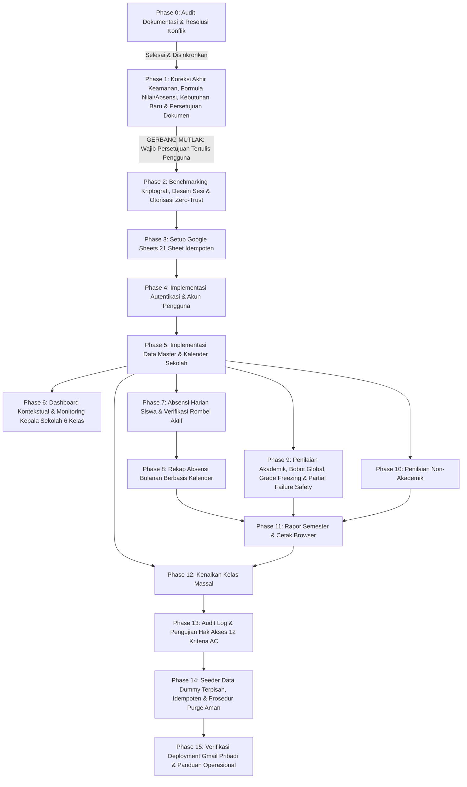

# IMPLEMENTATION TASKS & ROADMAP
# Sistem Absensi dan Penilaian Siswa SD

**Nama Proyek:** Sistem Absensi dan Penilaian Siswa SD
**Platform Target:** Google Apps Script Web App (V8 Runtime)
**Penyimpanan Data:** Google Sheets (21 Lembar Kerja Terstruktur)
**Versi Dokumen:** 1.0-baseline (Dokumentasi Spesifikasi Resmi Pra-Implementasi)
**Tanggal Penetapan Baseline:** 16 Oktober 2026
**Status Proyek:** **Phase 1 Selesai / Baseline Disahkan Bersyarat (Phase 2–15 Terkunci & Menunggu Persetujuan Implementasi)**
**Riwayat Versi Dokumen:**
- v1.0–v1.3: Roadmap 14 fase awal dan kriteria penerimaan.
- v1.4-revised: Penambahan Phase 0 & restrukturisasi menjadi 16 fase terkoordinasi (21 sheet, monitoring 6 kelas, mitigasi UU PDP, 12 AC test).
- v1.5-final-correction: Penegasan gerbang teknis Phase 2, evaluasi deployment 4 lapisan Phase 15, audit dummy Phase 14, dan penegasan status terkunci.
- v1.0-baseline: Penetapan baseline resmi pra-implementasi dengan pengesahan bersyarat Phase 1, penetapan aturan purge verifikasi pra-penghapusan data induk, dan penguncian mutlak Phase 2–15.
**AI Agent:** Senior System Analyst & Software Architect melalui Antigravity

---

## 1. Aturan Pelaksanaan dan Gerbang Persetujuan (Gatekeeper)

> [!IMPORTANT]
> **GERBANG EKSPLISIT IMPLEMENTASI (STATUS: TERKUNCI):**
> Pekerjaan saat ini adalah **koreksi dokumentasi dan peninjauan keputusan (Phase 1)**. Seluruh tahapan implementasi teknis (Phase 2 ke atas) **dilarang keras dimulai** sebelum pengguna memberikan persetujuan final secara tertulis atas kelima dokumen hasil revisi (`.prd.md`, `.architecture.md`, `.database.md`, `.gemini.md`, `.tasks.md`). Dilarang menulis kode aplikasi, memodifikasi folder `app/`, atau menjalankan skrip setup sebelum gerbang ini dibuka secara resmi.

### Definisi Status Task:
- `[ ]` Belum dikerjakan (Terkunci).
- `[~]` Sedang dikerjakan (Tahap aktif saat ini).
- `[x]` Selesai dan diverifikasi.
- `[!]` Terhambat atau menunggu keputusan.

---

## 2. Rincian 16 Fase Pengembangan

### Phase 0 — Audit Dokumentasi dan Resolusi Konflik
- **Tujuan:** Mengaudit kelima dokumen acuan (`.prd.md`, `.architecture.md`, `.database.md`, `.tasks.md`, `.gemini.md`), menemukan kontradiksi awal, dan menyelaraskan seluruh spesifikasi kebutuhan.
- **Prasyarat:** Tersedia kelima dokumen di folder `.docs/`.
- **Tugas Rinci:**
  - [x] Audit kesiapan teknis Google Apps Script dan analisis batasan platform.
  - [x] Identifikasi kontradiksi skema awal antara PRD dan Database.
  - [x] Evaluasi awal terhadap model siswa hybrid dan NISN.
  - [x] Inventarisasi 15 pertanyaan terbuka awal.
- **Kriteria Penerimaan:** Seluruh konflik awal tercatat dan disinkronkan ke dalam rancangan dasar.
- **Pengujian:** Verifikasi silang terminologi dan skema tabel antar-dokumen.
- **Ketergantungan:** Tidak ada.

---

### Phase 1 — Audit Koreksi Keamanan, Formula Nilai & Absensi, Kebutuhan Baru, serta Persetujuan Dokumentasi
- **Tujuan:** Melakukan koreksi akhir terhadap kelima dokumen proyek: memisahkan secara tegas 4 lapisan deployment & keamanan, mendokumentasikan implikasi `Execute as: Me` pada otorisasi backend, mendefinisikan alur login pengguna (Google login jika diwajibkan oleh deployment + login internal aplikasi), mengeliminasi tumpang tindih status dashboard dengan 4 status deterministik dan dimensi finalisasi terpisah, menerapkan formula kelengkapan dinamis $E$ dan $V$ tanpa asumsi statis penyebut, melakukan audit identifikasi dummy pada seluruh 21 sheet dan merancang prosedur purge bertingkat Child-to-Parent, menjaga kejujuran teknis autentikasi (latensi benchmark bukan bukti kekuatan kriptografis; token dan sesi menunggu validasi teknis), dan meminta persetujuan tertulis pengguna.
- **Prasyarat:** Phase 0 selesai.
- **Tugas Rinci:**
  - [x] Dokumentasikan 4 lapisan keamanan terpisah (Identitas Pemilik, Perimeter Akses Web App HTTP, Autentikasi Internal, dan Otorisasi Backend).
  - [x] Evaluasi realistis deployment Web App: `Anyone with Google Account` menambah lapisan akses akun Google, tetapi bukan jaminan bebas penyalahgunaan atau kehabisan kuota Apps Script.
  - [x] Dokumentasikan bahwa `Execute as: Me` berarti operasi berjalan menggunakan otorisasi pemilik deployment, sehingga backend wajib menegakkan otorisasi Zero-Trust pada setiap fungsi.
  - [x] Jelaskan alur pengguna: login akun Google (jika diwajibkan oleh deployment) sebagai langkah tambahan eksplisit, diikuti login dengan username dan password internal.
  - [x] Dokumentasikan risiko privasi data anak (UU PDP No. 27/2022); tetapkan bahwa validasi konfigurasi deployment adalah Blocker sebelum data nyata digunakan.
  - [x] Hilangkan tumpang tindih status dashboard: terapkan 4 status kelengkapan deterministik (`Belum Dimulai`, `Sedang Berlangsung`, `Belum Lengkap`, `Lengkap`) dan jadikan finalisasi sebagai dimensi terpisah (`Belum Difinalisasi`, `Difinalisasi Sebagian`, `Difinalisasi`).
  - [x] Rumuskan formula kelengkapan dinamis $E$ dan $V$ tanpa asumsi penyebut statis $\text{siswa} \times \text{komponen}$, tangani $E=0 \implies \text{"N/A"}$, skor 0 sah, dan eliminasi komponen opsional.
  - [x] Tinjau ulang seluruh 21 sheet: dokumentasikan mekanisme identifikasi data dummy tanpa mengasumsikan seluruh sheet memiliki kolom `is_dummy`.
  - [x] Rancang prosedur pembersihan aman `purgeDummyData_()` dengan urutan cascade Child-to-Parent melintasi 21 sheet, pengakuan ketiadaan transaksi ACID, verifikasi pra-penghapusan data induk, penghentian seketika pada referensi belum terselesaikan atau data ambigu, serta pelaporan kondisi pemulihan kegagalan parsial.
  - [x] Pertahankan kejujuran teknis: tandai password hashing, token generation, dan manajemen sesi sebagai "Menunggu Validasi Teknis"; jelaskan bahwa target benchmark < 1.000 ms murni pencegahan timeout, bukan bukti kekuatan kriptografis.
  - [x] Sajikan laporan penetapan baseline dokumentasi 1.0-baseline secara bersyarat (16 Oktober 2026), dengan gerbang implementasi Phase 2–15 tetap terkunci dan menunggu persetujuan implementasi terpisah.
- **Kriteria Penerimaan:** Kelima dokumen selaras sempurna tanpa kontradiksi, kebutuhan baru terdokumentasi presisi, folder `app/` tetap 100% kosong, dan seluruh fase implementasi tetap terkunci sampai persetujuan eksplisit diberikan.
- **Pengujian:** Pemeriksaan konsistensi internal kelima dokumen dan verifikasi integritas berkas di workspace.
- **Ketergantungan:** Phase 0.

---

### Phase 2 — Benchmarking Kriptografi, Desain Detail Sesi, dan Model Otorisasi Zero-Trust
- **Tujuan:** Melakukan uji tolok ukur (*benchmarking*) empiris algoritma derivasi kunci di Google Apps Script V8 sebagai gerbang teknis wajib sebelum implementasi autentikasi, menguji metode pembangkitan token acak, menetapkan struktur token sesi, dan menyusun middleware otorisasi server-side.
- **Prasyarat:** Phase 1 disetujui pengguna secara tertulis.
- **Tugas Rinci:**
  - [ ] **Gerbang Teknis Benchmarking:** Lakukan benchmarking komputasi algoritma derivasi kunci (PBKDF2 JS murni vs repeated HMAC-SHA256) pada runtime Apps Script V8.
  - [ ] **Kriteria Penerimaan Keamanan & Performa:**
    - Latensi komputasi verifikasi hash per login wajib < 1.000 ms (target optimal < 500 ms) semata-mata untuk mencegah gateway timeout runtime Apps Script, **bukan sebagai bukti kekuatan kriptografis**.
    - Wajib menggunakan 16-byte random salt unik per akun dan server pepper rahasia di `ScriptProperties`.
    - Faktor komputasi memaksimalkan beban kerja penyerang dalam batas waktu CPU yang diizinkan.
  - [ ] **Fallback Circuit-Breaker:** Jika pendekatan autentikasi internal gagal memenuhi kriteria performa dan keamanan, **hentikan implementasi form login** dan laporkan ke pengguna untuk meminta keputusan alternatif (misalnya integrasi Google Sign-In).
  - [ ] **Verifikasi Pembangkitan Token:** Uji ketersediaan API CSPRNG pada Apps Script V8 dan evaluasi `Utilities.getUuid()`. Token sesi dan mekanisme penyimpanannya berstatus "Menunggu Validasi Teknis" sampai uji empiris selesai.
  - [ ] Rancang mekanisme penyimpanan hash SHA-256 token sesi klien pada sheet `Sesi` (`token_hash`). Plaintext token dilarang disimpan di database.
  - [ ] Rancang struktur data respons standar (`success`, `data`, `message`, `code`).
  - [ ] Rancang middleware otorisasi server-side (`validateSession_` dan `verifyTeacherAssignment_`) untuk menegakkan otorisasi karena `Execute as: Me`.
  - [ ] Rancang mekanisme invalidasi sesi saat logout, ganti password, atau perubahan status akun.
  - [ ] Rancang pelindung *brute force throttling* pada percobaan login yang gagal berulang kali.
- **Kriteria Penerimaan:** Algoritma kriptografi tervalidasi empiris memenuhi kriteria batas waktu dan kontrak modul otorisasi terdefinisi lengkap.
- **Pengujian:** Uji komputasi waktu hashing pada Apps Script V8 dengan dataset uji.
- **Ketergantungan:** Phase 1.
- **Pengujian:** Uji komputasi waktu hashing pada Apps Script V8 dengan dataset uji.
- **Ketergantungan:** Phase 1.

---

### Phase 3 — Setup Google Sheets 21 Lembar Kerja yang Aman dan Idempoten
- **Tujuan:** Mengimplementasikan modul `setup.gs` untuk menyiapkan dan memvalidasi struktur 21 lembar kerja tanpa risiko menghapus data.
- **Prasyarat:** Phase 2 selesai dan lulus gerbang teknis.
- **Tugas Rinci:**
  - [ ] Buat berkas `app/setup.gs`.
  - [ ] Implementasikan fungsi `setupMasterSheets_()` untuk membuat 21 lembar kerja beserta baris headernya: `Pengaturan`, `Pengguna`, `Sesi`, `TahunAjaran`, `Semester`, `KalenderSekolah`, `Kelas`, `Siswa`, `RiwayatKelas`, `MataPelajaran`, `PenugasanGuru`, `KelasMataPelajaran`, `Absensi`, `KomponenPenilaian`, `Nilai`, `NilaiAkhir`, `RiwayatKoreksiNilai`, `AspekNonAkademik`, `PenilaianNonAkademik`, `CatatanSemester`, `AuditLog`.
  - [ ] Implementasikan validasi integritas header kolom jika sheet telah ada sebelumnya.
  - [ ] Pastikan script tidak membersihkan, menimpa, atau menghapus baris data pengguna yang sudah tersimpan.
  - [ ] Inisialisasi baris kunci default pada sheet `Pengaturan` (identitas sekolah, tahun ajaran aktif, semester aktif).
  - [ ] Buat akun administrator default awal pada sheet `Pengguna` jika tabel masih kosong.
- **Kriteria Penerimaan:** Inisialisasi dapat dijalankan berulang kali (*idempotent*) dengan hasil struktur 21 sheet valid tanpa kehilangan data.
- **Pengujian:** Jalankan setup pada spreadsheet kosong, lalu jalankan ulang pada spreadsheet yang sudah berisi data uji dan pastikan data tidak hilang.
- **Ketergantungan:** Phase 2.

---

### Phase 4 — Autentikasi dan Manajemen Akun Pengguna
- **Tujuan:** Mengimplementasikan form login, pemrosesan verifikasi kredensial, penerbitan sesi, logout, dan manajemen akun guru oleh administrator.
- **Prasyarat:** Phase 3 selesai.
- **Tugas Rinci:**
  - [ ] Implementasikan fungsi `doGet()` di `app/code.gs` untuk melayani antarmuka web.
  - [ ] Buat komponen form login modern di `app/index.html`.
  - [ ] Implementasikan endpoint login backend: verifikasi username, verifikasi hash password, penerbitan token sesi pada sheet `Sesi` (`token_hash`).
  - [ ] Implementasikan penyimpanan token sesi di `sessionStorage` browser klien.
  - [ ] Implementasikan endpoint `logout` yang menghapus sesi aktif di sheet `Sesi` dan membersihkan storage klien.
  - [ ] Implementasikan modul Admin untuk CRUD akun guru (tambah guru, reset password, ubah status aktif/non-aktif).
  - [ ] Catat seluruh riwayat percobaan login ke sheet `AuditLog` (tanpa mencatat password/token).
- **Kriteria Penerimaan:** Pengguna dapat login dengan aman, sesi kedaluwarsa tertangani, dan admin dapat mengelola akun guru.
- **Pengujian:** Uji login kredensial benar, login kredensial salah, penolakan akun non-aktif, uji kedaluwarsa sesi, dan pembersihan sesi saat logout.
- **Ketergantungan:** Phase 3.

---

### Phase 5 — Data Master Sekolah, Periode, Kalender, Kelas, Siswa, Mapel, dan Penugasan Guru
- **Tujuan:** Mengimplementasikan modul administrasi data master sekolah, kalender akademik, tahun ajaran, semester, kelas (1–6 SD), siswa (model hybrid), mata pelajaran, dan penugasan guru.
- **Prasyarat:** Phase 4 selesai.
- **Tugas Rinci:**
  - [ ] Implementasikan form pengaturan identitas sekolah (Nama, NPSN, Alamat, Kepala Sekolah, NIP, Titimangsa).
  - [ ] Implementasikan pengelolaan Tahun Ajaran, Semester, dan Kalender Sekolah (`KalenderSekolah`).
  - [ ] Implementasikan master Kelas/Rombel tingkat 1 sampai 6.
  - [ ] Implementasikan master Siswa dengan model hybrid: menyimpan `kelas_id_aktif` di tabel `Siswa` dan baris awal di `RiwayatKelas`.
  - [ ] Implementasikan validasi NISN (10 digit teks opsional unik) dan NIS.
  - [ ] Implementasikan master Mata Pelajaran dan relasi `KelasMataPelajaran`.
  - [ ] Implementasikan penugasan guru (`PenugasanGuru`): wali kelas dan guru mata pelajaran per rombel.
  - [ ] Implementasikan pencarian, filter, dan fitur pengarsipan (*soft delete*).
- **Kriteria Penerimaan:** Seluruh data master dapat dikelola dengan validasi integritas relasional di backend.
- **Pengujian:** Uji keunikan username/NISN, uji perubahan kelas siswa memperbarui `RiwayatKelas`, uji pengarsipan tidak merusak riwayat.
- **Ketergantungan:** Phase 4.

---

### Phase 6 — Dashboard Kontekstual & Monitoring Kepala Sekolah 6 Kelas
- **Tujuan:** Membangun antarmuka dashboard utama yang adaptif terhadap peran pengguna (Admin vs Guru) dan menyediakan Dashboard Monitoring Khusus Kepala Sekolah untuk melacak penyelesaian penilaian semester 6 kelas SD (Kelas 1–6) secara deterministik.
- **Prasyarat:** Phase 5 selesai.
- **Tugas Rinci:**
  - [ ] Implementasikan pemuatan data dashboard dinamis dari backend berdasarkan token sesi pengguna.
  - [ ] Tampilkan konteks aktif: Tahun Ajaran dan Semester aktif sekolah.
  - [ ] **Dashboard Guru:** Tampilkan daftar penugasan aktif (kelas wali dan mapel yang diajarkan) beserta ringkasan absensi hari ini.
  - [ ] **Dashboard Monitoring Kepala Sekolah (FR-06A):**
    - Ringkasan tabel 6 kelas (Kelas 1 s.d. Kelas 6 SD).
    - Metrik per kelas: Nama kelas, Tahun Ajaran/Semester, Guru Penanggung Jawab, Jumlah Siswa Aktif (`RiwayatKelas`), Jumlah Mapel Wajib (`KelasMataPelajaran`), Total Penilaian Wajib Diharapkan ($E$), Total Penilaian Wajib Valid ($V$), Persentase Kelengkapan.
    - **Formula Kelengkapan Dinamis:** Hitung $E = \sum_{s} \sum_{m} |\text{KomponenWajib}(m)|$ dan $V$ (jumlah nilai valid). Persentase: $\frac{V}{E} \times 100\%$ jika $E > 0$, atau `"N/A"` jika $E = 0$ (tanpa pembagian dengan nol dan tanpa asumsi penyebut statis).
    - **Evaluasi 4 Status Kelas Baku Deterministik:**
      - `Belum Dimulai`: $V = 0$ saat $E > 0$.
      - `Sedang Berlangsung`: $0 < V < E$ selama periode pengisian aktif dan belum ada pemicu evaluasi akhir.
      - `Belum Lengkap`: $V < E$ saat evaluasi kelengkapan dipicu (misal tenggat waktu terlampaui atau audit rapor dijalankan).
      - `Lengkap`: $V = E$ (100% presisi tanpa pembulatan ke atas).
    - **Evaluasi Dimensi Status Finalisasi Mandiri (Terpisah):** Tiga status resmi:
      - `Belum Difinalisasi`: Belum ada data nilai yang dibekukan ke `NilaiAkhir`.
      - `Difinalisasi Sebagian`: Sebagian mata pelajaran atau siswa telah dibekukan, sebagian lainnya masih dalam tahap pengisian atau verifikasi.
      - `Difinalisasi`: Seluruh nilai siswa dan mata pelajaran telah diverifikasi serta dibekukan ke `NilaiAkhir`. Status finalisasi disajikan sebagai indikator administratif tambahan atau tampilan gabungan, bukan pengganti fakta kelengkapan.
    - Aturan skor nol valid: skor `0` sah dihitung valid dalam $V$; komponen opsional kosong diabaikan dari penentu kelengkapan wajib.
    - Navigasi drill-down: Klik baris kelas untuk melihat rincian per mapel, komponen penilaian yang kosong, dan nama siswa spesifik yang belum lengkap.
    - Filter: Tahun Ajaran, Semester, Tingkat Kelas, dan Status Kelengkapan.
    - Pemantauan status absensi secara terpisah mutlak dari kelengkapan nilai.
  - [ ] Tampilkan status loading, empty state informatif, dan notifikasi banner.
- **Kriteria Penerimaan:** Angka dan metrik kelengkapan 6 kelas terhitung deterministik, navigasi drill-down responsif, dan pemisahan otorisasi admin vs guru berjalan sempurna.
- **Pengujian:** Uji tampilan dashboard admin dengan variasi status 6 kelas (dari Belum Dimulai hingga Difinalisasi) dan uji pembatasan dashboard guru.
- **Ketergantungan:** Phase 5.

---

### Phase 7 — Absensi Harian Siswa & Verifikasi Rombel Aktif
- **Tujuan:** Membangun antarmuka dan backend pencatatan kehadiran harian siswa per kelas dengan status Hadir, Sakit, Izin, dan Alpa, serta verifikasi siswa aktif berdasarkan interval penempatan tanggal kejadian.
- **Prasyarat:** Phase 5 selesai.
- **Tugas Rinci:**
  - [ ] Buat antarmuka pemilih tanggal (format `YYYY-MM-DD`) dan pemilih kelas.
  - [ ] Validasi hak akses guru: hanya wali kelas bersangkutan atau admin yang boleh mengisi absensi.
  - [ ] **Kueri Dinamis Siswa Aktif pada Tanggal Kejadian:** Tampilkan daftar siswa yang **benar-benar aktif di rombel pada tanggal terpilih** dengan memeriksa interval `RiwayatKelas` ($\text{tanggal\_mulai} \le t \le \text{tanggal\_selesai}$). Dilarang menggunakan `Siswa.kelas_id_aktif` untuk tanggal lampau.
  - [ ] **Penanganan 4 Skenario Dinamika Siswa:**
    1. *Siswa masuk/keluar tengah semester:* Hanya muncul dan dihitung pada tanggal-tanggal di mana masa penempatannya aktif.
    2. *Siswa pindah kelas antar-rombel:* Pada tanggal sebelum mutasi, tercatat di rombel lama; pada tanggal sejak mutasi, tercatat di rombel baru.
    3. *Koreksi absensi yang sudah diverifikasi:* Guru/Admin dapat mengoreksi status kehadiran tanggal lampau; backend memperbarui baris di `Absensi`, mengevaluasi ulang status kelengkapan kelas, dan mencatat koreksi ke `AuditLog`.
    4. *Daftar siswa tanggal lampau vs siswa saat ini:* Perhitungan kelengkapan historis tidak terdistorsi oleh mutasi yang terjadi di kemudian hari.
  - [ ] Sediakan seleksi cepat status kehadiran: Hadir (H), Sakit (S), Izin (I), Alpa (A), serta input catatan opsional.
  - [ ] Sediakan tombol *"Tandai Semua Hadir"* untuk efisiensi kerja guru.
  - [ ] Implementasikan penyimpanan batch backend dengan penguncian `LockService`.
  - [ ] Cegah duplikasi data: jika catatan tanggal dan siswa sudah ada, lakukan update status (*upsert*).
  - [ ] **Penanganan Absensi Belum Lengkap:** Tanggal atau siswa yang belum diisi absensinya ditandai `belum_diinput`, dilarang otomatis dihitung hadir maupun alpa.
  - [ ] Tandai status hari absensi kelas: lengkap vs belum lengkap berdasarkan kelengkapan seluruh siswa aktif pada tanggal tersebut.
- **Kriteria Penerimaan:** Absensi harian tersimpan rapi, koreksi status berjalan mulus, daftar siswa mutasi tertangani akurat, dan tidak terjadi duplikasi baris.
- **Pengujian:** Uji simpan kelas penuh (30 siswa), uji koreksi status di hari yang sama, uji siswa pindahan di tengah bulan.
- **Ketergantungan:** Phase 5.

---

### Phase 8 — Rekap Absensi Bulanan Berbasis Kalender Sekolah
- **Tujuan:** Membangun laporan rekapitulasi kehadiran bulanan kelas dengan kalkulasi persentase berbasis hari sekolah terjadwal, hari absensi lengkap, dan hari wajib hadir siswa.
- **Prasyarat:** Phase 7 selesai.
- **Tugas Rinci:**
  - [ ] Buat antarmuka pemilih kelas, bulan, dan tahun.
  - [ ] Ambil data hari efektif terjadwal dari `KalenderSekolah` ($K$).
  - [ ] Hitung jumlah hari absensi lengkap yang telah diverifikasi untuk kelas tersebut ($L_{\text{kelas}}$).
  - [ ] Hitung hari wajib hadir per siswa ($W_{\text{siswa, lengkap}}$) dengan mempertimbangkan rentang aktif penempatan siswa di `RiwayatKelas`.
  - [ ] Hitung persentase kehadiran: $(H_i / W_{\text{siswa, lengkap}}) \times 100\%$, dengan penanganan penyebut nol menampilkan `N/A`.
  - [ ] Tampilkan metrik transparansi audit: *"Terverifikasi $L_{\text{kelas}}$ dari $K$ Hari Sekolah Terjadwal ($K - L_{\text{kelas}}$ belum lengkap)"*.
  - [ ] Tampilkan rincian tabel H, S, I, A secara terpisah.
- **Kriteria Penerimaan:** Angka akumulasi dan persentase kehadiran akurat, pembagian nol tertangani (*N/A*), siswa mutasi tengah semester dihitung secara adil, dan hari yang belum diabsen tidak dijadikan hadir atau alpa.
- **Pengujian:** Uji hitung kelas dengan siswa yang memiliki riwayat Sakit/Izin/Alpa dan uji siswa pindahan di pertengahan bulan.
- **Ketergantungan:** Phase 7.

---

### Phase 9 — Penilaian Akademik, Bobot Global, Grade Freezing & Partial Failure Safety
- **Tujuan:** Membangun pengelolaan komponen penilaian berbobot global, pencatatan nilai akademik siswa per mapel, penegakan status `Belum Lengkap`, normalisasi komponen opsional, pembekuan nilai final ke `NilaiAkhir`, pencatatan audit multi-revisi ke `RiwayatKoreksiNilai`, dan perlindungan kegagalan sebagian pada operasi multi-sheet.
- **Prasyarat:** Phase 5 selesai.
- **Tugas Rinci:**
  - [ ] Implementasikan konfigurasi komponen penilaian semester aktif oleh Admin (nama, bobot, flag `is_wajib`).
  - [ ] Validasi bobot global: total bobot seluruh komponen aktif wajib sama dengan 100% ($\sum w_c = 100\%$).
  - [ ] Buat form input nilai untuk guru mata pelajaran sesuai kelas dan mapel yang ditugaskan.
  - [ ] Validasi rentang nilai (0.0 sampai 100.0). Pembedaan nilai kosong (`null`) dengan angka `0` (skor 0 sah masuk pembilang dan penyebut).
  - [ ] Implementasikan kalkulator backend untuk nilai akhir dengan normalisasi komponen opsional kosong: $\frac{\sum_{c \in C_{\text{dinilai}}} (V_s(c) \times w_c)}{\sum_{c \in C_{\text{dinilai}}} w_c}$.
  - [ ] **Penegakan Aturan `Belum Lengkap`:** Jika komponen bertanda `is_wajib = true` belum terisi nilai, tetapkan status nilai sebagai `Belum Lengkap` dan kembalikan nilai `null` (`-`).
  - [ ] Implementasikan fungsi pembekuan nilai final (*Freeze Grades*) yang mencatat snapshot nilai akhir ke sheet `NilaiAkhir` (1 baris per siswa/mapel/semester).
  - [ ] **Alur Multi-Revisi Pasca-Final (Pilihan 2):**
    - Kunci mutlak nilai final dari pengeditan guru.
    - Sediakan modul koreksi khusus untuk Administrator dengan alasan tertulis wajib.
    - Simpan jejak audit setiap revisi ke sheet `RiwayatKoreksiNilai` (`koreksi_id`, `nilai_akhir_id`, `versi_koreksi`, `nilai_sebelumnya`, `nilai_baru`, `alasan_revisi`, `revised_by`, `revised_at`).
    - Perbarui snapshot nilai aktif, increment `versi_koreksi`, dan catat `last_revised_by` / `last_revised_at` di sheet `NilaiAkhir`.
    - Catat transaksi koreksi ke sheet `AuditLog`.
  - [ ] **Mitigasi Kegagalan Parsial Multi-Sheet:**
    - Bungkus operasi multi-sheet (`NilaiAkhir` + `RiwayatKoreksiNilai` + `AuditLog`) dalam penguncian `LockService.getScriptLock()` (30s timeout).
    - Terapkan pola *compensating action* / rollback logis: jika penulisan audit log atau riwayat gagal, kembalikan baris `NilaiAkhir` ke nilai snapshot semula dan lempar error eksplisit ke pengguna agar tidak terjadi status inkonsisten.
- **Kriteria Penerimaan:** Nilai tersimpan aman, rumus normalisasi bobot global presisi, status `Belum Lengkap` ditegakkan, nilai final dibekukan ke `NilaiAkhir`, multi-revisi terekam 100%, dan kegagalan parsial tertangani aman.
- **Pengujian:** Uji hitung nilai lengkap, uji komponen wajib kosong menghasilkan status `Belum Lengkap`, uji skor 0 sah, uji alur koreksi berulang, dan simulasi kegagalan penulisan sheet perantara.
- **Ketergantungan:** Phase 5.

---

### Phase 10 — Penilaian Non-Akademik (Sikap dan Keterampilan)
- **Tujuan:** Membangun pencatatan evaluasi aspek perkembangan karakter, sikap (Dimensi P5 / Profil Pelajar Pancasila), dan keterampilan siswa.
- **Prasyarat:** Phase 5 selesai.
- **Tugas Rinci:**
  - [ ] Implementasikan master aspek non-akademik pada sheet `AspekNonAkademik`.
  - [ ] Buat antarmuka evaluasi untuk wali kelas per rombel.
  - [ ] Sediakan pilihan predikat capaian (*SB*, *BSH*, *MB*, *BB*) dan area teks deskripsi naratif.
  - [ ] Simpan hasil penilaian per semester ke sheet `PenilaianNonAkademik`.
  - [ ] Aspek yang belum dinilai tidak boleh diberi predikat otomatis.
- **Kriteria Penerimaan:** Wali kelas dapat menginput dan memperbarui capaian sikap siswa yang terhubung rapi ke semester aktif.
- **Pengujian:** Uji simpan penilaian sikap, uji pengubahan narasi perkembangan, dan uji pemfilteran per semester.
- **Ketergantungan:** Phase 5.

---

### Phase 11 — Rapor Semester dan Cetak Browser
- **Tujuan:** Membangun lembar pratinjau buku rapor semester Kurikulum Merdeka sederhana dan styling cetak presisi (*Save as PDF*).
- **Prasyarat:** Phase 8, Phase 9, dan Phase 10 selesai.
- **Tugas Rinci:**
  - [ ] Buat antarmuka pemilihan siswa dan semester untuk pratinjau rapor.
  - [ ] Baca nilai akhir mata pelajaran langsung dari sheet snapshot `NilaiAkhir` (lookup cepat tanpa rekalkulasi bobot lama).
  - [ ] Tampilkan identitas sekolah lengkap, identitas siswa, nilai mapel beserta capaian pembelajaran, rekap kehadiran (H/S/I/A), evaluasi sikap, dan catatan wali kelas.
  - [ ] Implementasikan field keputusan kenaikan kelas (`CatatanSemester`).
  - [ ] Rancang CSS `@media print` untuk pengaturan kertas A4/F4, menyembunyikan navigasi web, dan *page-break* rapi antarbagian rapor.
  - [ ] Hubungkan tombol *"Cetak Rapor"* ke fungsi browser `window.print()`.
  - [ ] Tampilkan catatan *disclaimer* bahwa format rapor adalah draft internal sekolah yang wajib diverifikasi kesesuaiannya dengan petunjuk teknis dinas pendidikan setempat oleh pihak sekolah.
- **Kriteria Penerimaan:** Rapor menyajikan seluruh data hasil belajar siswa secara akurat dari data yang telah dibekukan dan siap dicetak/disimpan sebagai PDF rapi melalui browser.
- **Pengujian:** Uji cetak browser di desktop dan laptop, uji konsistensi layout saat Save as PDF, uji penampilan tanda strip pada mapel yang berstatus `Belum Lengkap`.
- **Ketergantungan:** Phase 8, Phase 9, Phase 10.

---

### Phase 12 — Kenaikan Kelas Massal dan Pemeliharaan Riwayat Kelas
- **Tujuan:** Membangun modul kenaikan kelas massal (*bulk promotion*) terpandu untuk akhir tahun ajaran (semester genap) dengan pembaruan riwayat kelas historis.
- **Prasyarat:** Phase 5 dan Phase 11 selesai.
- **Tugas Rinci:**
  - [ ] Batasi akses modul kenaikan kelas khusus untuk peran Administrator.
  - [ ] *Langkah 1 (Seleksi):* Pilih tahun ajaran berjalan, kelas asal (misal `1A`), dan kelas tujuan (misal `2A`; atau `Lulus` untuk kelas 6).
  - [ ] *Langkah 2 (Pratinjau):* Tampilkan daftar seluruh siswa di kelas asal. Sediakan kontrol untuk menandai siswa yang tinggal kelas atau mutasi keluar.
  - [ ] *Langkah 3 (Konfirmasi):* Tampilkan modal rekapitulasi dampak dan minta konfirmasi tegas admin sebelum eksekusi.
  - [ ] *Eksekusi Backend Batch:* Tutup catatan `RiwayatKelas` lama (`tanggal_selesai` diisi, status `selesai`), buat baris baru pada `RiwayatKelas` untuk tahun ajaran baru, dan perbarui kolom `kelas_id_aktif` pada sheet `Siswa`.
  - [ ] Catat seluruh operasi mutasi massal ke sheet `AuditLog`.
- **Kriteria Penerimaan:** Kenaikan kelas massal berjalan sukses tanpa kehilangan jejak riwayat kelas lama dan data rapor masa lampau tetap dapat dibuka kembali secara konsisten.
- **Pengujian:** Uji alur kenaikan kelas 1A ke 2A dengan 1 siswa tinggal kelas; verifikasi data `RiwayatKelas` dan `Siswa.kelas_id_aktif`.
- **Ketergantungan:** Phase 5, Phase 11.

---

### Phase 13 — Audit Log dan Pengujian Hak Akses 12 Kriteria AC
- **Tujuan:** Memastikan seluruh aktivitas kritis tercatat di `AuditLog` dan memverifikasi ketatnya perlindungan otorisasi server-side berdasarkan 12 Kriteria Penerimaan (AC-01 s.d. AC-12).
- **Prasyarat:** Phase 12 selesai.
- **Tugas Rinci:**
  - [ ] Buat antarmuka penampil `AuditLog` khusus untuk Administrator (filter tanggal, aksi, aktor).
  - [ ] Verifikasi bahwa tidak ada password (baik plaintext maupun hash) atau token sesi yang bocor ke lembar audit log.
  - [ ] **Eksekusi 12 Skenario Pengujian Hak Akses (AC-01 s.d. AC-12):**
    - [ ] **AC-01:** Uji Guru Kelas 1 memanggil `getClassData("KLS-02")` $\to$ Ditolak `403 Forbidden`.
    - [ ] **AC-02:** Uji Guru Kelas 1 memanggil `apiSaveGrades` untuk siswa Kelas 2 $\to$ Ditolak `403 Forbidden`.
    - [ ] **AC-03:** Uji modifikasi payload/parameter di browser DevTools $\to$ Validasi backend menolak parameter tidak sah.
    - [ ] **AC-04:** Uji pemanggilan API dengan token sesi kedaluwarsa (`expired_at < now()`) $\to$ Ditolak `401 Unauthorized`.
    - [ ] **AC-05:** Uji pemanggilan API setelah logout / sesi dicabut $\to$ Ditolak `401 Unauthorized`.
    - [ ] **AC-06:** Uji pemanggilan API publik tanpa menyertakan token $\to$ Ditolak `401 Unauthorized`.
    - [ ] **AC-07:** Uji Administrator memantau rekap nilai Kelas 1–6 $\to$ Berhasil agregasi 6 kelas (tanpa akses akun Google pribadi guru).
    - [ ] **AC-08:** Uji eksekusi seeder dummy $\to$ Data operasional riil sekolah tetap utuh (non-destruktif).
    - [ ] **AC-09:** Uji kelas dengan 1 komponen wajib kosong $\to$ Dilaporkan `Belum Lengkap`, bukan `Lengkap`.
    - [ ] **AC-10:** Uji evaluasi sel bernilai skor nol (`0`) $\to$ Sah dihitung terisi, bukan dianggap kosong.
    - [ ] **AC-11:** Uji penilaian 100% lengkap tapi belum dibekukan $\to$ Berstatus `Lengkap`, bukan `Difinalisasi`.
    - [ ] **AC-12:** Uji kegagalan parsial saat proses koreksi $\to$ Rollback logis dieksekusi, status tidak misleading.
- **Kriteria Penerimaan:** Seluruh 12 skenario pengujian hak akses lulus verifikasi tanpa celah eskalasi hak akses.
- **Pengujian:** Eksekusi script pengujian integrasi otomatis di Apps Script V8 menggunakan akun pengujian dummy.
- **Ketergantungan:** Phase 12.

---

### Phase 14 — Seeder Data Dummy Terpisah, Idempoten & Prosedur Pembersihan Aman Bertingkat
- **Tujuan:** Mengimplementasikan fungsi seeder data dummy `seedSampleData_()` dan fungsi pembersihan `purgeDummyData_()` di `app/setup.gs` sesuai 10 ketentuan mutlak dan urutan cascade Child-to-Parent melintasi 21 lembar kerja untuk kemudahan verifikasi sistem tanpa membahayakan data operasional sekolah.
- **Prasyarat:** Phase 13 selesai.
- **Tugas Rinci:**
  - [ ] Implementasikan modul seeder terpisah `seedSampleData_()` di berkas `app/setup.gs` (terpisah dari `setupMasterSheets_()`).
  - [ ] **Audit Identifikasi Data Dummy pada 21 Sheet:**
    - Master entitas: Gunakan format ID berawalan `DUMMY-` (`USR-DUMMY-ADM`, `SIS-DUMMY-101`, `KLS-DUMMY-1`, `MPL-DUMMY-01`, dll.).
    - Transaksional / operasional: Gunakan prefiks ID unik dan/atau relasi foreign-key ke master dummy.
    - Prinsip non-asumsi skema: Dilarang berasumsi seluruh sheet memiliki kolom `is_dummy` jika skema tabel master tidak memuat kolom tersebut.
  - [ ] **Penyiapan Dataset Dummy Minimal:**
    - 1 akun Administrator dummy (Kepala Sekolah) dan 6 akun Guru dummy untuk Kelas 1 s.d. 6 SD.
    - Data siswa fiktif terdistribusi di Kelas 1–6 (tanpa data riil sesuai UU PDP No. 27/2022).
    - Master tahun ajaran dan semester aktif fiktif.
    - Master mata pelajaran SD lengkap dengan pemetaan kurikulum `KelasMataPelajaran` dan `PenugasanGuru`.
    - Komponen penilaian wajib (Formatif, Sumatif, SAS) dan opsional (Portofolio).
    - Variasi nilai lengkap, skor nol (`0`) sah, nilai kosong, dan nilai belum difinalisasi.
    - Simulasi variasi status kelas deterministik (`Belum Dimulai`, `Sedang Berlangsung`, `Belum Lengkap`, `Lengkap`) dan status finalisasi (`Belum Difinalisasi`, `Difinalisasi Sebagian`, `Difinalisasi`).
    - Data absensi realistis (H, S, I, A) dan contoh tanggal belum diinput.
    - Contoh mutasi siswa (masuk tengah semester atau pindah rombel) dan contoh riwayat koreksi berulang pada `RiwayatKoreksiNilai`.
  - [ ] **Implementasi Idempotensi:** Periksa keberadaan kunci primer dummy sebelum insert; jika sudah ada, lakukan update atau lewati (*no duplicate rows*).
  - [ ] **Implementasi Non-Destruktif Mutlak:** Dilarang keras memanggil `.clear()` atau `.clearContents()` pada baris data operasional sekolah.
  - [ ] **Kredensial Non-Produksi Aman:** Password dummy di-hash secara aman dan didokumentasikan khusus untuk pengujian; dilarang keras mencantumkan password Google pemilik `ryanhillfree23@gmail.com`.
  - [ ] **Implementasi Prosedur Pembersihan Aman Bertingkat (`purgeDummyData_()`):**
    - Eksekusi cascade Child-to-Parent terbalik melintasi 21 lembar kerja:
      1. `RiwayatKoreksiNilai` -> 2. `NilaiAkhir` -> 3. `Nilai` -> 4. `PenilaianNonAkademik` -> 5. `CatatanSemester` -> 6. `Absensi` -> 7. `RiwayatKelas` -> 8. `PenugasanGuru` -> 9. `KelasMataPelajaran` -> 10. `Siswa` -> 11. `KomponenPenilaian` -> 12. `AspekNonAkademik` -> 13. `MataPelajaran` -> 14. `Kelas` -> 15. `KalenderSekolah` -> 16. `Semester` -> 17. `TahunAjaran` -> 18. `Sesi` -> 19. `Pengguna` -> 20. `AuditLog` -> 21. `Pengaturan` (reset parameter `is_dummy_env` jika ada; parameter konfigurasi identitas sekolah non-dummy dilarang keras dihapus).
    - Kaidah keselamatan:
      - Akui bahwa urutan Child-to-Parent dan idempotensi semata bukan jaminan keamanan mutlak pada Google Sheets tanpa transaksi ACID.
      - **Verifikasi Pra-Penghapusan Data Induk:** Penghapusan entitas dummy pada tabel induk (`Siswa`, `MataPelajaran`, `Kelas`, `Pengguna`, `TahunAjaran`) HANYA diizinkan setelah sistem memverifikasi secara aktif bahwa seluruh data anak yang mereferensikannya telah 100% terhapus pada langkah sebelumnya.
      - **Penghentian Seketika:** Jika masih ditemukan referensi anak yang belum terselesaikan, asal usul data ambigu, atau terjadi kegagalan parsial per sheet, proses pembersihan data induk WAJIB DIHENTIKAN SEKETIKA (*halt immediately*).
      - **Pelaporan Kondisi Pemulihan:** Jika terjadi kegagalan parsial, sistem wajib menghentikan eksekusi, mencatat status ke `AuditLog`, dan menyajikan laporan kondisi pemulihan (*recovery condition report*) yang merinci sheet terdampak dan tindakan pemulihan bagi admin.
      - Tolak penghapusan entitas dummy jika memiliki referensi dari data operasional riil sekolah (isolasi mutlak data riil).
      - Catat seluruh aktivitas pembersihan ke `AuditLog`.
  - [ ] **Larangan Mutlak Fase Dokumentasi:** Dilarang membuat atau menjalankan seeder pada tahap ini!
- **Kriteria Penerimaan:** Seeder dapat dijalankan berulang kali tanpa duplikasi data, data dummy terisolasi rapi, dan fungsi pembersihan menghapus data dummy secara bersih tanpa merusak data riil.
- **Pengujian:** Jalankan `seedSampleData_()`, verifikasi kelengkapan data di Web App, jalankan ulang seeder (verifikasi idempoten), lalu jalankan `purgeDummyData_()` dan pastikan data kembali bersih.
- **Ketergantungan:** Phase 13.

---

### Phase 15 — Verifikasi Deployment 4 Lapisan, Checklist Salin Manual & Panduan Operasional
- **Tujuan:** Melakukan verifikasi konfigurasi deployment aktual pada akun Gmail pribadi `ryanhillfree23@gmail.com`, menegakkan pemisahan 4 lapisan keamanan, menyusun panduan penyalinan manual, dan memastikan sistem siap pakai dalam batasan yang disepakati.
- **Prasyarat:** Seluruh Phase 2 s/d Phase 14 selesai dan lulus pengujian.
- **Tugas Rinci:**
  - [ ] Siapkan daftar berkas akhir (`index.html`, `code.gs`, `setup.gs`).
  - [ ] **Verifikasi 4 Lapisan Deployment & Keamanan:**
    - Lapisan 1: Konfirmasi identitas pemilik deployment `ryanhillfree23@gmail.com` (tanpa password Google pemilik tertanam di mana pun).
    - Lapisan 2: Evaluasi opsi perimeter akses Web App HTTP:
      - Evaluasi opsi *Anyone with Google Account* (menambah lapisan akun Google, namun bukan jaminan bebas penyalahgunaan atau kehabisan kuota Apps Script).
      - Konfirmasi bahwa opsi *Anyone* (publik anonim) berstatus **Blocker Keamanan** sebelum penggunaan data riil sekolah karena risiko privasi data anak (UU PDP No. 27/2022).
      - Jangan memilih konfigurasi final tanpa bukti bahwa opsi tersebut tersedia dan berfungsi pada lingkungan aktual.
    - Lapisan 3: Dokumentasikan alur login pengguna: jika konfigurasi deployment mengharuskan pengguna masuk akun Google terlebih dahulu, jelaskan langkah tambahan tersebut secara eksplisit kepada pengguna sebelum mereka login dengan username/password internal.
    - Lapisan 4: Konfirmasi penegakan otorisasi backend: karena aplikasi berjalan dengan `Execute as: Me`, seluruh operasi ke Google Sheets berjalan atas nama pemilik deployment, sehingga backend wajib memvalidasi sesi, peran, dan hak penugasan pada setiap fungsi.
  - [ ] Buat panduan langkah demi langkah (*Deployment Manual Checklist*):
    - Cara membuat Google Sheets baru dan mengikat proyek Apps Script (*Container-bound script*).
    - Cara menyalin isi ketiga berkas ke Apps Script Editor.
    - Cara menjalankan fungsi `setupMasterSheets_()` pertama kali untuk inisialisasi 21 sheet.
    - Cara mengonfigurasi deployment Web App (*Execute as: Me*, *Who has access*).
    - Cara login pertama kali menggunakan akun admin default dan mereset password.
  - [ ] Uji fungsionalitas menyeluruh pada URL Web App hasil deployment riil dengan data dummy.
  - [ ] Siapkan prosedur pencadangan data Google Sheets (menu *File > Make a copy*).
- **Kriteria Penerimaan:** Aplikasi berjalan sempurna pada URL Google Apps Script Web App resmi, seluruh alur absensi, penilaian, monitoring kepala sekolah, dan rapor terverifikasi, serta panduan operasional lengkap.
- **Pengujian:** Uji operasional nyata di lingkungan cloud Google Apps Script.
- **Ketergantungan:** Phase 14.

---

## 3. Matriks Ketergantungan Fase (Dependency Matrix)

| Fase | Nama Fase | Membutuhkan Fase | Output Utama |
|---|---|---|---|
| **Phase 0** | Audit Dokumentasi & Konflik | - | Keselarasan 5 dokumen awal |
| **Phase 1** | Koreksi Akhir Keamanan, Kebutuhan Baru & Persetujuan Dokumen | Phase 0 | **Kelima dokumen final siap persetujuan** |
| **Phase 2** | Benchmarking Kriptografi & Otorisasi Zero-Trust | Phase 1 | Algoritma hashing teruji, skema sesi, RBAC spec |
| **Phase 3** | Setup Google Sheets 21 Sheet Idempoten | Phase 2 | `app/setup.gs` & 21 lembar kerja |
| **Phase 4** | Autentikasi & Akun Pengguna | Phase 3 | Form login, sesi, CRUD akun guru |
| **Phase 5** | Data Master & Kalender Sekolah | Phase 4 | Master kelas, siswa hybrid, mapel, kalender |
| **Phase 6** | Dashboard Kontekstual & Monitoring 6 Kelas | Phase 5 | Kartu metrik dinamis & monitoring kepala sekolah |
| **Phase 7** | Absensi Harian Siswa & Rombel Aktif | Phase 5 | Pencatatan & koreksi absensi harian |
| **Phase 8** | Rekap Absensi Bulanan Berbasis Kalender | Phase 7 | Rekapitulasi kehadiran H/S/I/A & % belajar |
| **Phase 9** | Penilaian Akademik, Bobot, Grade Freezing & Safety | Phase 5 | Bobot global, snapshot, multi-revisi & LockService |
| **Phase 10**| Penilaian Non-Akademik | Phase 5 | Evaluasi sikap, karakter P5, deskripsi naratif |
| **Phase 11**| Rapor Semester & Cetak | Phase 8, 9, 10 | Pratinjau rapor Kurikulum Merdeka & CSS cetak |
| **Phase 12**| Kenaikan Kelas Massal | Phase 5, 11 | Modul mutasi massal & pembaruan riwayat |
| **Phase 13**| Audit Log & Pengujian Hak Akses 12 Kriteria AC | Phase 12 | Monitoring aktivitas & verifikasi 12 kriteria AC |
| **Phase 14**| Seeder Data Dummy Terpisah, Idempoten & Prosedur Purge Aman | Phase 13 | Data uji terisolasi di `setup.gs` (10 aturan mutlak) |
| **Phase 15**| Verifikasi Deployment 4 Lapisan, Checklist & Panduan | Phase 14 | Web App live & panduan penyalinan manual |
