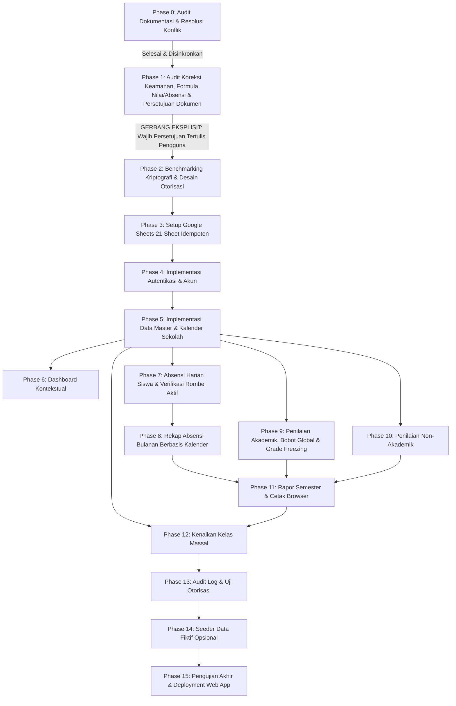

# IMPLEMENTATION TASKS & ROADMAP
# Sistem Absensi dan Penilaian Siswa SD

**Nama Proyek:** Sistem Absensi dan Penilaian Siswa SD  
**Platform Target:** Google Apps Script Web App (V8 Runtime)  
**Penyimpanan Data:** Google Sheets (21 Lembar Kerja Terstruktur)  
**Versi Dokumen:** 1.3-revised (Dokumentasi Pra-Implementasi & Audit Koreksi Final)  
**Status Proyek:** **Phase 1 Sedang Berjalan (Menunggu Persetujuan Final Pengguna atas Dokumentasi)**  
**AI Agent:** Gemini 3.8 Flash (High) melalui Antigravity

---

## 1. Aturan Pelaksanaan dan Gerbang Persetujuan (Gatekeeper)

> [!IMPORTANT]
> **GERBANG EKSPLISIT IMPLEMENTASI (STATUS: TERKUNCI):**  
> Pekerjaan saat ini adalah **revisi dokumentasi dan peninjauan keputusan (Phase 1)**. Seluruh tahapan implementasi teknis (Phase 2 ke atas) **dilarang keras dimulai** sebelum pengguna memberikan persetujuan final secara tertulis atas kelima dokumen hasil revisi (`.prd.md`, `.architecture.md`, `.database.md`, `.gemini.md`, `.tasks.md`). Dilarang menulis kode aplikasi, memodifikasi folder `app/`, atau menjalankan skrip setup sebelum gerbang ini dibuka secara resmi.

### Definisi Status Task:
- `[ ]` Belum dikerjakan (Terkunci).
- `[~]` Sedang dikerjakan (Tahap aktif saat ini).
- `[x]` Selesai dan diverifikasi.
- `[!]` Terhambat atau menunggu keputusan.

---

## 2. Rincian 16 Fase Pengembangan

### Phase 0 — Audit Dokumentasi dan Resolusi Konflik
- **Tujuan:** Mengaudit kelima dokumen acuan (`.prd.md`, `.architecture.md`, `.database.md`, `.tasks.md`, `.gemini.md`), menemukan kontradiksi awal, dan menyelaraskan seluruh spesifikasi kebutuhan.
- **Prasyarat:** Tersedia kelima dokumen di folder `.docs/`.
- **Tugas Rinci:**
  - [x] Audit kesiapan teknis Google Apps Script dan analisis batasan platform.
  - [x] Identifikasi kontradiksi skema awal antara PRD dan Database.
  - [x] Evaluasi awal terhadap model siswa hybrid dan NISN.
  - [x] Inventarisasi 15 pertanyaan terbuka awal.
- **Kriteria Penerimaan:** Seluruh konflik awal tercatat dan disinkronkan ke dalam rancangan dasar.
- **Pengujian:** Verifikasi silang terminologi dan skema tabel antar-dokumen.
- **Ketergantungan:** Tidak ada.

---

### Phase 1 — Audit Koreksi Keamanan, Formula Nilai & Absensi, serta Persetujuan Dokumentasi
- **Tujuan:** Mengoreksi klaim keamanan kriptografi, membedakan loop HMAC dari PBKDF2 standar, merancang formula matematis normalisasi komponen opsional, menetapkan kelengkapan absensi berbasis daftar siswa aktif per tanggal, memperluas skema 21 sheet, menyusun matriks status keputusan, dan meminta persetujuan final pengguna.
- **Prasyarat:** Phase 0 selesai.
- **Tugas Rinci:**
  - [x] Audit kembali seluruh klaim keamanan kriptografi dan hapus asumsi yang belum terbukti empiris.
  - [x] Evaluasi trade-off Google Authentication vs Custom Internal Authentication.
  - [x] Rancang penyimpanan token hash SHA-256 pada sheet `Sesi` dan klarifikasi sumber keacakan (native `Utilities.getUuid()`).
  - [x] Tetapkan formula eksplisit normalisasi nilai akhir berbobot global dan penegakan status `Belum Lengkap`.
  - [x] Evaluasi arsitektur nilai final: tetapkan Pilihan 2 (snapshot `NilaiAkhir` untuk rapor cepat dan sheet audit terpisah `RiwayatKoreksiNilai` untuk multi-revisi tak terbatas).
  - [x] Definisikan kelengkapan absensi kelas berdasarkan daftar siswa yang benar-benar aktif pada tanggal kejadian via `RiwayatKelas`.
  - [x] Perluas skema basis data menjadi 21 lembar kerja (menambahkan `KalenderSekolah`, `NilaiAkhir`, dan `RiwayatKoreksiNilai`).
  - [x] Susun matriks status keputusan 5 kategori (disetujui, menunggu info lingkungan, persetujuan pengguna, konfirmasi sekolah, validasi teknis / blocker).
  - [~] Sajikan laporan audit koreksi kepada pengguna dan tunggu persetujuan tertulis untuk membuka gerbang implementasi.
- **Kriteria Penerimaan:** Kelima dokumen selaras tanpa kontradiksi, isu keamanan dan formula terdefinisi presisi, dan pengguna memberikan persetujuan tertulis untuk memulai Phase 2.
- **Pengujian:** Pemeriksaan konsistensi internal kelima dokumen dan verifikasi integritas berkas di workspace.
- **Ketergantungan:** Phase 0.

---

### Phase 2 — Benchmarking Kriptografi, Desain Detail Sesi, dan Model Otorisasi
- **Tujuan:** Melakukan uji tolok ukur (*benchmarking*) empiris algoritma derivasi kunci di Google Apps Script V8 sebagai gerbang teknis wajib sebelum implementasi autentikasi, menetapkan struktur token sesi, dan menyusun middleware otorisasi server-side.
- **Prasyarat:** Phase 1 disetujui pengguna secara tertulis.
- **Tugas Rinci:**
  - [ ] **Gerbang Teknis Benchmarking:** Lakukan benchmarking komputasi algoritma derivasi kunci (PBKDF2 JS murni vs repeated HMAC-SHA256) pada runtime Apps Script V8.
  - [ ] **Kriteria Penerimaan Keamanan & Performa:**
    - Latensi komputasi verifikasi hash per login wajib < 1.000 ms (target optimal < 500 ms) agar tidak memicu gateway timeout.
    - Wajib menggunakan 16-byte random salt unik per akun dan server pepper rahasia di `ScriptProperties`.
    - Faktor komputasi memaksimalkan beban kerja penyerang dalam batas waktu CPU yang diizinkan.
  - [ ] **Fallback Circuit-Breaker:** Jika pendekatan autentikasi internal gagal memenuhi kriteria performa dan keamanan, **hentikan implementasi form login** dan laporkan ke pengguna untuk meminta keputusan alternatif (misalnya integrasi Google Sign-In).
  - [ ] **Verifikasi Pembangkitan Token:** Gunakan API native terverifikasi `Utilities.getUuid()` (UUID v4 122-bit pseudo-random entropy). Dilarang mengklaim metode byte acak aman tanpa API dan sumber CSPRNG terverifikasi.
  - [ ] Rancang mekanisme penyimpanan hash SHA-256 token sesi klien pada sheet `Sesi` (`token_hash`). Plaintext token dilarang disimpan di database.
  - [ ] Rancang struktur data respons standar (`success`, `data`, `message`, `code`).
  - [ ] Rancang middleware otorisasi server-side (`validateSession_` dan `verifyTeacherAssignment_`).
  - [ ] Rancang mekanisme invalidasi sesi saat logout, ganti password, atau perubahan status akun.
  - [ ] Rancang pelindung *brute force throttling* pada percobaan login yang gagal berulang kali.
- **Kriteria Penerimaan:** Algoritma kriptografi tervalidasi empiris memenuhi kriteria penerimaan (< 1.000 ms) dan kontrak modul otorisasi terdefinisi lengkap.
- **Pengujian:** Uji komputasi waktu hashing pada Apps Script V8 dengan dataset uji.
- **Ketergantungan:** Phase 1.

---

### Phase 3 — Setup Google Sheets 21 Lembar Kerja yang Aman dan Idempoten
- **Tujuan:** Mengimplementasikan modul `setup.gs` untuk menyiapkan dan memvalidasi struktur 21 lembar kerja tanpa risiko menghapus data.
- **Prasyarat:** Phase 2 selesai dan lulus gerbang teknis.
- **Tugas Rinci:**
  - [ ] Buat berkas `app/setup.gs`.
  - [ ] Implementasikan fungsi `initDatabase_()` untuk membuat 21 lembar kerja beserta baris headernya: `Pengaturan`, `Pengguna`, `Sesi`, `TahunAjaran`, `Semester`, `KalenderSekolah`, `Kelas`, `Siswa`, `RiwayatKelas`, `MataPelajaran`, `PenugasanGuru`, `KelasMataPelajaran`, `Absensi`, `KomponenPenilaian`, `Nilai`, `NilaiAkhir`, `RiwayatKoreksiNilai`, `AspekNonAkademik`, `PenilaianNonAkademik`, `CatatanSemester`, `AuditLog`.
  - [ ] Implementasikan validasi integritas header kolom jika sheet telah ada sebelumnya.
  - [ ] Pastikan script tidak membersihkan, menimpa, atau menghapus baris data pengguna yang sudah tersimpan.
  - [ ] Inisialisasi baris kunci default pada sheet `Pengaturan` (identitas sekolah, tahun ajaran aktif, semester aktif).
  - [ ] Buat akun administrator default awal pada sheet `Pengguna` jika tabel masih kosong.
- **Kriteria Penerimaan:** Inisialisasi dapat dijalankan berulang kali (*idempotent*) dengan hasil struktur 21 sheet valid tanpa kehilangan data.
- **Pengujian:** Jalankan setup pada spreadsheet kosong, lalu jalankan ulang pada spreadsheet yang sudah berisi data uji dan pastikan data tidak hilang.
- **Ketergantungan:** Phase 2.

---

### Phase 4 — Autentikasi dan Manajemen Akun Pengguna
- **Tujuan:** Mengimplementasikan form login, pemrosesan verifikasi kredensial, penerbitan sesi, logout, dan manajemen akun guru oleh administrator.
- **Prasyarat:** Phase 3 selesai.
- **Tugas Rinci:**
  - [ ] Implementasikan fungsi `doGet()` di `app/code.gs` untuk melayani antarmuka web.
  - [ ] Buat komponen form login modern di `app/index.html`.
  - [ ] Implementasikan endpoint login backend: verifikasi username, verifikasi hash password, penerbitan token sesi pada sheet `Sesi` (`token_hash`).
  - [ ] Implementasikan penyimpanan token sesi di `sessionStorage` browser klien.
  - [ ] Implementasikan endpoint `logout` yang menghapus sesi aktif di sheet `Sesi` dan membersihkan storage klien.
  - [ ] Implementasikan modul Admin untuk CRUD akun guru (tambah guru, reset password, ubah status aktif/non-aktif).
  - [ ] Catat seluruh riwayat percobaan login ke sheet `AuditLog` (tanpa mencatat password/token).
- **Kriteria Penerimaan:** Pengguna dapat login dengan aman, sesi kedaluwarsa tertangani, dan admin dapat mengelola akun guru.
- **Pengujian:** Uji login kredensial benar, login kredensial salah, penolakan akun non-aktif, uji kedaluwarsa sesi, dan pembersihan sesi saat logout.
- **Ketergantungan:** Phase 3.

---

### Phase 5 — Data Master Sekolah, Periode, Kalender, Kelas, Siswa, Mapel, dan Penugasan Guru
- **Tujuan:** Mengimplementasikan modul administrasi data master sekolah, kalender akademik, tahun ajaran, semester, kelas (1–6 SD), siswa (model hybrid), mata pelajaran, dan penugasan guru.
- **Prasyarat:** Phase 4 selesai.
- **Tugas Rinci:**
  - [ ] Implementasikan form pengaturan identitas sekolah (Nama, NPSN, Alamat, Kepala Sekolah, NIP, Titimangsa).
  - [ ] Implementasikan pengelolaan Tahun Ajaran, Semester, dan Kalender Sekolah (`KalenderSekolah`).
  - [ ] Implementasikan master Kelas/Rombel tingkat 1 sampai 6.
  - [ ] Implementasikan master Siswa dengan model hybrid: menyimpan `kelas_id_aktif` di tabel `Siswa` dan baris awal di `RiwayatKelas`.
  - [ ] Implementasikan validasi NISN (10 digit teks opsional unik) dan NIS.
  - [ ] Implementasikan master Mata Pelajaran dan relasi `KelasMataPelajaran`.
  - [ ] Implementasikan penugasan guru (`PenugasanGuru`): wali kelas dan guru mata pelajaran per rombel.
  - [ ] Implementasikan pencarian, filter, dan fitur pengarsipan (*soft delete*).
- **Kriteria Penerimaan:** Seluruh data master dapat dikelola dengan validasi integritas relasional di backend.
- **Pengujian:** Uji keunikan username/NISN, uji perubahan kelas siswa memperbarui `RiwayatKelas`, uji pengarsipan tidak merusak riwayat.
- **Ketergantungan:** Phase 4.

---

### Phase 6 — Dashboard Kontekstual
- **Tujuan:** Membangun antarmuka dashboard utama yang adaptif terhadap peran pengguna (Admin vs Guru) dan menampilkan ringkasan data aktual.
- **Prasyarat:** Phase 5 selesai.
- **Tugas Rinci:**
  - [ ] Implementasikan pemuatan data dashboard dinamis dari backend berdasarkan token sesi pengguna.
  - [ ] Tampilkan konteks aktif: Tahun Ajaran dan Semester aktif sekolah.
  - [ ] Tampilkan kartu metrik: Total siswa aktif dalam binaan, total kelas binaan, dan ringkasan kehadiran hari ini.
  - [ ] Untuk Guru: Tampilkan daftar penugasan aktif (kelas wali dan mapel yang diajarkan).
  - [ ] Tampilkan status loading, empty state informatif, dan notifikasi banner.
  - [ ] Sediakan navigasi cepat ke modul kerja harian.
- **Kriteria Penerimaan:** Angka dan konteks dashboard sesuai 100% dengan data yang tersimpan di Google Sheets dan terfilter sesuai hak akses guru.
- **Pengujian:** Uji tampilan dashboard menggunakan akun Admin dan akun Guru dengan variasi penugasan.
- **Ketergantungan:** Phase 5.

---

### Phase 7 — Absensi Harian Siswa & Verifikasi Rombel Aktif
- **Tujuan:** Membangun antarmuka dan backend pencatatan kehadiran harian siswa per kelas dengan status Hadir, Sakit, Izin, dan Alpa, serta verifikasi siswa aktif berdasarkan interval penempatan tanggal kejadian.
- **Prasyarat:** Phase 5 selesai.
- **Tugas Rinci:**
  - [ ] Buat antarmuka pemilih tanggal (format `YYYY-MM-DD`) dan pemilih kelas.
  - [ ] Validasi hak akses guru: hanya wali kelas bersangkutan atau admin yang boleh mengisi absensi.
  - [ ] **Kueri Dinamis Siswa Aktif pada Tanggal Kejadian:** Tampilkan daftar siswa yang **benar-benar aktif di rombel pada tanggal terpilih** dengan memeriksa interval `RiwayatKelas` ($\text{tanggal\_mulai} \le t \le \text{tanggal\_selesai}$). Dilarang menggunakan `Siswa.kelas_id_aktif` untuk tanggal lampau.
  - [ ] **Penanganan 4 Skenario Dinamika Siswa:**
    1. *Siswa masuk/keluar tengah semester:* Hanya muncul dan dihitung pada tanggal-tanggal di mana masa penempatannya aktif.
    2. *Siswa pindah kelas antar-rombel:* Pada tanggal sebelum mutasi, tercatat di rombel lama; pada tanggal sejak mutasi, tercatat di rombel baru.
    3. *Koreksi absensi yang sudah diverifikasi:* Guru/Admin dapat mengoreksi status kehadiran tanggal lampau; backend memperbarui baris di `Absensi`, mengevaluasi ulang status kelengkapan kelas, dan mencatat koreksi ke `AuditLog`.
    4. *Daftar siswa tanggal lampau vs siswa saat ini:* Perhitungan kelengkapan historis tidak terdistorsi oleh mutasi yang terjadi di kemudian hari.
  - [ ] Sediakan seleksi cepat status kehadiran: Hadir (H), Sakit (S), Izin (I), Alpa (A), serta input catatan opsional.
  - [ ] Sediakan tombol *"Tandai Semua Hadir"* untuk efisiensi kerja guru.
  - [ ] Implementasikan penyimpanan batch backend dengan penguncian `LockService`.
  - [ ] Cegah duplikasi data: jika catatan tanggal dan siswa sudah ada, lakukan update status (*upsert*).
  - [ ] **Penanganan Absensi Belum Lengkap:** Tanggal atau siswa yang belum diisi absensinya ditandai `belum_diinput`, dilarang otomatis dihitung hadir maupun alpa.
  - [ ] Tandai status hari absensi kelas: lengkap vs belum lengkap berdasarkan kelengkapan seluruh siswa aktif pada tanggal tersebut.
- **Kriteria Penerimaan:** Absensi harian tersimpan rapi, koreksi status berjalan mulus, daftar siswa mutasi tertangani akurat, dan tidak terjadi duplikasi baris.
- **Pengujian:** Uji simpan kelas penuh (30 siswa), uji koreksi status di hari yang sama, uji siswa pindahan di tengah bulan.
- **Ketergantungan:** Phase 5.

---

### Phase 8 — Rekap Absensi Bulanan Berbasis Kalender Sekolah
- **Tujuan:** Membangun laporan rekapitulasi kehadiran bulanan kelas dengan kalkulasi persentase berbasis hari sekolah terjadwal, hari absensi lengkap, dan hari wajib hadir siswa.
- **Prasyarat:** Phase 7 selesai.
- **Tugas Rinci:**
  - [ ] Buat antarmuka pemilih kelas, bulan, dan tahun.
  - [ ] Ambil data hari efektif terjadwal dari `KalenderSekolah` ($K$).
  - [ ] Hitung jumlah hari absensi lengkap yang telah diverifikasi untuk kelas tersebut ($L_{\text{kelas}}$).
  - [ ] Hitung hari wajib hadir per siswa ($W_{\text{siswa, lengkap}}$) dengan mempertimbangkan rentang aktif penempatan siswa di `RiwayatKelas`.
  - [ ] Hitung persentase kehadiran: $(H_i / W_{\text{siswa, lengkap}}) \times 100\%$, dengan penanganan penyebut nol menampilkan `N/A`.
  - [ ] Tampilkan metrik transparansi audit: *"Terverifikasi $L_{\text{kelas}}$ dari $K$ Hari Sekolah Terjadwal ($K - L_{\text{kelas}}$ belum lengkap)"*.
  - [ ] Tampilkan rincian tabel H, S, I, A secara terpisah.
- **Kriteria Penerimaan:** Angka akumulasi dan persentase kehadiran akurat, pembagian nol tertangani (*N/A*), siswa mutasi tengah semester dihitung secara adil, dan hari yang belum diabsen tidak dijadikan hadir atau alpa.
- **Pengujian:** Uji hitung kelas dengan siswa yang memiliki riwayat Sakit/Izin/Alpa dan uji siswa pindahan di pertengahan bulan.
- **Ketergantungan:** Phase 7.

---

### Phase 9 — Penilaian Akademik, Bobot Global, dan Pembekuan Nilai (*Grade Freezing*)
- **Tujuan:** Membangun pengelolaan komponen penilaian berbobot global, pencatatan nilai akademik siswa per mapel, penegakan status `Belum Lengkap`, normalisasi komponen opsional, pembekuan nilai final ke `NilaiAkhir`, dan pencatatan audit multi-revisi ke `RiwayatKoreksiNilai`.
- **Prasyarat:** Phase 5 selesai.
- **Tugas Rinci:**
  - [ ] Implementasikan konfigurasi komponen penilaian semester aktif oleh Admin (nama, bobot, flag `is_wajib`).
  - [ ] Validasi bobot global: total bobot seluruh komponen aktif wajib sama dengan 100% ($\sum w_c = 100\%$).
  - [ ] Buat form input nilai untuk guru mata pelajaran sesuai kelas dan mapel yang ditugaskan.
  - [ ] Validasi rentang nilai (0.0 sampai 100.0). Pembedaan nilai kosong (`null`) dengan angka `0` (skor 0 sah masuk pembilang dan penyebut).
  - [ ] Implementasikan kalkulator backend untuk nilai akhir dengan normalisasi komponen opsional kosong: $\frac{\sum_{c \in C_{\text{dinilai}}} (V_s(c) \times w_c)}{\sum_{c \in C_{\text{dinilai}}} w_c}$.
  - [ ] **Penegakan Aturan `Belum Lengkap`:** Jika komponen bertanda `is_wajib = true` belum terisi nilai, tetapkan status nilai sebagai `Belum Lengkap` dan kembalikan nilai `null` (`-`).
  - [ ] Implementasikan fungsi pembekuan nilai final (*Freeze Grades*) yang mencatat snapshot nilai akhir ke sheet `NilaiAkhir` (1 baris per siswa/mapel/semester).
  - [ ] **Alur Multi-Revisi Pasca-Final (Pilihan 2):**
    - Kunci mutlak nilai final dari pengeditan guru.
    - Sediakan modul koreksi khusus untuk Administrator dengan alasan tertulis wajib.
    - Simpan jejak audit setiap revisi ke sheet `RiwayatKoreksiNilai` (`koreksi_id`, `nilai_akhir_id`, `versi_koreksi`, `nilai_sebelumnya`, `nilai_baru`, `alasan_revisi`, `revised_by`, `revised_at`).
    - Perbarui snapshot nilai aktif, increment `versi_koreksi`, dan catat `last_revised_by` / `last_revised_at` di sheet `NilaiAkhir`.
    - Catat transaksi koreksi ke sheet `AuditLog`.
- **Kriteria Penerimaan:** Nilai akademik tersimpan aman, rumus normalisasi bobot global bekerja presisi, status `Belum Lengkap` ditegakkan, nilai final dibekukan ke sheet `NilaiAkhir`, dan seluruh riwayat koreksi berkali-kali dapat direkonstruksi penuh dari `RiwayatKoreksiNilai`.
- **Pengujian:** Uji perhitungan nilai lengkap, uji komponen wajib kosong menghasilkan status `Belum Lengkap`, uji komponen opsional kosong dinormalkan tanpa error, uji skor 0 sah dihitung dalam pembilang dan penyebut, dan uji alur koreksi multi-revisi nilai final.
- **Ketergantungan:** Phase 5.

---

### Phase 10 — Penilaian Non-Akademik (Sikap dan Keterampilan)
- **Tujuan:** Membangun pencatatan evaluasi aspek perkembangan karakter, sikap (Dimensi P5 / Profil Pelajar Pancasila), dan keterampilan siswa.
- **Prasyarat:** Phase 5 selesai.
- **Tugas Rinci:**
  - [ ] Implementasikan master aspek non-akademik pada sheet `AspekNonAkademik`.
  - [ ] Buat antarmuka evaluasi untuk wali kelas per rombel.
  - [ ] Sediakan pilihan predikat capaian (*SB*, *BSH*, *MB*, *BB*) dan area teks deskripsi naratif.
  - [ ] Simpan hasil penilaian per semester ke sheet `PenilaianNonAkademik`.
  - [ ] Aspek yang belum dinilai tidak boleh diberi predikat otomatis.
- **Kriteria Penerimaan:** Wali kelas dapat menginput dan memperbarui capaian sikap siswa yang terhubung rapi ke semester aktif.
- **Pengujian:** Uji simpan penilaian sikap, uji pengubahan narasi perkembangan, dan uji pemfilteran per semester.
- **Ketergantungan:** Phase 5.

---

### Phase 11 — Rapor Semester dan Cetak Browser
- **Tujuan:** Membangun lembar pratinjau buku rapor semester Kurikulum Merdeka sederhana dan styling cetak presisi (*Save as PDF*).
- **Prasyarat:** Phase 8, Phase 9, dan Phase 10 selesai.
- **Tugas Rinci:**
  - [ ] Buat antarmuka pemilihan siswa dan semester untuk pratinjau rapor.
  - [ ] Baca nilai akhir mata pelajaran langsung dari sheet snapshot `NilaiAkhir` (lookup cepat tanpa rekalkulasi bobot lama).
  - [ ] Tampilkan identitas sekolah lengkap, identitas siswa, nilai mapel beserta capaian pembelajaran, rekap kehadiran (H/S/I/A), evaluasi sikap, dan catatan wali kelas.
  - [ ] Implementasikan field keputusan kenaikan kelas (`CatatanSemester`).
  - [ ] Rancang CSS `@media print` untuk pengaturan kertas A4/F4, menyembunyikan navigasi web, dan *page-break* rapi antarbagian rapor.
  - [ ] Hubungkan tombol *"Cetak Rapor"* ke fungsi browser `window.print()`.
  - [ ] Tampilkan catatan *disclaimer* bahwa format rapor adalah draft internal sekolah yang wajib diverifikasi kesesuaiannya dengan petunjuk teknis dinas pendidikan setempat oleh pihak sekolah.
- **Kriteria Penerimaan:** Rapor menyajikan seluruh data hasil belajar siswa secara akurat dari data yang telah dibekukan dan siap dicetak/disimpan sebagai PDF rapi melalui browser.
- **Pengujian:** Uji cetak browser di desktop dan laptop, uji konsistensi layout saat Save as PDF, uji penampilan tanda strip pada mapel yang berstatus `Belum Lengkap`.
- **Ketergantungan:** Phase 8, Phase 9, Phase 10.

---

### Phase 12 — Kenaikan Kelas Massal dan Pemeliharaan Riwayat Kelas
- **Tujuan:** Membangun modul kenaikan kelas massal (*bulk promotion*) terpandu untuk akhir tahun ajaran (semester genap) dengan pembaruan riwayat kelas historis.
- **Prasyarat:** Phase 5 dan Phase 11 selesai.
- **Tugas Rinci:**
  - [ ] Batasi akses modul kenaikan kelas khusus untuk peran Administrator.
  - [ ] *Langkah 1 (Seleksi):* Pilih tahun ajaran berjalan, kelas asal (misal `1A`), dan kelas tujuan (misal `2A`; atau `Lulus` untuk kelas 6).
  - [ ] *Langkah 2 (Pratinjau):* Tampilkan daftar seluruh siswa di kelas asal. Sediakan kontrol untuk menandai siswa yang tinggal kelas atau mutasi keluar.
  - [ ] *Langkah 3 (Konfirmasi):* Tampilkan modal rekapitulasi dampak dan minta konfirmasi tegas admin sebelum eksekusi.
  - [ ] *Eksekusi Backend Batch:* Tutup catatan `RiwayatKelas` lama (`tanggal_selesai` diisi, status `selesai`), buat baris baru pada `RiwayatKelas` untuk tahun ajaran baru, dan perbarui kolom `kelas_id_aktif` pada sheet `Siswa`.
  - [ ] Catat seluruh operasi mutasi massal ke sheet `AuditLog`.
- **Kriteria Penerimaan:** Kenaikan kelas massal berjalan sukses tanpa kehilangan jejak riwayat kelas lama dan data rapor masa lampau tetap dapat dibuka kembali secara konsisten.
- **Pengujian:** Uji alur kenaikan kelas 1A ke 2A dengan 1 siswa tinggal kelas; verifikasi data `RiwayatKelas` dan `Siswa.kelas_id_aktif`.
- **Ketergantungan:** Phase 5, Phase 11.

---

### Phase 13 — Audit Log dan Pengujian Integrasi / Otorisasi
- **Tujuan:** Memastikan seluruh aktivitas kritis tercatat di `AuditLog` dan memverifikasi ketatnya perlindungan otorisasi server-side.
- **Prasyarat:** Phase 12 selesai.
- **Tugas Rinci:**
  - [ ] Buat antarmuka penampil `AuditLog` khusus untuk Administrator (filter tanggal, aksi, aktor).
  - [ ] Verifikasi bahwa tidak ada password (baik plaintext maupun hash) atau token sesi yang bocor ke lembar audit log.
  - [ ] Jalankan audit pengujian keamanan (*security audit*):
    - Panggil fungsi server langsung via konsol browser tanpa parameter token sesi.
    - Panggil fungsi server dengan token sesi guru untuk memanipulasi kelas yang bukan penugasannya.
    - Uji pengiriman data nilai di luar batas rentang (skor negatif atau > 100).
    - Uji injeksi tag HTML/skrip pada input nama siswa dan catatan guru.
- **Kriteria Penerimaan:** Seluruh fungsi publik server menolak request tidak berizin dengan kode error yang tepat dan seluruh aksi tercatat di audit log.
- **Pengujian:** Uji penetrasi klien DevTools dan verifikasi logging.
- **Ketergantungan:** Phase 12.

---

### Phase 14 — Seeder Data Fiktif Opsional
- **Tujuan:** Menyediakan fungsi pembantu `seedSampleData_()` di `app/setup.gs` untuk mengisi data uji fiktif yang realistis demi kemudahan verifikasi sistem.
- **Prasyarat:** Phase 13 selesai.
- **Tugas Rinci:**
  - [ ] Implementasikan fungsi `seedSampleData_()` di berkas `app/setup.gs`.
  - [ ] Pasang pengaman ketat: periksa apakah sheet `Siswa` sudah memiliki data riil. Jika ada data, hentikan eksekusi secara otomatis.
  - [ ] Isi data fiktif terstruktur: 1 Tahun Ajaran (`2026/2027`), 2 Semester, Kalender Sekolah (hari efektif & libur), 2 Kelas (`1A` dan `2A`), 10 Siswa fiktif (beserta NIS dan NISN 10 digit), 4 Mata Pelajaran, dan akun guru contoh.
  - [ ] Pastikan fungsi ini berakhiran garis bawah (`_`) dan hanya dapat dieksekusi manual dari Apps Script Editor.
- **Kriteria Penerimaan:** Data sampel terisi lengkap untuk keperluan demo/pengujian dan tidak dapat dipanggil dari publik atau menimpa data riil.
- **Pengujian:** Jalankan fungsi seeder pada spreadsheet uji dan verifikasi data muncul di antarmuka Web App.
- **Ketergantungan:** Phase 13.

---

### Phase 15 — Pengujian Akhir, Checklist Salin Manual, dan Deployment Web App
- **Tujuan:** Melakukan verifikasi end-to-end, menyusun panduan deployment, dan memastikan aplikasi siap disalin secara manual ke Google Apps Script.
- **Prasyarat:** Seluruh Phase 2 s/d Phase 14 selesai dan lulus pengujian.
- **Tugas Rinci:**
  - [ ] Siapkan daftar berkas akhir (`index.html`, `code.gs`, `setup.gs`).
  - [ ] Buat panduan langkah demi langkah (*Deployment Manual Checklist*):
    - Cara membuat Google Sheets baru dan mengikat proyek Apps Script (*Container-bound script*).
    - Cara menyalin isi ketiga berkas ke Apps Script Editor.
    - Cara menjalankan fungsi `setup.gs` pertama kali untuk inisialisasi 21 sheet.
    - Cara mengonfigurasi deployment Web App (*Execute as: Me*, *Who has access: Domain Sekolah / Google Account*).
    - Cara login pertama kali menggunakan akun admin default dan mereset password.
  - [ ] Uji fungsionalitas menyeluruh pada URL Web App hasil deployment riil.
  - [ ] Siapkan prosedur pencadangan data Google Sheets (menu *File > Make a copy*).
- **Kriteria Penerimaan:** Aplikasi berjalan sempurna pada URL Google Apps Script Web App resmi, seluruh alur absensi dan rapor terverifikasi, dan dokumentasi operasional lengkap.
- **Pengujian:** Uji operasional nyata di lingkungan cloud Google Apps Script.
- **Ketergantungan:** Phase 14.

---

## 3. Matriks Ketergantungan Fase (Dependency Matrix)

| Fase | Nama Fase | Membutuhkan Fase | Output Utama |
|---|---|---|---|
| **Phase 0** | Audit Dokumentasi & Konflik | - | Keselarasan 5 dokumen awal |
| **Phase 1** | Audit Koreksi Keamanan & Persetujuan Dokumen | Phase 0 | **Kelima dokumen final siap persetujuan** |
| **Phase 2** | Benchmarking Kriptografi & Otorisasi | Phase 1 | Algoritma hashing teruji, skema sesi, RBAC spec |
| **Phase 3** | Setup Google Sheets 21 Sheet Idempoten | Phase 2 | `app/setup.gs` & 21 lembar kerja |
| **Phase 4** | Autentikasi & Akun Pengguna | Phase 3 | Form login, sesi, CRUD akun guru |
| **Phase 5** | Data Master & Kalender Sekolah | Phase 4 | Master kelas, siswa hybrid, mapel, kalender |
| **Phase 6** | Dashboard Kontekstual | Phase 5 | Kartu metrik dinamis & navigasi kerja |
| **Phase 7** | Absensi Harian Siswa & Rombel Aktif | Phase 5 | Pencatatan & koreksi absensi harian |
| **Phase 8** | Rekap Absensi Bulanan Berbasis Kalender | Phase 7 | Rekapitulasi kehadiran H/S/I/A & % belajar |
| **Phase 9** | Penilaian Akademik, Bobot & Grade Freezing | Phase 5 | Bobot global, freeze snapshot & multi-revisi |
| **Phase 10**| Penilaian Non-Akademik | Phase 5 | Evaluasi sikap, karakter P5, deskripsi naratif |
| **Phase 11**| Rapor Semester & Cetak | Phase 8, 9, 10 | Pratinjau rapor Kurikulum Merdeka & CSS cetak |
| **Phase 12**| Kenaikan Kelas Massal | Phase 5, 11 | Modul mutasi massal & pembaruan riwayat |
| **Phase 13**| Audit Log & Uji Otorisasi | Phase 12 | Monitoring aktivitas & verifikasi celah keamanan |
| **Phase 14**| Seeder Data Fiktif Opsional | Phase 13 | Data uji terisolasi di `setup.gs` |
| **Phase 15**| Pengujian Akhir & Deployment | Phase 14 | Web App live & panduan penyalinan manual |live & panduan penyalinan manual |